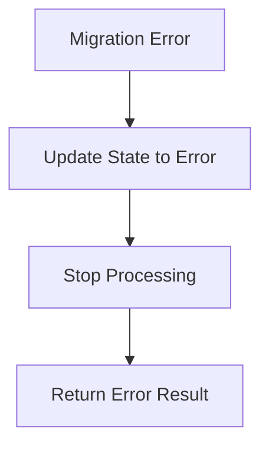
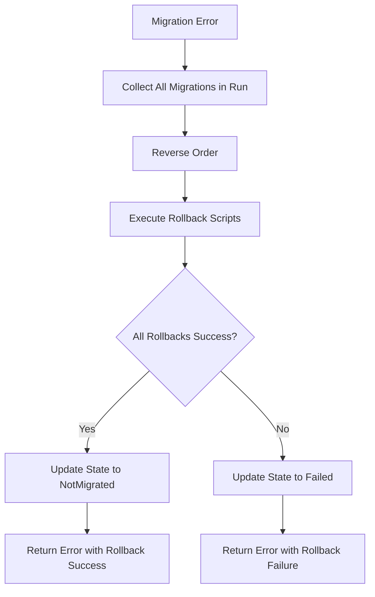
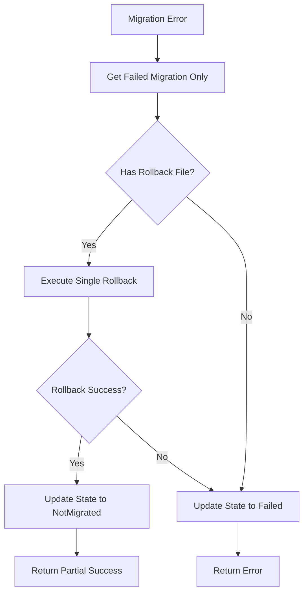
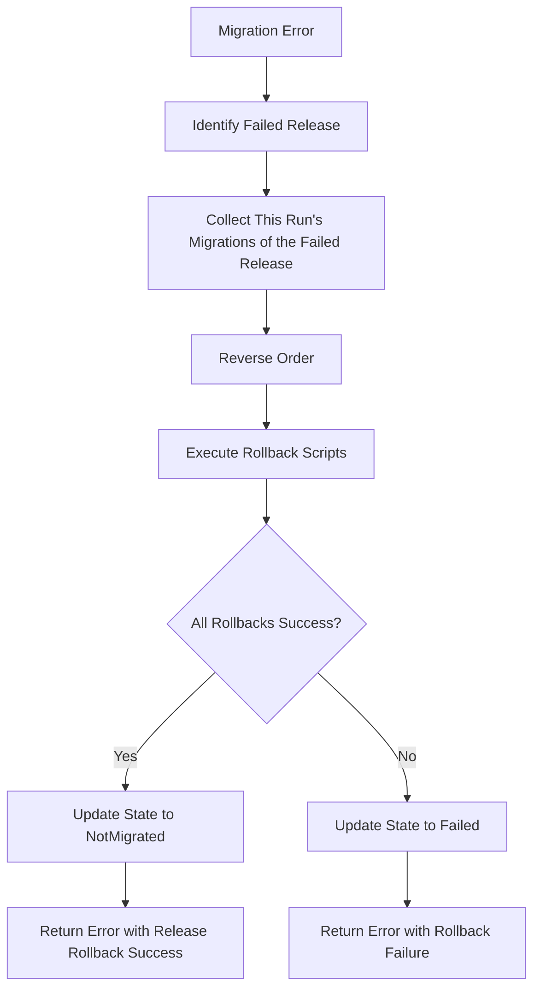
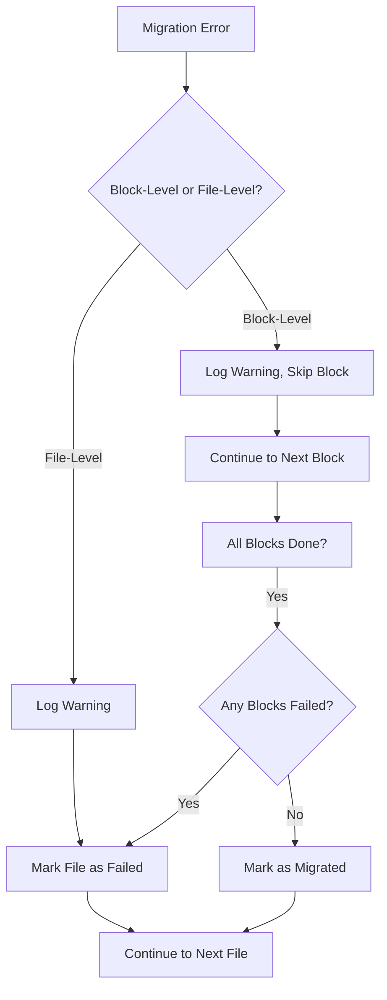
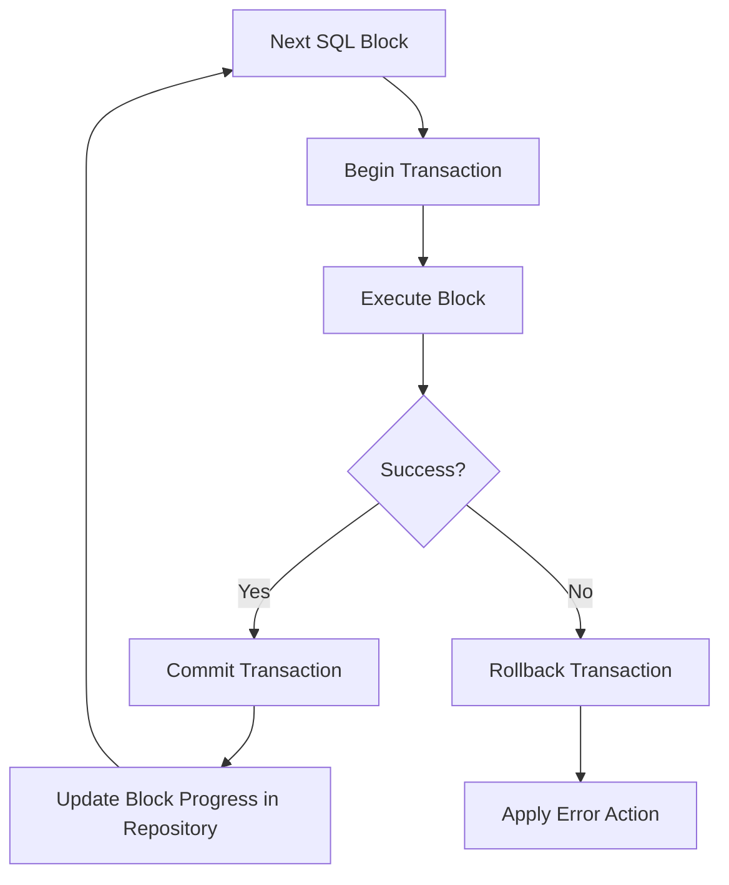

# Error Handling

RayMigrator provides configurable error handling strategies to control behavior when migrations fail.

## Error Action Modes

### Enum Values

| Name | Value | Description |
|------|-------|-------------|
| `Undefined` | 0 | Invalid — not set |
| `Terminate` | 10 | Stop immediately, no rollback |
| `Rollback` | 20 | Rollback all migrations in current run |
| `RollbackErrorOnly` | 21 | Rollback only the failed migration |
| `RollbackRelease` | 22 | Rollback the current run's migrations of the failed release |
| `Ignore` | 30 | Ignore the error and continue execution |

Source: `Raycoon.RayMigrator.Core/Configuration/Enums/MigrationErrorAction.cs` (namespace `Raycoon.RayMigrator.Core.Configuration.Enums`)

Configure via `MigrationErrorAction` at multiple levels:

```json
{
  "ProductDefaults": {
    "MigrationErrorAction": "Terminate"
  },
  "Products": [{
    "Alias": "MyProduct",
    "MigrationErrorAction": "Rollback"
  }]
}
```

### Priority Chain

`MigrationErrorAction` supports a full configuration hierarchy with three conceptual levels (appsettings, migsettings, TOML), each with sub-levels. Listed from lowest to highest priority:

```
ProductDefaults (appsettings)
  ← Product (appsettings)
    ← Product/migsettings.txt
      ← Product/migsettings.{Env}.txt
        ← Release/migsettings.txt
          ← Release/migsettings.{Env}.txt
            ← TargetGroup/migsettings.txt
              ← TargetGroup/migsettings.{Env}.txt
                ← Migration file TOML (highest priority)
```

This allows per-directory or per-file error handling. For example, a directory of seed data scripts can use `Terminate` while schema migrations use `Rollback`:

**`Release 1.0/Backend/migsettings.txt`**:
```toml
[RayMigrator]
MigrationErrorAction = Rollback
```

**`Release 1.0/Backend/99_SeedData.sql`**:
```sql
/*
[RayMigrator]
Description = "Seed data — terminate on error"
MigrationErrorAction = Terminate
*/
INSERT INTO LookupData VALUES (...);
```

### Terminate

Stop immediately on error. No rollback is performed. There is no built-in default for `MigrationErrorAction`: validation rule RULE_8_1 requires an effective value on the product or in `ProductDefaults`.



**Characteristics**:
- Fastest error response
- Preserves partial state
- Requires manual intervention
- Database may be in partial state

**Use Cases**:
- Production environments (prevent cascading changes)
- Debugging (preserve state for investigation)
- When rollback is riskier than partial state

### Rollback

Execute all rollback scripts for the current migration run in reverse order.



**Implementation detail**: The rollback list is built from `successfullyMigratedRecords`, a `List<(MigrationFileInfo File, int MigrationRecordId, string TargetAlias)>`. Each record stores the `TargetAlias` at the time the migration was executed, ensuring that rollbacks target the correct database even when multiple targets exist. The failed migration itself uses the current `MigrationState.TargetAlias`.

**Characteristics**:
- Attempts to restore pre-migration state
- Rollback failures leave `Failed` status
- Requires rollback files for all migrations
- May not be possible for all operations

**Use Cases**:
- Development environments
- Test environments
- When atomic success/failure is required

### RollbackErrorOnly

Rollback only the failed migration, keep successful ones.



**Characteristics**:
- Preserves successful migrations
- Only rollback the problem migration
- Balance between progress and safety
- May leave targets in different states

**Use Cases**:
- When partial progress is acceptable
- Long migration sequences
- Independent migration files

### RollbackRelease

Rollback the current run's migrations of the release where the error occurred, keep migrations from previous releases and migrations of the same release that earlier runs applied (#20).



**Characteristics**:
- Scoped to the release that failed — previous releases remain intact
- Balance between full rollback and error-only rollback
- Requires rollback files for all migrations in the failed release
- Preserves progress from earlier releases

**Use Cases**:
- Multi-release migration runs where earlier releases should be preserved
- When releases represent logical units of change
- Staged deployments where partial rollback is desired

### Ignore

Ignore the error and continue execution. Failed SQL blocks are skipped, and the migration file is marked as `Failed`. The migration run proceeds with the next file, is persisted as `PartialSuccess` (50) and the CLI exit code is 1, so a scheduler still notices that something was skipped (#18).



**Two-Level Ignore**:
- **Block level**: Each SQL block that fails is logged and skipped. The remaining blocks in the file still execute.
- **File level**: If any blocks failed, the file is marked as `Failed` in the repository. Execution continues with the next migration file.

**Characteristics**:
- Does not abort the migration run
- Failed files are marked as `Failed` (re-attempted on next run). The re-attempt is decided per target: a file that succeeded on one target and failed on another is executed again on the failed target only, the successful target is not touched (#8)
- Failed files are NOT added to `successfullyMigratedRecords` — they won't be rolled back if a later file fails with Rollback
- In FileByFile mode: if a file fails on one target, remaining targets for that file are skipped
- The overall `MigrationRunResult` is `PartialSuccess` (50) when any ignored failures occurred; the CLI exit code is 1 (#18)

**Use Cases**:
- Seed data or optional lookups where partial failure is acceptable
- Development environments where you want to run as many migrations as possible
- Non-critical migrations that should not block the rest of the run

### Error Handling in FileByFile vs TargetByTarget Modes

Both `TargetMigrationOrder` modes handle errors identically:

- **FileByFile** (file -> target loop): If a file fails on one target, remaining targets for that file are skipped. With `Ignore`, the file is marked as `Failed` and execution continues to the next file. With any other error action, the `TargetGroup` is aborted immediately.
- **TargetByTarget** (target -> file loop): If a file fails on a target, with `Ignore`, the file is marked as `Failed` and execution continues to the next file for that target. With any other error action, the `TargetGroup` is aborted immediately.

In both modes, when a non-Ignore error aborts a `TargetGroup`, the caller (`MigrateUpAsync` Phase 3) invokes `HandleMigrationError` to execute the configured error action (Terminate, Rollback, RollbackErrorOnly, or RollbackRelease), then finalizes the `MigrationRun` and returns. The run is persisted as `MigrationRunResult.Recovered` (80) when a rollback action completed without a failure or warning (repository and database are consistent again), and as `MigrationRunResult.Error` (90) for `Terminate`, for a failed rollback block, a missing rollback file or a stopped chain. The CLI exit code is 1 in both cases (#18). `MigrationRun.ErrorCode` and the `ErrorCode` of the result carry the engine error code of the failure (`ExtractErrorCode`). A cancel while the error recovery runs stops it at the next rollback block; the run stays `Error` with the code of the failure, and its message names the failure first (see [Cancellation](#cancellation)).

See also: [Product Options](../06-configuration-reference/product-options.md) for `MigrationErrorAction` configuration.

---

## Cancellation

A host or the CLI can stop a run while it executes. A cancel is not an error: the `MigrationErrorAction` does not apply. The run stops at the next block boundary, keeps what committed, records why it stopped and then takes the `MigrationCancelledAction` the cancel chose. The decision and the alternatives that were rejected are recorded in [ADR-028](../arc42/09-Architecture-Decisions.md#adr-028-a-run-cancels-at-the-next-block-boundary-with-a-migrationcancelledaction-and-records-cancelled).

### Requesting a Cancel

Every method of `IMigrationService` takes `CancellationToken cancellationToken = default` as its last parameter. A host that lets the user choose what the run does after it stopped passes a `RunCancellation` (`Raycoon.RayMigrator.Services.Abstractions`) in the `Cancellation` property of `MigrateUpRequest`, `MigrateDownRequest` or `BaselineRequest` and calls `Cancel(action, reason)`:

```csharp
// The context of the run was created through IMigrationContextFactory
using var cancellation = new RunCancellation();
var request = new MigrateUpRequest { ProductAlias = "MyProduct", Environment = "Production", Cancellation = cancellation };
Task<MigrationOperationResult> run = migrationService.MigrateUpAsync(request);

// Later, from another thread: the user stops the run
cancellation.Cancel(MigrationCancelledAction.RollbackFile, "stopped by the operator");

MigrationOperationResult result = await run;   // Success = false, Result = Cancelled (or Error, see Results)
```

The first `Cancel` decides the action and returns `true`; a later call changes nothing and returns `false`, and so does a call after `Dispose`. `Undefined` or a value that is not a member throws `ArgumentOutOfRangeException`. `Token`, `Action`, `Reason`, `RequestedAtUtc` and `IsCancellationRequested` describe the request. The call that cancels runs the callbacks registered on the token synchronously on the calling thread, among them those of the database providers (MySqlConnector opens a connection of its own for `KILL QUERY`), so it may take as long as they do; it swallows their exceptions, because the action and the token are set before the callbacks run, and the run stops at its next checkpoint all the same, even when the statement in progress could not be interrupted. The engine links the token of the call with the token of the handle; a run cancelled through the token of the call alone takes `Terminate`. A handle belongs to one run, and the host disposes it after the run returned.

The CLI cancels the same way for the process: the first Ctrl+C or SIGTERM while a command runs cancels it with the action of `--cancelled-action` (see [CLI](#cli) below).

### Where a Run Stops

The run checks the token before every file, every target and every block: the forward blocks on both execution paths, the blocks a Simulate run walks, and every rollback block after the first. It checks it as well between the records of a rollback chain, before every file of a baseline, and in the steps before the first file (repository checks, discovery, reading the records). Within a block, the token reaches the statement in progress through the target DAL, the transaction of the atomic path and a CLI tool, which is killed together with the processes it started. A CLI tool that has exited when the cancel takes effect is judged by its exit code, so a tool that succeeded keeps its result if it got the whole file; a tool that fails, or that did not get the whole file in `Stdin` mode, after the cancel counts as the cancel and not as a failure for the `MigrationErrorAction`, because on Linux and macOS Ctrl+C reaches the whole process group and the tool gets the signal as well, and the cancel may cut off the write of the file. When a database error meets the cancel, the `OperationCanceledException` of the DAL names the provider's message, and the provider's exception stays its inner exception. What the providers do with the statement in progress:

| Database | Statement in progress |
|----------|-----------------------|
| SQL Server | Interrupted |
| PostgreSQL | Interrupted; the transaction is unusable afterwards and is rolled back |
| MariaDB | Interrupted, except a `SLEEP()`: `KILL QUERY` ends it early without an error, the further statements of the block run, and the next block boundary stops the run |
| MySQL | `KILL QUERY` ends the statement in progress only (a `SLEEP()` early and without an error); the further statements of the block run, and the next block boundary stops the run |
| SQLite | Not interrupted (Microsoft.Data.Sqlite cannot); the token is checked before a block starts |

Commit and rollback of a transaction never take the token: a commit that has started completes. Repository writes on a connection of their own never take the token, so a cancel never separates a record from its history row; on the atomic path the record updates are part of the file's transaction, which the token may interrupt and which then rolls back as a whole. The repository reads take the token, except the two around the insert of the run row (the release the run starts from and the orphan check). Every write after the stop (the record of the interrupted file, the rollback of the action, the run row) runs to its end.

### What the Interrupted File Keeps

The block in progress does not commit where the provider interrupts its statement. On SQLite, on MySQL, whose `KILL QUERY` ends only the statement in progress, and on MariaDB in a `SLEEP()`, which its `KILL QUERY` ends without an error, the block may run to its end; it then commits and counts as committed, and the run stops at the next block boundary. The record of the interrupted file on its target is `Failed` with the blocks that committed before the run stopped; on the atomic path, whose transaction rolls back with the file, these are only the blocks an earlier attempt committed, normally none. The next migrate-up resumes the file with the first block that did not commit, like a failed file (`FindResumableBlock`); `info` lists it as `Resumable after block n`, or as `Failed` when no block committed. `FileCompletedEvent` reports `FileOutcome.Cancelled` (100) for it. The files the run completed before stay `Migrated`. A run cancelled between two files, before its first file, or in FileByFile order between two targets of a file has no interrupted file. A file stopped between two of its targets counts as a finished file in the result (`SuccessfulMigrations`, a `MigrationFileResult` with `Success = true`) and in `RunCompletedEvent`, because it migrated on the targets it ran on.

### MigrationCancelledAction

What a cancelled migrate-up does after it stopped. The value belongs to the run, not to the configuration, and never replaces the `MigrationErrorAction` of a failure; the rollback actions carry the numbers of the error actions whose rollback chain they run.

| Name | Value | After the stop | Rollback chain of |
|------|-------|----------------|-------------------|
| `Undefined` | 0 | Invalid; `Cancel` refuses it | — |
| `Terminate` | 10 | Nothing else (the default): the interrupted file keeps its committed blocks for the next migrate-up | — |
| `RollbackRun` | 20 | Rolls back the interrupted file and every file the run migrated, newest first | `Rollback` |
| `RollbackFile` | 21 | Rolls back the interrupted file only; nothing when the run stopped between two files or, in FileByFile order, between two targets of a file | `RollbackErrorOnly` |
| `RollbackRelease` | 22 | Rolls back the interrupted file and the files of its release the run migrated; without an interrupted file the release of the file the run migrated last | `RollbackRelease` |

Source: `Raycoon.RayMigrator.Core/Configuration/Enums/MigrationCancelledAction.cs` (namespace `Raycoon.RayMigrator.Core.Configuration.Enums`)

The rollback of a cancel action follows the rules of the error recovery for missing rollback files and `RollbackErrorAction` (see [Rollback Error Handling](#rollback-error-handling)), and it runs without the token: a second cancel cannot leave it halfway. Migrate-down and an error recovery that is already running are rollbacks themselves, and a baseline executes no SQL, so they stop and ignore the action; the log says so when the action is not `Terminate`.

### Rollback Units That Always Complete

Three units of a rollback run to their end even when the token is cancelled, because a stop inside them would leave the record `Failed` without rollback progress, a state that migrate-down does not continue and from which migrate-up runs the file again from its first block:

- the first block of a rollback file on the block-by-block path;
- an atomic rollback, whose rollback blocks and status update share one transaction (see [Rollback Atomicity](#rollback-atomicity));
- a rollback through a CLI tool.

The cancel takes effect before the next rollback block or the next record, which keeps its state.

### A Rollback That Stopped in the Middle

A record `Failed` with some but not all of its rollback blocks (`0 < FileDownBlocksMigrated < FileDownBlocksTotal`) is a rollback that stopped in the middle: a cancelled migrate-down or error recovery leaves it, and so does a failed rollback block after the first. Its target kept the part of the file that the remaining rollback blocks would take back. Migrate-down continues such a record with rollback block k+1. Migrate-up must not run the file again, because the record insert would reset the rollback columns and run the file from its first block on that target. Before its first file, migrate-up therefore checks the records of the (file, target) pairs it would run, after `--to-release` and `--target-group`, and refuses to run while one of them has this state, also in Simulate: no file runs, the run is `Error` like a refused out-of-order run, and the message names every such record:

```
Incomplete rollback: 1 file(s) stopped in the middle of their rollback, and migrate-up runs no file again before its rollback has completed: [Release 2.0/02_SeedData.sql on target Main: 1 of 3 rollback blocks, migrate-down continues at block 2]. Complete the rollback with migrate-down to a release before theirs, then run migrate-up.
```

`info` lists such a pair as `RollbackIncomplete` (60) with the rollback blocks that ran and the blocks of the rollback file (`PendingMigrationInfo.RollbackBlocksMigrated`, `RollbackBlocksTotal`), before every other reason. A `Failed` record without rollback progress, whose first rollback block failed, is not refused: nothing continues it, and migrate-up runs the file again from its first block (see [Known Gaps](#known-gaps)).

### Results

| Operation | After a cancel | Run row (`MigrationRunResult`, `ErrorCode`) | Returns |
|-----------|----------------|---------------------------------------------|---------|
| migrate-up | Stops at the next block boundary, then takes the action | `Cancelled` (70), `1004` (`TemplateResultCode.Cancelled`); `Error` (90), `1005` (`TemplateResultCode.CancelledRollbackIncomplete`) when the rollback of the action reported a failure or a warning | `Success = false`, `Result` as recorded |
| migrate-up while its error recovery runs | The recovery stops at the next rollback block or record; the action is ignored. The run had failed before the cancel, so the failure decides its result | `Error` (90) with the code of the failure (none for a database error, which has no engine code); the message names the failure first, then how many rollbacks the recovery completed | `Success = false`, `Result = Error` |
| migrate-down | Stops at the next rollback block or record; the action is ignored. The record in progress is `Failed` with the rollback blocks that ran, and the next migrate-down continues it; until then migrate-up refuses to run the file ([A Rollback That Stopped in the Middle](#a-rollback-that-stopped-in-the-middle)) | `Cancelled`, `1004` | `Success = false`, `Result = Cancelled` |
| baseline | Stops before the next file; the action is ignored. The records written so far stay `Migrated` | `Cancelled`, `1004` | `Success = false`, `BaselineResult.Result = Cancelled` |
| update-hash, fix | Stop before the next record or run | no run row | `Success = false`, `ErrorCode = 1004`, what they did so far; update-hash counts a file in `UpdatedFiles` and `UpdatedFileNames` once its first record is updated |
| validate-hash, status, history | Stop | no run row | throw `OperationCanceledException` |
| repository cleanup (`IRepositoryMaintenanceService.CleanUpAsync`) | Stops before the next batch; SQL Server, PostgreSQL, MySQL and MariaDB abort the batch in progress, which rolls back whole | no run row | `Completed = false` with the rows deleted so far and no error code; a cancel during the checks of the options and the schema version, or in a dry run, throws `OperationCanceledException` |

The same rule that decides `Recovered` against `Error` after a failure decides `Cancelled` against `Error` here: a rollback with a failure or a warning leaves the state unclear. The error message of a cancelled run is `Cancelled on request (<action>): <outcome>`, followed by `. Reason: <reason>` when the cancel gave one; an operation that ignored an action other than `Terminate` names it as `(<action> ignored: <why>)`. A migrate-up whose error recovery the cancel stopped is no cancelled run but a failed one: the run failed at the file before the cancel, and the cancel only stopped the handling of that failure, so the failure stays the result that error rates, the exit code and the operator see. Its message is the failure, then `. The error recovery was cancelled on request` with where the cancel stopped the recovery and what that leaves: `in the rollback of <file> on target <target> after <j> of <J> rollback block(s); migrate-down continues that rollback, and migrate-up refuses <file> until it has completed`, `before its first rollback: nothing was rolled back, <failed file> stays Failed with the blocks it committed, and the files this run migrated stay Migrated` or `after <i> of <m> rollback(s): the files it did not reach keep their state`; then `. Reason: <reason>` when the cancel gave one. The ignored action is logged as a warning when it is not `Terminate`. A cancelled run returns its result instead of throwing, and `RunCompletedEvent` reports it. A run cancelled before its run row exists returns `MigrationRunId` 0 and writes no run row, and a rollback action then reports that there is nothing to roll back. Simulate and Validate persist nothing and roll nothing back. The engine logs a cancel as a warning without the exception: the warning names the message of the exception, which also names a provider error that met the cancel, and the exception with its stack trace goes to the `Debug` level.

### CLI

`RayMigratorService.DoWorkAsync(host, cancellation)` runs every command with the `RunCancellation` of the process: migrate-up, migrate-down and baseline carry it in their request, and every service call observes its token. While the command runs, the first Ctrl+C or SIGTERM (SIGTERM on Linux and macOS only) cancels it with the action of `--cancelled-action` (`terminate`, `rollback-file`, `rollback-run`, `rollback-release`) and the signal name as reason, and keeps the process alive; a warning on the console and in the database log of the run says where the command stops and what a second signal does. A command that the cancel ended logs a warning instead of an error and exits with `130`: a run with the result `Cancelled`, and, while the token of the process is cancelled, update-hash and fix with `ErrorCode = 1004` and validate-hash and info with an `OperationCanceledException`. The engine maps every `OperationCanceledException` of a failure to `1004`, so a `1004` or an `OperationCanceledException` without the signal is an error and exits with `1`, as do a cancelled migrate-up whose rollback did not complete cleanly (`1005`) and a migrate-up that failed at a file before the cancel stopped its error recovery (`Error` with the code of the failure).

A second Ctrl+C or SIGTERM keeps the default and ends the process at once. The run row then stays `Running` and the record of the file in progress `Executing` (or `Pending`, see [After a Hard Abort](migration-state-machine.md#after-a-hard-abort)), until a later start for the same product and environment closes the run as orphaned or `fix --scope orphanedruns` does (see [Fix Orphaned Runs](#4-fix-orphaned-runs)). Before the command (loading the configuration, the logger, the connection check) and after it (flushing the log), both signals keep their default. See [Global Options: Cancelling a Run](../08-cli-reference/global-options.md#cancelling-a-run) for the command table and the platform notes.

### Known Gaps

- MySQL ends only the statement in progress: a block with several statements runs its remaining statements after `KILL QUERY`, and the run stops at the next block boundary. On MySQL and MariaDB `KILL QUERY` ends a `SLEEP()` early without an error, so a block that waits in `SLEEP()` runs to its end as well.
- A cancel with `MigrationErrorAction = Ignore` stores the block count of the file on its `Failed` record, as an ignored failure does, because the committed blocks are no contiguous prefix there: the next migrate-up runs the whole file again from block 1, including the blocks that committed before the cancel.
- A first rollback block that fails, rather than being cancelled, still leaves the record `Failed` with no rollback block, which migrate-down does not continue and migrate-up runs again from its first block; this predates the cancellation.

---

## Rollback Error Handling

When a rollback operation itself encounters an error (e.g., a rollback SQL block fails), the `RollbackErrorAction` setting controls what happens. Since a failed rollback cannot itself be rolled back, the options are limited to **stopping** or **continuing**.

### RollbackErrorAction Enum Values

| Name | Value | Description |
|------|-------|-------------|
| `Undefined` | 0 | Invalid — not set |
| `Terminate` | 10 | Stop the rollback chain immediately (default) |
| `Ignore` | 30 | Skip the failed block, continue with remaining blocks and files |

Source: `Raycoon.RayMigrator.Core/Configuration/Enums/RollbackErrorAction.cs` (namespace `Raycoon.RayMigrator.Core.Configuration.Enums`)

### Configuration

Configure via `RollbackErrorAction` at multiple levels. In appsettings, `RollbackErrorAction` is available on `ProductDefaultsOptions` and `ProductOptions` only (not on `TargetGroupOptions`). However, migsettings files at any directory level and per-file TOML metadata can override it:

```json
{
  "ProductDefaults": {
    "RollbackErrorAction": "Terminate"
  },
  "Products": [{
    "Alias": "MyProduct",
    "RollbackErrorAction": "Ignore"
  }]
}
```

The full priority chain (lowest to highest):

```
ProductDefaults (appsettings)
  ← Product (appsettings)
    ← Product/migsettings.txt
      ← Product/migsettings.{Env}.txt
        ← Release/migsettings.txt
          ← Release/migsettings.{Env}.txt
            ← TargetGroup/migsettings.txt
              ← TargetGroup/migsettings.{Env}.txt
                ← Migration file TOML (highest priority)
```

### Terminate (Default)

When a rollback SQL block fails, the entire rollback chain is aborted immediately. The failed migration is marked as `Failed`.

**Characteristics**:
- Prevents executing further rollbacks that may depend on the failed one
- Failed migration remains in `Failed` status
- Remaining migrations stay in their current status (e.g., `Migrated`)

### Ignore

When a rollback SQL block fails, it is logged as a warning and skipped. Remaining blocks in the file and remaining files in the chain continue executing.

**Characteristics**:
- Failed blocks are skipped, remaining blocks still execute
- If any blocks in a file failed, that file is marked as `Failed`
- The rollback chain continues with the next file
- Log level is downgraded from `Fatal` to `Warning`

### Missing Rollback Files

Missing rollback files during an error-recovery rollback chain are controlled by `RequireRollbackFile` and `StopRollbackOnMissingRollbackFile`:

| RequireRollbackFile | StopRollbackOnMissingRollbackFile | File Missing | Behavior |
|---------------------|-----------------------------------|-------------|----------|
| `true` | *(any)* | yes | **Abort** — structural error, chain stops immediately, migration marked `Failed` |
| `false` | `true` (default) | yes | **Stop** — chain stops, warning logged, migration status **unchanged** |
| `false` | `false` | yes | **Continue** — warning logged, migration status **unchanged**, chain proceeds |
| - | - | no (block error) | see `RollbackErrorAction` |

`StopRollbackOnMissingRollbackFile` is configured at `ProductDefaults`, `Product`, and `TargetGroup` levels (lowest to highest priority) and can also be overridden per-run via the CLI option `--stop-rollback-on-missing-rollback-file` / `-sromrf` (highest priority). It can also be set in migsettings files and per-file TOML metadata, though those values are parsed but not used in the runtime rollback resolution (only appsettings and CLI levels are consulted).

This setting **only applies to error-recovery rollback** (triggered by `MigrationErrorAction = Rollback`, `RollbackRelease`, or `RollbackErrorOnly`). It does **not** affect explicit `migrate-down` operations.

**Important**: `StopRollbackOnMissingRollbackFile` does **not** override `RequireRollbackFile = true`. A required but missing rollback file is a structural configuration error that always aborts the chain.

## Error Categories

### Custom Exception Types

All custom exceptions are defined in `Raycoon.RayMigrator.Shared/Exceptions/CustomExceptions.cs` (namespace `Raycoon.RayMigrator.Shared.Exceptions`) unless otherwise noted.

#### Pre-Migration Exceptions

| Exception | AbortMessage Prefix | Description |
|-----------|---------------------|-------------|
| `ApplicationStartupException` | "RayMigrator aborted due to startup-problems." | Host or DI configuration failures |
| `ConfigurationValidationException` | "RayMigrator aborted due to problems processing the configuration." | Invalid options, unknown database types, missing required properties |

#### Template Exceptions

| Exception | AbortMessage Prefix | Description |
|-----------|---------------------|-------------|
| `TemplateExecutionException` | "RayMigrator aborted due to an error at template execution." | SQL template execution failure (e.g., cannot create DAL) |
| `TemplateResultException` | "RayMigrator aborted due to a negative result at a template execution." | Negative `ResultCode` from a template SELECT. Has `ResultCode` property. |
| `UndefinedTemplateResultException` | *(inherits from `TemplateResultException`)* | Negative ResultCode not in the known catalog (custom user templates). Always causes abort. |

#### Migration-Run Exceptions

| Exception | AbortMessage Prefix | Description |
|-----------|---------------------|-------------|
| `MigrationHashValidationException` | *(none)* | Hash mismatch during validation |
| `MigrationFileParsingException` | "RayMigrator aborted due to problems parsing the migration script." | TOML parse errors, unknown keys, `RequireRollbackFile` validation failure. Has optional `ErrorCode` property. |
| `MigrationExecutionException` | *(none)* | General migration execution failure |
| `CliToolExecutionException` | "RayMigrator aborted due to a CLI tool execution error." | External CLI tool process start failure or unexpected exit code. Inherits from `MigrationExecutionException`. Has `ExecutablePath` and optional `ExitCode` properties. |
| `CliToolTimeoutException` | *(inherits from `CliToolExecutionException`)* | CLI tool execution exceeded the configured timeout. Has `TimeoutSeconds` property. |
| `RayMigratorInternalException` | "RayMigrator aborted due to an internal error." | Unexpected internal errors |

#### Database and Recovery Exceptions

| Exception | AbortMessage Prefix | Description |
|-----------|---------------------|-------------|
| `DatabaseParameterException` | "RayMigrator aborted due to a database parameter conversion error." | Parameter conversion failure. Has `ParameterCount` property. |
| `MigrationAlreadyRunningException` | "RayMigrator aborted because another migration is already running." | Concurrent migration guard. Has `ProductId` and `ExistingMigrationRunId` properties. |
| `MigrationRecoveryException` | "RayMigrator encountered an error during migration recovery." | Recovery/fix operation failure. Has `MigrationRunId` and `MigrationRecordId` properties. |
| `DatabaseTransientException` | "RayMigrator aborted after exhausting retry attempts for transient database error." | Thrown after all retries exhausted. Has `AttemptsMade` (int) and `LastErrorCode` (string?) properties. |

#### Retry Exception (Database.Common)

Defined in `Raycoon.RayMigrator.Database.Common/RetryHelper.cs` (namespace `Raycoon.RayMigrator.Database.Common`):

| Exception | Description |
|-----------|-------------|
| `RetryExhaustedException` | All retry attempts exhausted for a transient error. Has `AttemptsMade` (int) and `LastErrorCode` (string?) properties. |

#### Not Yet Implemented

| Exception | AbortMessage Prefix | Description |
|-----------|---------------------|-------------|
| `NotYetImplementedException` | "This feature is not yet implemented." | Feature exists in CLI but business logic is not implemented. Message: `"'{feature}' is planned for a future release."` |

**Affected Features**: None currently -- all commands are fully implemented.

### Exception Handling in DoWorkAsync

`RayMigratorService.DoWorkAsync(host, cancellation)` in the Pipeline layer (`Raycoon.RayMigrator.Pipeline`) handles exceptions with three catch blocks:

1. **`OperationCanceledException` while the token of the process is cancelled**: the read commands (validate-hash, info) throw when Ctrl+C or SIGTERM cancelled them. Logged as a warning with the reason. Returns exit code `130`.
2. **`MigrationAlreadyRunningException`**: Logged as error with a guidance message suggesting the Fix command to clean up orphaned runs. Returns exit code `1`.
3. **Generic `Exception`**: All other exceptions (including `NotYetImplementedException`, `ConfigurationValidationException`, and an `OperationCanceledException` that did not come from the cancel of the process) are caught, logged as error, and return exit code `1`.

The commands that return a result instead of throwing are mapped the same way: migrate-up, migrate-down and baseline with the result `Cancelled`, and update-hash and fix with `ErrorCode = 1004` (`TemplateResultCode.Cancelled`) while the token of the process is cancelled, log a warning and return `130`; a `1004` without the signal is logged as an error and returns `1`, and so is a migrate-up with the result `Error` after the signal, such as one that failed at a file before the cancel stopped its error recovery. See [Cancellation](#cancellation).

### Configuration Errors

Occur before migration execution:
- Invalid connection strings
- Missing required properties
- Unknown database types
- Invalid file paths

**Handling**: Fail fast at startup. Throws `ApplicationStartupException` or `ConfigurationValidationException`.

### Connection Errors

Occur when connecting to databases:
- Network failures
- Authentication failures
- Database not available
- Timeout

**Handling**: Based on retry configuration (see [Transient Error Retry](#transient-error-retry) below):
```json
{
  "Targets": [{
    "DbCommandMaxRetries": 3,
    "DbCommandWaitTimeInMsBeforeRetry": 500
  }]
}
```

### Execution Errors

Occur during SQL execution:
- Syntax errors
- Constraint violations
- Deadlocks
- Timeout
- A CLI tool that fails: an exit code outside `SuccessExitCodes`, its timeout, or in `Stdin` mode a success code before it read the whole file

**Handling**: Based on `MigrationErrorAction`

### Validation Errors

Occur during pre-execution validation:
- Hash mismatch (`MigrationHashValidationException`)
- Missing rollback file when `RequireRollbackFile = true` (`MigrationFileParsingException`)
- Invalid TOML metadata (`MigrationFileParsingException`)

**Handling**: Reject migration, don't execute

### Cancelled Runs

Not an error category: a host or the CLI stopped the run on request.

**Handling**: The run stops at the next block boundary and takes its `MigrationCancelledAction`; the result is `Cancelled` with the engine code `1004`, or `Error` with `1005` when the rollback of the action did not complete cleanly. A migrate-up that failed at a file before the cancel stopped its error recovery stays `Error` with the code of the failure. See [Cancellation](#cancellation).

## Transaction Support

### With Transactions (Default)

```json
// In migration file TOML
[RayMigrator]
UseTransaction = true
```



**Behavior**:
- A transaction spans **one SQL block**, not the whole file. `ExecuteSqlBlocks` passes `UseTransaction` to the DAL via `DalSettings`, and each `ExecuteNonQueryAsync` call opens its own connection, begins a transaction, executes the block and commits it.
- A failed block is rolled back by the database and the configured `MigrationErrorAction` applies. Blocks that already committed stay committed, so a multi-block file is **not atomic** on this path.
- The committed block count is tracked in `MigrationState.FileBlocksCommitted` and persisted per block; a re-run resumes at the first uncommitted block (`FindResumableBlock`).
- Transient-error retries (`DbCommandMaxRetries`) repeat the failed block only.
- File-level atomicity exists only on the atomic shared-connection path: when `CanUseSharedConnection` returns `true` (`UseTransaction = true`, `MigrationErrorAction != Ignore`, repository and target with the same `DatabaseType` and byte-identical `ConnectionString`), `ExecuteSqlBlocks` delegates to `ExecuteSqlBlocksAtomic`, which runs all blocks and the repository status updates in a single transaction that commits or rolls back as a whole. See [Atomic Shared Connection](#atomic-shared-connection) below.
- Which targets run on that path is logged once per run at Information level (`Target [X] in TargetGroup [Y] shares the repository connection: ...`), so the default log tells an operator whether a failed file left its first blocks committed or rolled everything back.

### Without Transactions

```json
// In migration file TOML
[RayMigrator]
UseTransaction = false
```

**Use Cases**:
- DDL operations that can't be in transactions (MariaDB/MySQL)
- Large data migrations
- Operations requiring intermediate commits

**Warning**: Partial execution possible on error, including inside a single block. `UseTransaction = false` also disables the atomic shared-connection path.

### Database-Specific DDL Transaction Limitations

| Database | DDL in Transactions | Notes |
|----------|---------------------|-------|
| SQL Server | Full support | All DDL statements are transactional |
| PostgreSQL | Full support | All DDL statements are transactional |
| MariaDB | Limited | DDL causes implicit commit |
| MySQL | Limited | DDL causes implicit commit |
| SQLite | Full support | All DDL statements are transactional |

For details on database-specific behavior, see:
- [SQL Dialects](../03-database-layer/sql-dialects.md) — Delimiter and transaction differences per database
- [Design Decisions](../01-architecture/design-decisions.md) — Why transaction handling is delegated to the DAL
- [TOML Metadata](../07-migration-files/toml-metadata.md) — `UseTransaction` setting per migration file

## Atomic Shared Connection

When the Repository and a migration Target share the **same ConnectionString** (same physical database), RayMigrator automatically wraps all SQL blocks of a migration file AND the repository status updates in a **single atomic transaction**.

### The Atomicity Gap Problem

Without this feature, each SQL block executes on its own connection, and each repository status write uses a separate connection. If a crash occurs after a target SQL block commits but before the corresponding repository status write completes, the system is left in an inconsistent state: the database has the DDL/DML changes, but the repository does not reflect this.

Existing recovery mechanisms (`TryFinalizeCompletedMigrationAsync`, `FindResumableBlock`, `fix` command) mitigate this gap but cannot eliminate it entirely.

### How It Works

When the guard conditions are met (see below), `ExecuteSqlBlocks` delegates to `ExecuteSqlBlocksAtomic`:

1. A single database connection is opened via `IDal.CreateConnection()`
2. A transaction is started on that connection
3. Each SQL block is executed on the shared connection/transaction
4. After each block, the repository migration status is updated on the **same** connection/transaction
5. After all blocks succeed, the final `Migrated` status is written — still inside the transaction
6. The transaction commits atomically — either all blocks + the repository status are persisted, or nothing is

### Guard Conditions

All four conditions must be true for the atomic path to activate:

| Condition | Rationale |
|-----------|-----------|
| `UseTransaction = true` | The migration file must support transactional execution |
| `MigrationErrorAction != Ignore` | Block-error-ignore is incompatible with a shared transaction (a failed transaction is dead on all DB engines) |
| Repository `DatabaseType` = Target `DatabaseType` | Both must be the same engine to share a connection |
| Repository `ConnectionString` = Target `ConnectionString` | Ordinal (byte-exact) string comparison — the user is responsible for using identical strings |

When **any** guard condition is not met, RayMigrator falls back to the existing per-block-connection behavior with no change in functionality.

### File-Level Retry

When `DbCommandMaxRetries > 0` is configured on the target, retries operate at the **file level** within the atomic path:

1. On a transient error (timeout, connection drop), the entire transaction is rolled back
2. A new connection and transaction are created
3. **All blocks are re-executed from scratch** (not just the failed block)
4. This repeats up to `DbCommandMaxRetries` times
5. If all retries are exhausted, the exception propagates and the migration fails (nothing is committed)

**Example**: Migration with 3 blocks, `DbCommandMaxRetries = 1`:

```
Attempt 1:
  Block 1 → OK (in transaction buffer)
  Block 2 → OK (in transaction buffer)
  Block 3 → TRANSIENT ERROR (e.g., timeout)
  → Transaction ROLLBACK (blocks 1-3 undone, repository updates undone)
  → Wait RetryDelayMs

Attempt 2 (retry):
  NEW connection, NEW transaction
  Block 1 → OK (re-executed)
  Block 2 → OK (re-executed)
  Block 3 → OK (transient issue resolved)
  Repository status: Migrated
  → Transaction COMMIT (all blocks + status persisted atomically)
```

This is safe because database transactions guarantee that a rolled-back transaction leaves the database in the exact state it was before the transaction started.

### Rollback Atomicity

The same atomic behavior applies to rollback operations (migrate-down, error-triggered rollback via `MigrationErrorAction.Rollback`):

- All rollback blocks + the repository status (`NotMigrated`) are committed in a single transaction
- File-level retry applies to rollback as well
- If a rollback block itself fails (broken rollback file) and `RollbackErrorAction = Terminate`, the `Failed` status is written via a **separate connection** (outside the rolled-back transaction), ensuring the failure is always recorded

### Concurrency

Each migration run creates its own connection and transaction as stack-local variables. Multiple products or environments running in parallel against the same database are fully isolated — no shared mutable state is involved.

### Limitations

- **Same database only**: The atomic path activates only when Repository and Target are on the same physical database (same ConnectionString). When they are on different databases, the existing non-atomic behavior applies.
- **Ordinal ConnectionString comparison**: The comparison is byte-exact. Different key ordering or casing in the connection string will prevent the atomic path (safe fallback).
- **MariaDB/MySQL DDL**: DDL statements (`CREATE TABLE`, `ALTER TABLE`) cause implicit commits that break the shared transaction. The safety warning system (Rule 2.08) warns about this.

> **See also**: [Migration Service — Atomic Shared Connection Execution](../04-service-layer/migration-service.md#atomic-shared-connection-execution) for implementation details.

## Transient Error Retry

RayMigrator includes a `RetryHelper` (in `Raycoon.RayMigrator.Database.Common`) that provides automatic retry logic for transient database errors with linear backoff.

### Configuration

```json
{
  "TargetGroupDefaults": {
    "TargetDefaults": {
      "DbCommandTimeoutInSeconds": 20,
      "DbCommandMaxRetries": 0,
      "DbCommandWaitTimeInMsBeforeRetry": 250
    }
  }
}
```

- `DbCommandMaxRetries`: Number of retry attempts. `0` disables retries (default).
- `DbCommandWaitTimeInMsBeforeRetry`: Base delay in milliseconds. Actual delay = `base * attempt` (linear backoff).

### Transient Error Codes Per Database

Each DAL plugin overrides the `IsTransient(Exception)` virtual method from `DalBase` to detect database-specific transient errors. The base class handles `TimeoutException` for all providers, and recursively inspects `InnerException`. The codes below are the built-in lists (`DefaultTransientErrorCodes`); a `TransientErrorCodes.txt` in `DataAccessLayers/{DatabaseType}/` replaces them completely, see [Transient Error Codes](../03-database-layer/transient-error-codes.md).

| Database | Exception Type | Transient Error Codes |
|----------|---------------|----------------------|
| SQL Server | `Microsoft.Data.SqlClient.SqlException` | -2 (timeout), 20, 64, 233, 596, 4021, 10053, 10054, 10060, 40197, 40501, 40613, 49918, 49919, 49920 |
| PostgreSQL | `Npgsql.PostgresException` | SQLSTATE codes: 08000, 08001, 08003, 08004, 08006, 57P01, 57P02, 57P03, 40001, 40P01 |
| MariaDB | `MySqlConnector.MySqlException` | 1040, 1205, 1213, 1614, 2002, 2003, 2006, 2013, 2055 |
| MySQL | `MySqlConnector.MySqlException` | 1040, 1205, 1213, 1614, 2002, 2003, 2006, 2013, 2055 |
| SQLite | `Microsoft.Data.Sqlite.SqliteException` | 5 (SQLITE_BUSY), 6 (SQLITE_LOCKED) |

Additionally, `TimeoutException` is always considered transient. Inner exceptions are also checked recursively.

### Custom Transient Predicates

External DAL developers override `DefaultTransientErrorCodes` with their built-in list and the `IsTransient(Exception)` virtual method in their DAL class, classifying the provider's code through `IsTransientCode`. The method returns a `(bool isTransient, string? errorCode)` tuple. `RetryHelper` accepts a `Func<Exception, (bool isTransient, string? errorCode)>` predicate as a required parameter, which each DAL passes from its `IsTransient` implementation. The error code is a string to support both numeric codes (e.g., SQL Server "233") and SQLSTATE codes (e.g., PostgreSQL "08000").

### Retry Exhaustion

When all retries are exhausted, a `RetryExhaustedException` is thrown containing `AttemptsMade` (int) and `LastErrorCode` (string?), with the original exception as `InnerException`.

### Retry and Cancellation

A cancelled call is never retried. `DalBase.IsTransient` never counts a cancellation as transient, and `RetryHelper.ExecuteWithRetryAsync` takes the token of the call, waits for a retry with it and neither classifies nor retries a failure after the token was cancelled. A DAL call that fails after the cancellation throws an `OperationCanceledException` that carries the token, whatever the provider reported (SqlClient reports a cancelled command as a `SqlException`). The file-level retry of the atomic path waits with the token as well. See [Cancellation](#cancellation).

---

## Rollback File Requirements

For rollback to work, migration files need corresponding rollback files:

```
migrations/
├── 001_CreateTable.sql           # Forward migration
├── 001_CreateTable.rollback.sql  # Rollback migration
├── 002_InsertData.sql
└── 002_InsertData.rollback.sql
```

### Rollback File Naming

Default pattern: `{filename}.rollback.sql`

Configure via:
```json
{
  "Products": [{
    "MigrationRollbackFilesPreExtension": "rollback"
  }]
}
```

### Missing Rollback Files

Missing rollback files are checked at two points:

1. **During file discovery** (before any SQL executes): When `RequireRollbackFile = true`, `DiscoverAndPrepareMigrationFiles` validates that every migration file has a corresponding rollback file on disk. If any are missing, the entire run is aborted with a `MigrationFileParsingException` before any migration executes. See [File Discovery](../04-service-layer/file-discovery.md).

2. **During rollback execution**: If a rollback file is missing when the rollback chain reaches it (this can happen when `RequireRollbackFile = false` since the discovery-time check was skipped):

- **`RequireRollbackFile = true`**: The rollback chain is **aborted immediately** as a structural error, regardless of `RollbackErrorAction` or `StopRollbackOnMissingRollbackFile`. The migration is marked as `Failed`.
- **`RequireRollbackFile = false`, `StopRollbackOnMissingRollbackFile = true` (default)**: The rollback chain is **stopped**. A warning is logged and the migration status is left **unchanged** (the file retains its previous status, e.g., `Migrated`). This is the default behavior when `RequireRollbackFile = false`.
- **`RequireRollbackFile = false`, `StopRollbackOnMissingRollbackFile = false`**: A warning is logged and the rollback chain **continues** to the next file. The migration status is left **unchanged**.

When `RequireRollbackFile = false`, the migration record status is never changed by the missing-file logic — it retains its original status. Only `RequireRollbackFile = true` causes the record to be explicitly set to `Failed`.

## Error Recovery Steps

### 1. Identify the Error

Check logs for error details:
```bash
# Console output
# or database logs
SELECT * FROM logs.MigrationLog
WHERE MigrationRunId = @RunId
ORDER BY CreatedAt DESC;
```

### 2. Assess Database State

Query the repository:
```sql
SELECT
    m.Filename,
    m.MigrationStatusId,
    s.Name as Status,
    m.FileUpBlocksMigrated,
    m.FileUpBlocksTotal
FROM MigrationRecord m
JOIN MigrationStatus s ON m.MigrationStatusId = s.Id
WHERE m.MigrationRunId = @RunId
ORDER BY m.FileOrderId;
```

### 3. Fix the Issue

Options:
1. **Fix migration file**: Correct SQL error, re-run
2. **Fix database manually**: Apply change manually, update hash
3. **Skip migration**: If change is no longer needed

### 4. Fix Orphaned Runs

If a previous migration was interrupted (e.g., process crash), the migration run may remain in `Running` state, blocking new runs with `MigrationAlreadyRunningException`.

A running migrate-up, migrate-down or baseline refreshes `MigrationRun.LastHeartbeatAt` every `Repository.HeartbeatIntervalInSeconds` (default 30). A run counts as orphaned once its last heartbeat, or its start when it never wrote one, is older than `Repository.OrphanedRunThresholdInMinutes` (default 2). A run that a second Ctrl+C or SIGTERM ended at once is such a run as well (see [Cancellation: CLI](#cli)).

**Automatic**: The next migrate-up, migrate-down or baseline for the same product and environment closes an orphaned run as `Error`, marks its open records `NotMigrated` and starts (`RepositoryMigrationRunInsertWithAutoFix`). No manual intervention is needed in this case.

**Manual**: When no new run is started, use the Fix command. With the default `--older-than` (2 minutes, the default threshold as well) it repairs only runs whose last heartbeat is older; for a run whose heartbeat is younger, first make sure that no process still runs it, then pass `--older-than 0`:

```bash
# Dry run — see what would be fixed
raymigrator fix --product MyProduct --environment Production --scope orphanedruns --run-mode simulate

# Fix orphaned runs whose last heartbeat is older than 2 minutes (default --older-than)
raymigrator fix --product MyProduct --environment Production --scope orphanedruns
```

### 5. Resume or Restart

```bash
# Continue from where it stopped
raymigrator migrate-up --product MyProduct --environment Production

# Or update hashes if manual fix was applied
raymigrator update-hash --product MyProduct --environment Production
```

## Best Practices

### Production
- Use `Terminate` to prevent cascading issues
- Always have rollback files
- Test migrations in lower environments first

### Development
- Use `Rollback` for quick iteration
- Use `Simulate` before actual migration

### Testing
- Test both success and failure paths
- Verify rollback scripts work
- Test partial failure scenarios

## Related Documentation

- [Error Scenarios and Recovery](error-scenarios-and-recovery.md) - Concrete scenario outcomes with step-by-step recovery procedures
- [Migration State Machine](migration-state-machine.md) - State transitions on error
- [Execution Modes](execution-modes.md) - How modes affect error handling
- [Resilience and Recovery](resilience.md) - Transient error retry, block-level resume, and orphaned run handling
- [Migration Service](../04-service-layer/migration-service.md) - `HandleMigrationError` implementation details
- [Troubleshooting](../appendix/troubleshooting.md) - Common error solutions
