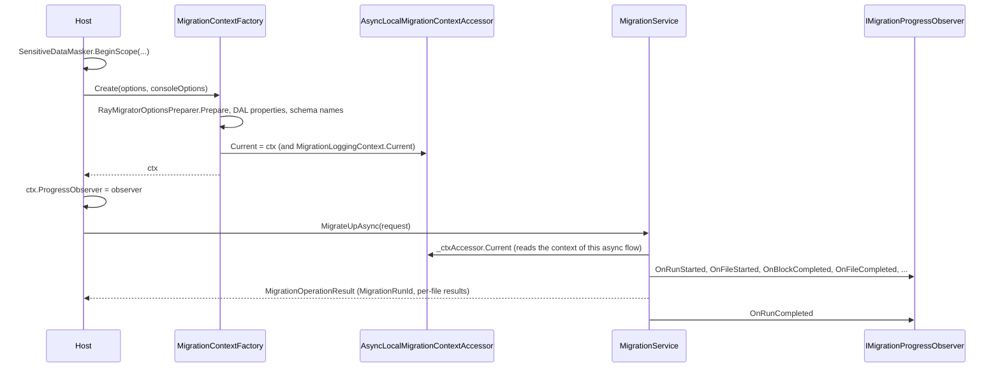
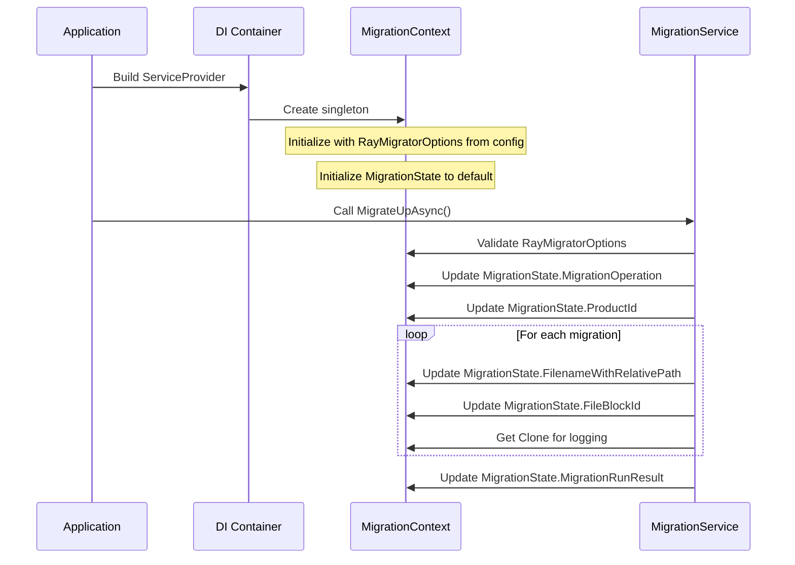

# MigrationContext

The `MigrationContext` is the central state object that flows through the entire RayMigrator execution pipeline. It carries both configuration (immutable) and runtime state (mutable).

## Purpose

- **Single source of truth** for migration configuration and state
- **Dependency injection** friendly — singleton (CLI) or per-request via AsyncLocal (API)
- **Immutable snapshots** for safe logging and auditing
- **State tracking** across the migration lifecycle

## Class Structure

```csharp
public class MigrationContext
{
    // Configuration (set at creation)
    public RayMigratorOptions RayMigratorOptions { get; set; }
    public RayMigratorConsoleOptions RayMigratorConsoleOptions { get; set; }
    public string RayMigratorVersion { get; set; }

    // Target group shortcut
    public IEnumerable<TargetGroupOptions>? ProductTargetGroupOptionsEnumerable { get; init; }

    // Runtime state (updated during execution)
    public MigrationState MigrationState { get; set; }

    // DAL-specific properties
    public ConcurrentDictionary<string, DalSpecificProperties> DalSpecificPropertiesDictionary { get; set; }

    // Safe copy for logging
    public MigrationContext Clone { get; }
}
```

## Configuration Properties

### RayMigratorOptions

Bound from `appsettings.json`:

```csharp
public class RayMigratorOptions
{
    public RepositoryOptions? Repository { get; set; }
    public DatabaseLoggingOptions? DatabaseLogging { get; set; }
    public SerilogOptions? Serilog { get; set; }
    public ProductDefaultOptions? ProductDefaults { get; set; }  // [Required]
    public List<ProductOptions>? Products { get; set; }          // [Required]
    public List<CliToolOptions>? CliTools { get; set; }
}
```

### RayMigratorConsoleOptions

Set from command-line arguments:

```csharp
public class RayMigratorConsoleOptions
{
    public required MigrationCommand Command { get; init; }
    public required string Product { get; init; }
    public required string Environment { get; init; }
    public required MigrationRunMode RunMode { get; init; }
    public string? TargetReleaseVersion { get; init; }
    public string[]? TargetGroupAliases { get; init; }
    public string[]? TargetGroupMigrationOrder { get; init; }
    public HashValidationScope? HashValidationScope { get; init; }
    public required bool ShowStartupInfo { get; set; }
    public required bool RevealSensitiveData { get; init; }
    public FixScope? FixScope { get; init; }
    public bool? AllowOutOfOrder { get; init; }
    public int? FixOlderThanMinutes { get; init; }
    public MigrationStatus? FixAssumedMigrationStatus { get; init; }
    public bool? StopRollbackOnMissingRollbackFile { get; init; }
    public string? ConfigDir { get; init; }
}
```

## MigrationState

Tracks current operation progress:

```csharp
public class MigrationState
{
    // Migration Process
    public MigrationEvent? MigrationEvent { get; set; }

    // RunId's
    public int MigratorMetaId { get; set; }
    public int ProductId { get; set; }
    public int EnvironmentId { get; set; }
    public int MigrationRunId { get; set; }
    public int MigrationRecordId { get; set; }

    // File metadata
    public string ReleaseVersionFromFileNameWithPath { get; set; }
    public string FilenameWithRelativePath { get; set; }
    public int FileOrderId { get; set; }
    public int FileBlockId { get; set; }

    // Step / Result
    public MigrationRunResult MigrationRunResult { get; set; }
    public MigrationOperation MigrationOperation { get; set; }
    public MigrationStatus MigrationStatus { get; set; }

    // TargetGroup- / Target-settings
    public string TargetGroupAlias { get; set; }
    public HashValidationScope? HashValidationScope { get; set; }
    public string TargetAlias { get; set; }
}
```

## Context Accessor Pattern

Services do not inject `MigrationContext` directly. Instead, they depend on `IMigrationContextAccessor`, which provides the current context for the execution scope. This enables both CLI (singleton) and API (per-request) hosting modes with the same service code.

### `IMigrationContextAccessor`

```csharp
public interface IMigrationContextAccessor
{
    MigrationContext Current { get; set; }
}
```

### `SingletonMigrationContextAccessor` (CLI)

Wraps a single `MigrationContext` instance. Used in CLI mode where only one migration runs per process.

```csharp
public class SingletonMigrationContextAccessor : IMigrationContextAccessor
{
    public MigrationContext Current { get; set; } = null!;
}
```

### `AsyncLocalMigrationContextAccessor` (API)

Uses `AsyncLocal<T>` for per-request isolation, analogous to `IHttpContextAccessor` in ASP.NET Core. Each API request gets its own `MigrationContext` via the factory.

```csharp
public class AsyncLocalMigrationContextAccessor : IMigrationContextAccessor
{
    private static readonly AsyncLocal<MigrationContext?> _current = new();
    public MigrationContext Current
    {
        get => _current.Value ?? throw new InvalidOperationException(
            "No MigrationContext available for the current execution context. " +
            "Ensure the context is set before accessing it.");
        set => _current.Value = value;
    }
}
```

### `IMigrationContextFactory` / `MigrationContextFactory`

The factory is the entry point of every host for one run, the CLI pipeline included. The interface lives in `Core`, the implementation in `Services` (it needs `DalFactory`) and is registered by `AddRayMigratorServices`. The console options carry the command, product, environment, run mode, target release and flags; the `command` is stamped into the MigrationRun settings snapshot and drives the command's side effects (`CommandProfile`), so it must be the command that is actually executed (#6). `runMode` is only a choice for `MigrateUp` / `MigrateDown`; pass `MigrationRunMode.Migrate` for every other command.

```csharp
public interface IMigrationContextFactory
{
    // Options a host built in memory: prepared with RayMigratorOptionsPreparer first
    MigrationContext Create(RayMigratorOptions options, RayMigratorConsoleOptions consoleOptions);

    // Options the options framework already bound, merged and validated (the CLI pipeline)
    MigrationContext CreateFromValidatedOptions(RayMigratorOptions options, RayMigratorConsoleOptions consoleOptions);
}
```

Both methods do the same work after the preparation step:

1. Build the context. An unknown product alias throws a `ConfigurationValidationException` whose message names a near miss or the configured aliases (`ProductAliasGuard`).
2. Fill `DalSpecificPropertiesDictionary` for the repository, every target of the product and the database logging, and check the schema names against the DAL capabilities. A host that skipped this step fell back to the SQL Server block delimiter `GO` for every engine.
3. Register the configuration's secrets with `SensitiveDataMasker` and make the context current: `IMigrationContextAccessor.Current` and `MigrationLoggingContext.Current` of the calling async flow.

`Create` additionally runs `RayMigratorOptionsPreparer.Prepare`, which gives in-memory options what options bound from `appsettings*.json` always got: `{ENV:VARIABLE}` placeholders are resolved in every string of the options graph (a missing variable is an error that names the variable and the path), the product defaults are merged down, every enum-typed value is probed, the data annotations run and write their documented defaults into null properties, and the rule catalog is applied. Preparing an object twice is harmless.

### Hosting the engine in-process

A host (RayMigrator Studio, an integration test) runs one operation per context. The sequence per run is:

1. Build the options object, or load it from a store, and the `RayMigratorConsoleOptions` of the operation.
2. Open the masking scope for the async flow of the run: `using var scope = SensitiveDataMasker.BeginScope(revealSensitiveData);`. Without an active scope or global initialization the masker is off and the MigrationRun settings snapshot stores connection strings unmasked.
3. `factory.Create(options, consoleOptions)`. The returned context is current for the calling async flow; set `context.ProgressObserver` before the operation if the host wants progress events.
4. Optionally `ConnectionValidator.ValidateTargetConnections(context, logger)`: it opens the connections the command's profile needs and fails fast with a clear message.
5. Call the operation on a scoped `IMigrationService`. The request must agree with the context: `MigrateUpAsync`, `MigrateDownAsync` and `BaselineAsync` refuse a request whose run mode or target release differs from the console options of the context (#6, #17).
6. Dispose the scope. The next run gets a fresh scope, a fresh context and a fresh `TemplateExecutor` (it caches the repository of the first context it sees, so it is registered as scoped).

Per process, not per run: one `TemplateCache` (`new TemplateCache(revealSensitiveData, logger)`, then `ValidateConfigurationAgainstTemplateCache(options)` for each configuration the host runs), the `DatabaseLogWriter` and its Serilog sink when database logging is wanted, and the Serilog logger with `MigrationContextEnricher`, which reads `MigrationLoggingContext.Current` and stamps every event with run, release, target group, target, file and block.

Process-global state a host shares between runs: `SensitiveDataMasker` (per-flow scopes isolate runs; `Initialize` sets the global mode the CLI uses), `MigrationLoggingContext` and `AsyncLocalMigrationContextAccessor` (both `AsyncLocal`, isolated per async flow), `DalFactory` (type map and DAL instances per database type and connection string, safe to share). The repository lock allows one run per product and environment; runs of different combinations may execute in parallel in separate scopes and async flows. `DirectModePipeline` stays CLI-only: it replaces the static `Log.Logger`, writes to the console and returns an exit code.

### `ProgressObserver`

`MigrationContext.ProgressObserver` receives the lifecycle events of the run through `IMigrationProgressObserver` (namespace `Raycoon.RayMigrator.Core.Progress`): `RunStartedEvent` after the run row exists (with its id), `FileStartedEvent` and `FileCompletedEvent` for every file on every target (migration, rollback and baseline, with the record id and a `FileOutcome`), `BlockCompletedEvent` for every executed SQL block, and `RunCompletedEvent` with the result. The engine raises them synchronously on the thread of the run; an observer that throws is logged and the run continues. The default `NullMigrationProgressObserver` ignores everything, and the CLI sets none. See [Migration Service: Progress events](../04-service-layer/migration-service.md#progress-events).

### `RayMigratorHostMode`

Enum controlling which accessor `AddRayMigratorServices` registers. Both accessors are singletons: the CLI holds one context for the whole process, and the API accessor isolates runs per async flow through a static `AsyncLocal`, so a scoped registration would isolate nothing.

```csharp
public enum RayMigratorHostMode
{
    Cli,  // SingletonMigrationContextAccessor
    Api   // AsyncLocalMigrationContextAccessor (per async flow)
}
```

### API-Mode Lifecycle

> **Note**: The API hosting mode is implemented in **RayMigrator Studio** (a separate repository). `AsyncLocalMigrationContextAccessor`, `IMigrationContextFactory` and `RayMigratorHostMode` are part of the Engine's NuGet contract and are consumed by Studio. The Engine itself always uses `RayMigratorHostMode.Cli` (singleton accessor). The following diagram illustrates the per-run lifecycle as a host implements it.



## Lifecycle



## State Transitions

### MigrationOperation

| Value | Meaning |
|-------|---------|
| `Undefined` (0) | Not set |
| `Rollback` (5) | Performing rollback (stamped on records written by an error-recovery rollback chain) |
| `MigrateDown` (50) | Performing down-migration |
| `MigrateUp` (100) | Performing up-migration |
| `Baseline` (110) | Marking migration files as migrated without executing them (baseline command) |

### MigrationRunResult

| Value | Meaning |
|-------|---------|
| `Undefined` (0) | Invalid value -- ResultId has not been set properly |
| `Running` (10) | Migration process is currently running |
| `PartialSuccess` (50) | The run finished, but at least one file was skipped or left `Failed`: a migrate-up that continued past a failure with `MigrationErrorAction.Ignore`, or a migrate-down that skipped a missing rollback file or ignored a failed rollback block (`RollbackErrorAction.Ignore`). CLI exit code unchanged (1 for migrate-up, 0 for migrate-down) (#18) |
| `Recovered` (80) | A migrate-up failed and the configured error recovery (`Rollback`, `RollbackRelease` or `RollbackErrorOnly`) completed without a failure or warning: every record the recovery touched is `NotMigrated` again. Terminate, Ignore, a rollback failure, a skipped or missing rollback file and a stopped chain are persisted as `Error`. CLI exit code stays 1 (#18) |
| `Error` (90) | Migration(s) stopped due to error(s): aborted without recovery, or the error recovery did not complete cleanly |
| `Ok` (100) | Migration(s) successfully executed and finished |

### MigrationStatus

| Value | Meaning |
|-------|---------|
| `Undefined` (0) | Value has not been set properly |
| `Pending` (10) | Migration record created, execution has not started yet |
| `Executing` (20) | SQL blocks are currently being executed |
| `Failed` (30) | Execution failed, database state is unclear |
| `NotMigrated` (50) | File is not deployed on target database (rolled back or never executed) |
| `Migrated` (100) | File is successfully deployed on target database |

## Usage Examples

### Accessing Configuration

```csharp
public class MigrationService
{
    private readonly IMigrationContextAccessor _ctxAccessor;

    public MigrationService(IMigrationContextAccessor ctxAccessor)
    {
        _ctxAccessor = ctxAccessor;
    }

    public async Task<MigrationOperationResult> MigrateUpAsync(MigrateUpRequest request)
    {
        // Access product configuration
        var product = _ctxAccessor.Current.RayMigratorOptions.Products
            .FirstOrDefault(p => p.Alias == request.ProductAlias);

        if (product == null)
            throw new InvalidOperationException($"Product '{request.ProductAlias}' not found");

        // Access repository configuration
        var repoConnectionString = _ctxAccessor.Current.RayMigratorOptions.Repository.ConnectionString;
    }
}
```

### Updating State

```csharp
public async Task ExecuteMigrationAsync(MigrationFile file)
{
    var ctx = _ctxAccessor.Current;

    // Update state before execution
    ctx.MigrationState.FilenameWithRelativePath = file.Filename;
    ctx.MigrationState.MigrationRunResult = MigrationRunResult.Running;
    ctx.MigrationState.FileBlockId = 0;

    try
    {
        foreach (var block in file.SqlBlocks)
        {
            ctx.MigrationState.FileBlockId++;
            await ExecuteBlockAsync(block);
        }

        ctx.MigrationState.MigrationRunResult = MigrationRunResult.Ok;
    }
    catch (Exception)
    {
        ctx.MigrationState.MigrationRunResult = MigrationRunResult.Error;
        throw;
    }
}
```

### Using Clone for Logging

```csharp
public void LogProgress(string message)
{
    // Get immutable snapshot
    var snapshot = _ctxAccessor.Current.Clone;

    _logger.LogInformation(
        "Migration progress: {Message} | File: {Filename} | Block: {Block}",
        message,
        snapshot.MigrationState.FilenameWithRelativePath,
        snapshot.MigrationState.FileBlockId);
}
```

### Checking Console Options

```csharp
public void ExecuteWithOptions()
{
    var ctx = _ctxAccessor.Current;

    // Check run mode
    if (ctx.RayMigratorConsoleOptions.RunMode == MigrationRunMode.Simulate)
    {
        _logger.LogInformation("SIMULATION MODE - No changes will be made");
    }

    // Check environment
    var environment = ctx.RayMigratorConsoleOptions.Environment;

    // Sensitive data logging
    if (ctx.RayMigratorConsoleOptions.RevealSensitiveData)
    {
        _logger.LogDebug("Connection: {Connection}",
            ctx.RayMigratorOptions.Repository.ConnectionString);
    }
}
```

## Thread Safety

The `MigrationContext` is designed for single-threaded execution within its scope:

- **RayMigratorOptions**: Immutable after creation - thread-safe
- **RayMigratorConsoleOptions**: Immutable after creation - thread-safe
- **MigrationState**: Mutable - not thread-safe

**CLI Mode**: Migrations execute sequentially in a single thread. The singleton `MigrationContext` is safe for this use case.

**API Mode**: Each API request gets its own `MigrationContext` via `AsyncLocalMigrationContextAccessor`. The `AsyncLocal<T>` storage ensures per-request isolation — concurrent requests do not share state. Within a single request, migrations still execute sequentially.

## Best Practices

1. **Always use Clone for logging** to avoid race conditions
2. **Validate context early** in service methods
3. **Update state at boundaries** (before/after each operation)
4. **Never modify RayMigratorOptions directly** after context creation
5. **One context per operation** in a host; set `ProgressObserver` before the call, not during it

## Related Documentation

- [Configuration System](configuration-system.md) - How options are loaded
- [Migration State Machine](migration-state-machine.md) - State transitions
- [Error Handling](error-handling.md) - Error state management
