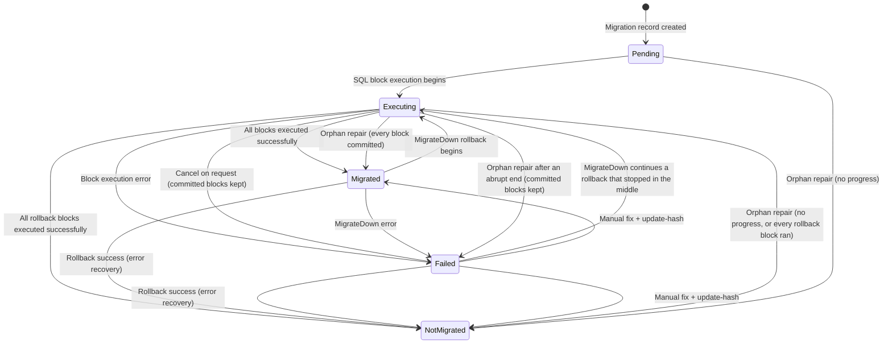
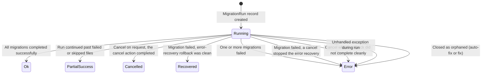
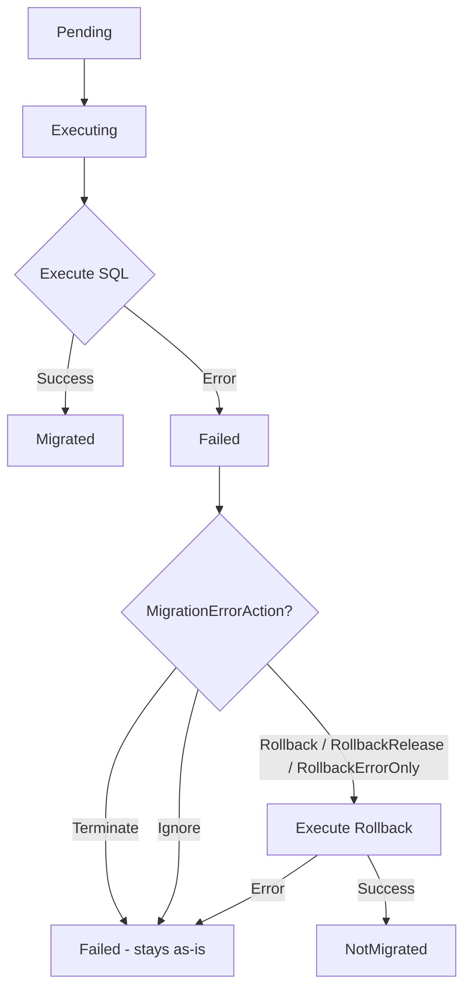
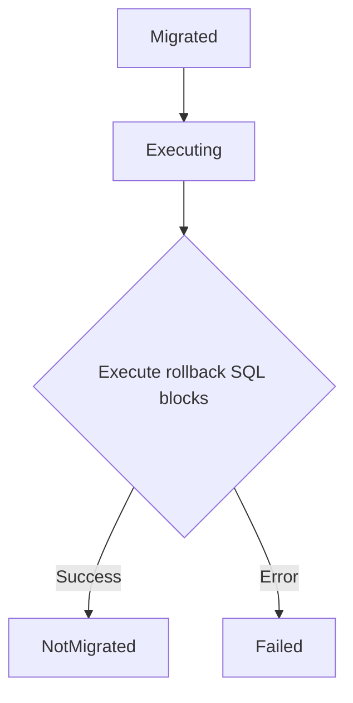
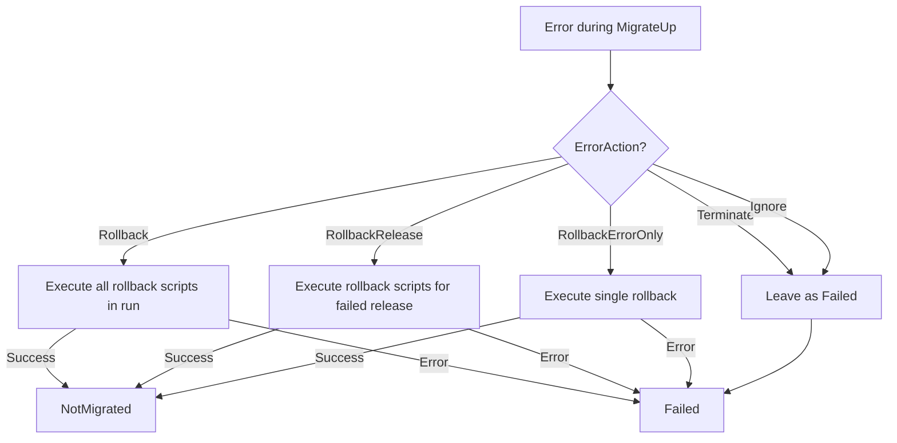
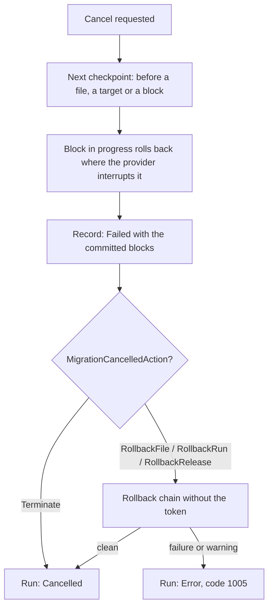

# Migration State Machine

The migration state machine tracks the current status of each migration file and the overall result of each migration run. States determine what operations are valid and what happens during errors.

## Overview

RayMigrator uses two separate status enums:

- **`MigrationStatus`** -- Tracks per-file status in the `MigrationRecord` table (`MigrationStatusId` column)
- **`MigrationRunResult`** -- Tracks the overall run outcome in the `MigrationRun` table (`MigrationRunResultId` column)

## MigrationStatus (Per-File)



## MigrationStatus Definitions

| Status | Value | Description |
|--------|-------|-------------|
| `Undefined` | 0 | Invalid value -- value has not been set properly |
| `Pending` | 10 | Migration record created, execution has not started yet |
| `Executing` | 20 | SQL blocks are currently being executed |
| `Failed` | 30 | Execution failed, database state is unclear |
| `NotMigrated` | 50 | File is not deployed on target database (rolled back or never executed) |
| `Migrated` | 100 | File is successfully deployed on target database |

### Pending (10)

A migration file is in `Pending` status when:
- A migration record has been inserted but SQL execution has not started
- The process was interrupted before execution began

**Valid Operations**: Execution proceeds to `Executing`

### Executing (20)

A migration file is in `Executing` status when:
- SQL blocks are actively being executed against the target database (MigrateUp)
- Rollback blocks are actively being executed against the target database (MigrateDown / error recovery)
- Progress is tracked per block (`FileUpBlocksMigrated` for up-migrations, `FileDownBlocksMigrated` for rollbacks): the counter holds the leading blocks that committed on the target at every moment, see [Block-Level State](#block-level-state)

**Valid Operations**: Completes to `Migrated` on up-migration success, `NotMigrated` on rollback success, transitions to `Failed` on error or on a cancel

A record also stays `Executing` (or `Pending`) with its counter when the process ended in the middle of the file: a crash, a kill, or a second Ctrl+C or SIGTERM in the CLI. It keeps that status until the run is closed as orphaned, and the repair then settles it by its progress (see [After a Hard Abort](#after-a-hard-abort)).

### NotMigrated (50)

A migration file is in `NotMigrated` status when:
- Newly discovered (never executed)
- Successfully rolled back via `migrate-down`
- Successfully rolled back via error recovery
- Skipped due to environment/target filters
- Ignored due to configuration

**Valid Operations**: `MigrateUp`

### Migrated (100)

A migration file is in `Migrated` status when:
- Successfully executed via `MigrateUp`
- Forward migration completed without errors
- Baselined (marked as migrated without executing SQL)
- Rollback file was missing during a rollback chain (status is not updated — remains `Migrated`; with `RequireRollbackFile=true` the chain aborts there, and migrate-down rolls the file back once its rollback file is there)

**Valid Operations**: `MigrateDown`

### Failed (30)

A migration file is in `Failed` status when:
- Error occurred during `MigrateUp` and rollback was not attempted (Terminate/Ignore) or rollback itself failed
- Error occurred during `MigrateDown` rollback execution
- Error occurred during error recovery rollback (rollback block failed)
- Partial block execution with `MigrationErrorAction=Ignore` (some blocks succeeded, some failed)
- A cancel interrupted the file (the record keeps the blocks that committed) or stopped a migrate-down or an error recovery between two rollback blocks (the record keeps the leading rollback blocks that ran); see [After a Cancel](#after-a-cancel)

**Valid Operations**: Manual investigation required

A record `Failed`, or `Executing` in a run that has ended, with some but not all of its rollback blocks (`0 < FileDownBlocksMigrated < FileDownBlocksTotal`) is a rollback that stopped in the middle, as a cancelled migrate-down or error recovery, a failed rollback block after the first or the orphan repair of a run that ended abruptly in the middle of the rollback leaves it. Migrate-down continues it with its next rollback block, and migrate-up refuses to run while a file it would run has such a record, because it would run the file from block 1 on a target that kept part of it; `info` lists it as `RollbackIncomplete`. See [Error Handling: A Rollback That Stopped in the Middle](error-handling.md#a-rollback-that-stopped-in-the-middle).

## MigrationRunResult (Per-Run)

The `MigrationRunResult` enum tracks the overall outcome of a migration run in the `MigrationRun` table (`MigrationRunResultId` column). This was renamed from `MigrationResult`/`MigrationResultId` in a breaking change.

| Result | Value | Description |
|--------|-------|-------------|
| `Undefined` | 0 | Invalid value -- ResultId has not been set properly |
| `Running` | 10 | Migration process is currently running |
| `PartialSuccess` | 50 | Finished, but at least one file was skipped or left Failed |
| `Cancelled` | 70 | Stopped on request at the next block or file boundary, and the `MigrationCancelledAction` completed (engine code `1004`); since schema version 3 |
| `Recovered` | 80 | Failed, but the error-recovery rollback (`Rollback`, `RollbackRelease`, `RollbackErrorOnly`) completed without a failure or warning (#18) |
| `Error` | 90 | Migration(s) stopped due to error(s), or the error recovery did not complete cleanly; also a failed migrate-up whose error recovery a cancel stopped (with the code of the failure), a cancelled migrate-up whose rollback did not complete cleanly (engine code `1005`) and a run closed as orphaned (engine code `1006`) |
| `Ok` | 100 | Migration(s) successfully executed and finished |

### Run Result Transitions



The `MigrationRunResult` is stored in the `MigrationRun` table and linked via the `fk_MigrationRun_MigrationRunResult` foreign key to the `MigrationRunResult` lookup table.

## State Transitions

### MigrateUp



### MigrateDown



### Rollback (Error Recovery)



## After a Cancel

A host or the CLI cancels a run (`RunCancellation`, Ctrl+C or SIGTERM); see [Error Handling: Cancellation](error-handling.md#cancellation). The run stops at the next block boundary and leaves:

| What | migrate-up | migrate-down, error recovery | baseline |
|------|------------|------------------------------|----------|
| Record in progress | `Failed` with the blocks that committed (`FileUpBlocksMigrated`; on the atomic path only those of an earlier attempt, normally 0); the next migrate-up resumes it, a RunAlways file and a file that a CLI tool runs from block 1 | `Failed` with the leading rollback blocks that ran (`FileDownBlocksMigrated`; with `RollbackErrorAction=Ignore` those before the first failed one); the next migrate-down continues it, a failed rollback block included, and migrate-up refuses to run the file until then | none: a baseline stops before the next file |
| Records the run completed | `Migrated`, unless the `MigrationCancelledAction` rolls them back (`NotMigrated`) | `NotMigrated` | `Migrated` |
| Records not reached | unchanged | unchanged | unchanged |
| Run | `Cancelled` (70) with `1004`; `Error` (90) with `1005` when the rollback of the action reported a failure or a warning | migrate-down: `Cancelled` with `1004`; error recovery: `Error` (90) with the code of the failure it started from, because the run failed before the cancel | `Cancelled` with `1004` |



The first block of a rollback file, an atomic rollback and a rollback through a CLI tool always complete, so a cancel leaves a record `Failed` without rollback progress only where `RollbackErrorAction=Ignore` went on after a failed first rollback block, which migrate-down does not continue (see [Error Handling: Known Gaps](error-handling.md#known-gaps)).

## After a Hard Abort

A process that ends in the middle of a run writes nothing more: a crash, a kill, a `SIGKILL` after the grace period of a container stop, or a second Ctrl+C or SIGTERM in the CLI. The run row stays `Running` and the record of the file in progress `Executing` with the leading blocks that committed (0 while a CLI tool runs, those of the earlier attempt from before the first block of a resumed file), or `Pending` when a file had not committed a block yet, a resumed file as well when the process ended between the insert of its record and the write of its resume point; on the atomic path, whose transaction the abort rolls back, the record keeps what it showed before that transaction: `Pending`, or `Executing` with the blocks a resumed file resumes after. A rollback in progress leaves `Executing` with the rollback blocks that ran. The heartbeat of the run stops. The next migrate-up, migrate-down or baseline for the same product and environment closes the run as `Error` once its last heartbeat is older than `Repository.OrphanedRunThresholdInMinutes` (default 2) and settles its open records by their progress, as a failure at the block that was running would have left them:

| Record when the process ended | After the repair | Next migrate-up |
|-------------------------------|------------------|-----------------|
| `Pending`, or `Executing` without a committed block (a CLI tool file, the atomic path) | `NotMigrated` | runs the file from block 1 |
| `Executing` with some committed blocks | `Failed` with them | resumes after them when the SQL blocks of the file did not change, so that at most the block that was running runs again (with `MigrationErrorAction=Ignore` the blocks from the first failed one) |
| `Executing` with every block committed | `Migrated` | runs nothing of the file |
| A rollback in its first block (`FileDownHash` set, no rollback block) | `Failed` | runs the file from block 1; migrate-down does not continue it |
| A rollback with some rollback blocks | `Failed` with them | refuses the file; migrate-down continues the rollback |
| A rollback with every rollback block | `NotMigrated` | runs the file from block 1 |

The repair settles the record of a RunAlways file by the same rule, but the next migrate-up runs that file in full from block 1, as on every run, unless its rollback stopped in the middle. It does the same with a file that a CLI tool runs, whose record kept blocks of an attempt on the DAL.

`fix --scope orphanedruns` applies the same rule with `--older-than`; `--last-migration-status migrated` or `not-migrated` sets that status on every open record of the run instead. The repair keeps the counters, sets `FinishedAt` to its time where it is empty, leaves `DurationInMs` as it is (empty for a file that was running; a record whose rollback was running keeps the end and the duration of its last terminal status) and writes no history row. It closes the run row as `Error` with the engine code `1006` (`OrphanedRunClosed`) and the message `Closed as orphaned by the repair: the run ended without finishing; last heartbeat <yyyy-MM-dd HH:mm:ss> UTC` (`LastHeartbeatAt`, or `StartedAt` for a run without one), the same for the auto-fix and for `fix`, so that the run history tells an abrupt end from a failure; a code or a message that the row has already stays. `info` lists the open records of an open run as the repair will leave them, because the repair comes first. See [Concurrency Control](concurrency-control.md#scenario-3-process-crash).

After the repair a run that ended abruptly leaves its records as a cancel or a failure at the same block leaves them, because the counters are the same (see [Block-Level State](#block-level-state)), and the next run does the same after either; at most a record without a committed block is `NotMigrated` instead of `Failed`. Two things differ on purpose:

- The run row: a cancel closes the run as `Cancelled` (70) with `1004`, or as `Error` (90) with `1005`; the repair closes a run that ended abruptly as `Error` (90) with `1006` and a message that names its last heartbeat.
- The `MigrationCancelledAction`: only a cancel takes it. A run that ends abruptly rolls nothing back, as with `Terminate`, so the files it migrated stay `Migrated`. A second Ctrl+C or SIGTERM during the rollback of a `RollbackFile`, `RollbackRun` or `RollbackRelease` ends the process at once: the record that rollback is working on stays `Executing` with the leading rollback blocks that ran, as after any hard abort, until the repair settles it by the table above; the records it did not reach keep their state, and the repair closes the run as `Error` instead of `Cancelled`.

## Block-Level State

For multi-block migrations (SQL Server with `GO` separator), state is tracked at block level for both up-migrations and rollbacks:

### Up-Migration Blocks

| Field | Description |
|-------|-------------|
| `FileUpBlocksTotal` | Total blocks in the up-migration file |
| `FileUpBlocksMigrated` | Leading blocks that committed on the target |

### Rollback Blocks

| Field | Description |
|-------|-------------|
| `FileDownBlocksTotal` | Total blocks in the rollback file |
| `FileDownBlocksMigrated` | Leading rollback blocks that ran on the target |

**Example**: A file with 5 up-migration blocks where block 3 fails:

```
Block 1: Executed (ok)
Block 2: Executed (ok)
Block 3: Failed (error)
Block 4: Not executed
Block 5: Not executed

FileUpBlocksTotal = 5
FileUpBlocksMigrated = 2
MigrationStatus = Failed
```

The counters hold the leading blocks that committed at every moment of a run, so that a run that ends abruptly leaves a counter the next start can trust: `FileUpBlocksMigrated` the blocks that committed in a row from block 1, `FileDownBlocksMigrated` the rollback blocks that ran in a row from rollback block 1. Every decision about a record reads its counters, its `FileDownHash` and the hash of its SQL blocks, never how the attempt ended: whether migrate-up finalizes or resumes a file, whether it refuses a file whose rollback stopped in the middle, which records migrate-down picks and what `info` lists. The exceptions are named below and under [After a Hard Abort](#after-a-hard-abort).

- A block that commits after a failed one does not count: with `MigrationErrorAction=Ignore` the counter stays at the blocks before the first failure while the file goes on, and the record keeps it when the file ends or a cancel stops it, so that the next migrate-up resumes at the failed block (and runs the whole file when the first block failed). A counter equal to the block count therefore always means that every block committed. With `RollbackErrorAction=Ignore` the rollback counter stays at the rollback blocks before the first failure the same way while the rollback goes on, and a cancel keeps it, so that the next migrate-down runs the failed rollback block again (after a failed first rollback block the count is 0, a known gap, see [Error Handling: Known Gaps](error-handling.md#known-gaps)). Only a rollback that ran to its end stores its block count with `Failed`: it accepts its failed blocks. This exception to the rule is on purpose: a count of the leading rollback blocks would leave a rollback that stopped in the middle, which migrate-up refuses and migrate-down continues at the failed block, which fails again under `Ignore` and stops at the same count, without end.
- A file that a CLI tool runs counts 0 while the tool runs: the tool commits nothing the engine can count. The completed file counts all its blocks: one when the file names the tool or every target of its target group runs one, so that the file is not split, otherwise the blocks it was split into for the targets on the DAL. Because the tool runs the whole file, migrate-up neither resumes nor finalizes an earlier attempt of a file it runs through a tool, also when an attempt on the DAL committed some or every block before the target got the tool. A rollback through a CLI tool leaves `FileUpBlocksMigrated` alone.
- A resumed file carries the committed blocks of its earlier attempt from before its first block: the record insert of the new attempt resets the counter to 0, and the run writes the blocks it resumes after before its first block (`MarkResumedRecordAsync`). A process that ends between these two repository writes leaves `Pending` with 0, which the orphan repair settles as `NotMigrated`, so that the next migrate-up runs the committed blocks again. A rollback that continues one that stopped in the middle carries its rollback blocks the same way.
- A RunAlways file is never resumed: migrate-up runs it from block 1 on every run, also after an earlier attempt that committed some of its blocks, and never finalizes a record of it that committed every block. Its counter starts at 0 with the record insert and counts the blocks of the new attempt.
- On the atomic shared connection the progress updates share the transaction of the file, so until it commits the counter shows what it showed before that transaction: 0, or the blocks a resumed file resumes after.
- A rollback that fails keeps the rollback blocks that ran before it: those before a failed rollback block, and on the atomic path and through a CLI tool, which take back or count nothing of their own attempt, those of the earlier attempt they continued (0 without one).

## Repository Database Tracking

### Per-File Status (MigrationRecord Table)

File-level status is stored in the `MigrationRecord` and `MigrationRecordHistory` tables via the `MigrationStatusId` column:

```sql
-- Current file status
SELECT
    Filename,
    MigrationStatusId,
    FileUpBlocksMigrated,
    FileUpBlocksTotal,
    FileDownBlocksMigrated,
    FileDownBlocksTotal
FROM MigrationRecord
WHERE ProductId = @ProductId
    AND EnvironmentId = @EnvironmentId
    AND TargetAlias = @TargetAlias;
```

### Per-Run Result (MigrationRun Table)

Run-level results are stored in the `MigrationRun` table via the `MigrationRunResultId` column:

```sql
-- Current run result
SELECT
    Id,
    MigrationRunResultId,
    StartedAt,
    FinishedAt,
    DurationInMs
FROM MigrationRun
WHERE ProductId = @ProductId;
```

### MigrationStatus Lookup Table

```sql
INSERT INTO MigrationStatus (Id, Name, Description) VALUES
    (10, 'Pending', 'Record created, execution pending'),
    (20, 'Executing', 'SQL blocks are being executed'),
    (30, 'Failed', 'Execution failed, DB state unclear'),
    (50, 'NotMigrated', 'Not deployed / rolled back'),
    (100, 'Migrated', 'Successfully deployed');
```

### MigrationRunResult Lookup Table

```sql
INSERT INTO MigrationRunResult (Id, Name, Description) VALUES
    (10, 'Running', 'Migration process is currently running'),
    (50, 'PartialSuccess', 'Migration(s) finished but at least one file was skipped or left Failed'),
    (70, 'Cancelled', 'Migration(s) stopped on request before completion'),  -- schema step 3
    (80, 'Recovered', 'Migration(s) failed and the configured error recovery rolled back cleanly'),
    (90, 'Error', 'Migration(s) stopped due to error(s)'),
    (100, 'Ok', 'Migration(s) successfully executed');
```

## Handling Failed State

When a migration is in `Failed` status, manual intervention is required:

### 1. Investigate the Error

Check the Serilog output (console or file sink) for error details. You can also inspect the repository for block-level progress:

```sql
SELECT
    Filename,
    MigrationStatusId,
    FileUpBlocksMigrated,
    FileUpBlocksTotal
FROM MigrationRecord
WHERE MigrationStatusId = 30;  -- Failed
```

### 2. Fix the Database

Manually repair the database state:
- Complete partially executed changes
- Or rollback partially executed changes

### 3. Update Repository

Use `update-hash` to synchronize repository with actual database state:

```bash
raymigrator update-hash -p MyProduct -env Production
```

### 4. Manually Set Status (if needed)

Direct database update (use with caution):

```sql
UPDATE MigrationRecord
SET MigrationStatusId = 50  -- NotMigrated
WHERE Id = @MigrationRecordId;
```

## State Queries

### Find Migrations in Failed Status

```sql
SELECT
    p.Name AS Product,
    m.EnvironmentId,
    m.ReleaseVersion,
    m.Filename,
    m.FileUpBlocksMigrated,
    m.FileUpBlocksTotal
FROM MigrationRecord m
JOIN Product p ON m.ProductId = p.Id
WHERE m.MigrationStatusId = 30;  -- Failed
```

### Find Not-Yet-Migrated Files

```sql
SELECT
    m.ReleaseVersion,
    m.Filename,
    m.FileOrderId
FROM MigrationRecord m
WHERE m.ProductId = @ProductId
    AND m.TargetAlias = @TargetAlias
    AND m.MigrationStatusId = 50  -- NotMigrated
ORDER BY m.FileOrderId;
```

### Find Failed or Orphaned Migration Runs

```sql
SELECT
    mr.Id,
    mr.MigrationRunResultId,
    mr.StartedAt,
    mr.FinishedAt,
    mr.DurationInMs
FROM MigrationRun mr
WHERE mr.ProductId = @ProductId
    AND mr.MigrationRunResultId IN (10, 90);  -- Running (orphaned) or Error
```

## Related Documentation

- [Migration Context](migration-context.md) - Context state management
- [Error Handling](error-handling.md) - Error recovery strategies
- [Error Scenarios and Recovery](error-scenarios-and-recovery.md) - Concrete scenario outcomes with step-by-step recovery procedures
- [Execution Modes](execution-modes.md) - How execution affects state
- [Resilience and Recovery](resilience.md) - Block-level tracking and resume
- [Concurrency Control](concurrency-control.md) - Orphaned run detection and cleanup
