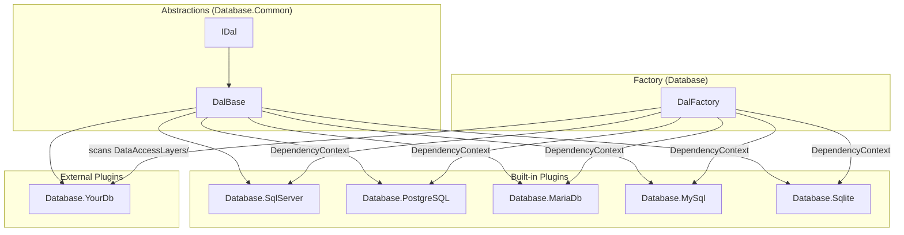

# DAL Architecture

The Database Access Layer (DAL) provides database-specific implementations for RayMigrator using a **plugin architecture**. Each database provider is a separate assembly that can be developed, built, and deployed independently.

## Architecture Overview



## IDal Interface

**Location**: `Raycoon.RayMigrator.Database.Common/IDal.cs`

```csharp
public interface IDal
{
    string DatabaseType { get; }
    DalSpecificProperties DalSpecificProperties { get; }

    Task ExecuteNonQueryAsync(string sqlCode, IDalSettings dalSettings, DalParameterList? dalParameterList = null, CancellationToken cancellationToken = default);
    void ExecuteNonQuery(string sqlCode, IDalSettings dalSettings, DalParameterList? dalParameterList = null);   // no token: the database log writer calls it from its own thread
    Task<object?> ExecuteScalarAsync(string sqlCode, IDalSettings dalSettings, DalParameterList? dalParameterList = null, CancellationToken cancellationToken = default);
    Task<List<Dictionary<string, object?>>> ExecuteReaderAsync(string sqlCode, IDalSettings dalSettings, DalParameterList? dalParameterList = null, CancellationToken cancellationToken = default);
    Task<bool> IsConnectionValidAsync(string connectionString, IDalSettings dalSettings, CancellationToken cancellationToken = default);
    void CheckConnectionStringOrValidateConnection(bool validateConnection);
    bool TryGetDbTypeForType(Type type, out DbType dbType);
    bool TryGetDbSpecificSqlParameter<T>(DalParameterList dalParameterList, out List<T>? sqlParameterList) where T : class, IDbDataParameter, new();

    // Shared-connection methods: caller controls the connection and transaction lifecycle.
    // Used for atomic execution where repository updates and target SQL blocks share one transaction.
    DbConnection CreateConnection();
    Task ExecuteNonQueryAsync(string sqlCode, DbConnection connection, DbTransaction transaction, int commandTimeoutInSeconds, DalParameterList? dalParameterList = null, CancellationToken cancellationToken = default);
    Task<object?> ExecuteScalarAsync(string sqlCode, DbConnection connection, DbTransaction transaction, int commandTimeoutInSeconds, DalParameterList? dalParameterList = null, CancellationToken cancellationToken = default);
}
```

A call that fails after its token was cancelled throws an `OperationCanceledException` that carries that token, whatever the provider reported, and starts no further retry (see [Cancellation](#cancellation)).

## Database-Specific Settings

Database-specific properties are carried by the `DalSpecificProperties` class (`Raycoon.RayMigrator.Database.Common/DalSpecificProperties.cs`), which each DAL implementation populates in its constructor. These properties control SQL parsing, schema handling, identifier quoting, and transactional DDL behavior:

| Field | SQL Server | PostgreSQL | MariaDB | MySQL | SQLite |
|-------|------------|------------|---------|-------|--------|
| `SqlBlockDelimiter` | `GO` | `;` | `;` | `;` | `;` |
| `SqlMultiLineCommentStart` | `/*` | `/*` | `/*` | `/*` | `/*` |
| `SqlMultiLineCommentEnd` | `*/` | `*/` | `*/` | `*/` | `*/` |
| `SupportsSchema` | `true` | `true` | `false` | `false` | `false` |
| `SupportsTransactionalDdl` | `true` | `true` | `false` | `false` | `true` |
| `IdentifierQuoteStart` | `[` | `"` | `` ` `` | `` ` `` | `"` |
| `IdentifierQuoteEnd` | `]` | `"` | `` ` `` | `` ` `` | `"` |
| `DefaultSchema` | `dbo` | `public` | _(empty)_ | _(empty)_ | _(empty)_ |
| `FoldsUnquotedIdentifiersToLower` | `false` | `true` | `false` | `false` | `false` |

## Project Structure (Plugin Architecture)

Each DAL is an independent project/assembly:

```
Raycoon.RayMigrator.Database/                  <- DalFactory only (depends on Microsoft.Extensions.DependencyModel for built-in DAL discovery)
├── DalFactory.cs
└── Raycoon.RayMigrator.Database.csproj

Raycoon.RayMigrator.Database.Common/           <- Abstractions and shared types
├── DalBase.cs
├── DalParameter.cs
├── DalParameterList.cs
├── DalSettings.cs
├── DalSpecificProperties.cs
├── DatabaseTypeAttribute.cs
├── IDal.cs
├── IDalSettings.cs
├── RetryHelper.cs
└── Raycoon.RayMigrator.Database.Common.csproj

Raycoon.RayMigrator.Database.SqlServer/        <- Separate project
├── DalSqlServer.cs
├── Templates/
│   ├── DatabaseLogging_CheckCreate.sql
│   ├── DatabaseLogging_Count.sql
│   ├── DatabaseLogging_Delete.sql
│   ├── DatabaseLogging_Insert.sql
│   ├── Repository_CheckCreate.sql
│   ├── Repository_Upgrade_1.sql
│   ├── Repository_Upgrade_2.sql
│   ├── Repository_Upgrade_3.sql
│   ├── Repository_MigratorMeta_CheckInsert.sql
│   ├── Repository_Drop.sql
│   ├── Repository_Environment_CheckInsert.sql
│   ├── Repository_Environment_Select.sql
│   ├── Repository_MigrationRecordHistory_Count.sql
│   ├── Repository_MigrationRecordHistory_Delete.sql
│   ├── Repository_MigrationRecordHistory_Select.sql
│   ├── Repository_MigrationRecord_FixOrphaned.sql
│   ├── Repository_MigrationRecord_GetInterrupted.sql
│   ├── Repository_MigrationRecord_Insert.sql
│   ├── Repository_MigrationRecord_Select.sql
│   ├── Repository_MigrationRecord_Update.sql
│   ├── Repository_MigrationRecord_UpdateHash.sql
│   ├── Repository_MigrationRecord_UpdateRollback.sql
│   ├── Repository_MigrationRun_FixOrphaned.sql
│   ├── Repository_MigrationRun_Heartbeat.sql
│   ├── Repository_MigrationRun_Insert.sql
│   ├── Repository_MigrationRun_Select.sql
│   ├── Repository_MigrationRun_SelectOrphaned.sql
│   ├── Repository_MigrationRun_Update.sql
│   ├── Repository_Product_CheckInsert.sql
│   └── Repository_Product_Select.sql
└── Raycoon.RayMigrator.Database.SqlServer.csproj

Raycoon.RayMigrator.Database.PostgreSQL/       <- Separate project
├── DalPostgreSql.cs
├── Templates/ (same 30 templates, PostgreSQL syntax)
└── Raycoon.RayMigrator.Database.PostgreSQL.csproj

Raycoon.RayMigrator.Database.MariaDb/          <- Separate project
├── DalMariaDb.cs
├── Templates/ (same 30 templates, MariaDB syntax)
└── Raycoon.RayMigrator.Database.MariaDb.csproj

Raycoon.RayMigrator.Database.MySql/            <- Separate project
├── DalMySql.cs
├── Templates/ (same 30 templates, MySQL syntax)
└── Raycoon.RayMigrator.Database.MySql.csproj

Raycoon.RayMigrator.Database.Sqlite/           <- Separate project
├── DalSqlite.cs
├── Templates/ (same 30 templates, SQLite syntax)
└── Raycoon.RayMigrator.Database.Sqlite.csproj

Raycoon.RayMigrator.Database.Example/          <- Skeleton template for external DAL development
├── DalExample.cs
├── Templates/ (30 placeholder templates, one per required template)
└── Raycoon.RayMigrator.Database.Example.csproj
```

**Runtime directory structure:**
```
bin/Debug/{TargetFramework}/   (e.g., net10.0, net9.0, or net8.0)
├── raymigrator.dll
├── Raycoon.RayMigrator.Database.Common.dll
├── DataAccessLayers/
│   ├── SqlServer/
│   │   ├── Raycoon.RayMigrator.Database.SqlServer.dll
│   │   └── *.sql (30 template files)
│   ├── PostgreSQL/
│   │   ├── Raycoon.RayMigrator.Database.PostgreSQL.dll
│   │   └── *.sql (30 template files)
│   ├── MariaDb/
│   │   ├── Raycoon.RayMigrator.Database.MariaDb.dll
│   │   └── *.sql (30 template files)
│   ├── MySql/
│   │   ├── Raycoon.RayMigrator.Database.MySql.dll
│   │   └── *.sql (30 template files)
│   └── Sqlite/
│       ├── Raycoon.RayMigrator.Database.Sqlite.dll
│       └── *.sql (30 template files)
```

## DatabaseType Attribute

**Location**: `Raycoon.RayMigrator.Database.Common/DatabaseTypeAttribute.cs`

Each DAL class must be decorated with a `[DatabaseType]` attribute that declares its database type string. This attribute is used by `DalFactory` for type discovery and by the DAL class itself to set its `DatabaseType` property.

```csharp
[AttributeUsage(AttributeTargets.Class, Inherited = false)]
public class DatabaseTypeAttribute : Attribute
{
    public string DatabaseType { get; }

    public DatabaseTypeAttribute(string databaseType)
    {
        DatabaseType = databaseType;
    }
}
```

**Registered database types:**

| Attribute Value | DAL Class | Namespace |
|-----------------|-----------|-----------|
| `"SqlServer"` | `DalSqlServer` | `Raycoon.RayMigrator.Database.SqlServer` |
| `"PostgreSQL"` | `DalPostgreSql` | `Raycoon.RayMigrator.Database.PostgreSQL` |
| `"MariaDb"` | `DalMariaDb` | `Raycoon.RayMigrator.Database.MariaDb` |
| `"MySql"` | `DalMySql` | `Raycoon.RayMigrator.Database.MySql` |
| `"Sqlite"` | `DalSqlite` | `Raycoon.RayMigrator.Database.Sqlite` |

## Template Deployment

Each DAL project's `.csproj` includes templates as `<Content>` items that propagate transitively through ProjectReference and as `contentFiles` in NuGet packages. A build target copies the DAL DLL into the same subdirectory.

```xml
<PropertyGroup>
    <RayMigratorDatabaseType>SqlServer</RayMigratorDatabaseType>
</PropertyGroup>

<!-- Templates as Content (transitive propagation + NuGet contentFiles) -->
<ItemGroup>
    <Content Include="Templates\**\*.sql">
        <CopyToOutputDirectory>PreserveNewest</CopyToOutputDirectory>
        <Link>DataAccessLayers\$(RayMigratorDatabaseType)\%(RecursiveDir)%(Filename)%(Extension)</Link>
        <Pack>true</Pack>
        <PackagePath>contentFiles\any\any\DataAccessLayers\$(RayMigratorDatabaseType)\</PackagePath>
        <PackageCopyToOutput>true</PackageCopyToOutput>
    </Content>
</ItemGroup>

<!-- Copy DAL DLL into DataAccessLayers/{Type}/ -->
<Target Name="CopyDalToDataAccessLayers" AfterTargets="Build">
    <MakeDir Directories="$(OutputPath)DataAccessLayers\$(RayMigratorDatabaseType)" />
    <Copy SourceFiles="$(TargetPath)"
          DestinationFolder="$(OutputPath)DataAccessLayers\$(RayMigratorDatabaseType)\"
          SkipUnchangedFiles="true" />
</Target>
```

The Console project additionally has a post-build target (`CopyDalAssembliesToDataAccessLayers`) that copies the built-in DAL DLLs into the correct subdirectories for plugin discovery by `DalFactory`.

**Runtime Path**: `TemplateCache` scans each database type subdirectory for `.sql` files during construction:
```csharp
var dataAccessLayersPath = Path.Combine(
    AppDomain.CurrentDomain.BaseDirectory,
    "DataAccessLayers");      // ConfigurationConstants.DatabaseAccessLayersRootDirectory

// For each subDir in DataAccessLayers/ (e.g., SqlServer/, PostgreSQL/):
Directory.GetFiles(subDir, "*.sql");
```

## DalBase Abstract Class

**Location**: `Raycoon.RayMigrator.Database.Common/DalBase.cs`

`DalBase` provides a base implementation for all DAL classes, implementing `IDal`. It implements the asynchronous `IDal` members itself on top of protected `…CoreAsync` members that each DAL overrides, so that a cancelled call ends the same way in every DAL, declares the other abstract members, and provides default implementations for common functionality such as parameter conversion and type mapping.

```csharp
public abstract class DalBase : IDal
{
    public abstract string DatabaseType { get; }
    public abstract DalSpecificProperties DalSpecificProperties { get; }

    // IDal members implemented by DalBase: each calls its …CoreAsync member and turns whatever it throws after the
    // cancellation into an OperationCanceledException carrying the caller's token
    public Task ExecuteNonQueryAsync(string sqlCode, IDalSettings dalSettings, DalParameterList? dalParameterList = null, CancellationToken cancellationToken = default);
    public Task<object?> ExecuteScalarAsync(string sqlCode, IDalSettings dalSettings, DalParameterList? dalParameterList = null, CancellationToken cancellationToken = default);
    public Task<List<Dictionary<string, object?>>> ExecuteReaderAsync(string sqlCode, IDalSettings dalSettings, DalParameterList? dalParameterList = null, CancellationToken cancellationToken = default);
    public Task<bool> IsConnectionValidAsync(string connectionString, IDalSettings dalSettings, CancellationToken cancellationToken = default);

    // What a DAL overrides: the work behind the members above
    protected abstract Task ExecuteNonQueryCoreAsync(string sqlCode, IDalSettings dalSettings, DalParameterList? dalParameterList, CancellationToken cancellationToken);
    protected abstract Task<object?> ExecuteScalarCoreAsync(string sqlCode, IDalSettings dalSettings, DalParameterList? dalParameterList, CancellationToken cancellationToken);
    protected abstract Task<List<Dictionary<string, object?>>> ExecuteReaderCoreAsync(string sqlCode, IDalSettings dalSettings, DalParameterList? dalParameterList, CancellationToken cancellationToken);
    protected abstract Task<bool> IsConnectionValidCoreAsync(string connectionString, IDalSettings dalSettings, CancellationToken cancellationToken);
    public abstract void ExecuteNonQuery(string sqlCode, IDalSettings dalSettings, DalParameterList? dalParameterList = null);
    public abstract void CheckConnectionStringOrValidateConnection(bool validateConnection);

    // Shared-connection members: DalBase implements the two IDal members over these abstracts, which each DAL
    // implements with its own connection/command types
    public abstract DbConnection CreateConnection();
    protected abstract Task ExecuteNonQueryCoreAsync(string sqlCode, DbConnection connection, DbTransaction transaction, int commandTimeoutInSeconds, DalParameterList? dalParameterList, CancellationToken cancellationToken);
    protected abstract Task<object?> ExecuteScalarCoreAsync(string sqlCode, DbConnection connection, DbTransaction transaction, int commandTimeoutInSeconds, DalParameterList? dalParameterList, CancellationToken cancellationToken);

    // Transient error detection: each DAL overrides DefaultTransientErrorCodes with its built-in list and
    // classifies the provider's error code through IsTransientCode in its IsTransient override. The effective
    // list (TransientErrorCodes) is replaced by DataAccessLayers/{Type}/TransientErrorCodes.txt when DalFactory
    // finds that file (ADR-022). The base IsTransient handles TimeoutException and recursively checks InnerException.
    protected virtual IReadOnlyCollection<string> DefaultTransientErrorCodes => [];
    public IReadOnlySet<string> TransientErrorCodes { get; }
    public string? TransientErrorCodesSource { get; }
    public void SetTransientErrorCodes(IEnumerable<string> codes, string? source) { ... }
    protected (bool isTransient, string? errorCode) IsTransientCode(string? code) { ... }
    public virtual (bool isTransient, string? errorCode) IsTransient(Exception ex) { ... }

    // Command timeout detection (since 0.20.0): the base recognises a TimeoutException in the chain of inner
    // exceptions, as Npgsql reports a timeout; the SQL Server DAL adds SqlClient error -2, the MySQL and MariaDB DALs
    // the CommandTimeoutExpired of MySqlConnector. A cancellation is never a timeout. The initialization of the
    // database log retries a transient failure of DatabaseLogging_CheckCreate, but not a timeout.
    public virtual bool IsTimeout(Exception ex) { ... }

    // Retry helpers: delegate to RetryHelper using this DAL's IsTransient method; the asynchronous ones take the
    // token, wait for a retry with it and start no attempt after the cancellation
    protected async Task<T> ExecuteWithRetryAsync<T>(
        Func<Task<T>> operation, IDalSettings dalSettings, string? operationDescription = null, CancellationToken cancellationToken = default) { ... }
    protected async Task ExecuteWithRetryAsync(
        Func<Task> operation, IDalSettings dalSettings, string? operationDescription = null, CancellationToken cancellationToken = default) { ... }
    protected void ExecuteWithRetry(
        Action operation, IDalSettings dalSettings, string? operationDescription = null) { ... }

    // Default implementation: maps .NET types to DbType
    public bool TryGetDbTypeForType(Type type, out DbType dbType) { ... }

    // Default implementation: converts DalParameterList to database-specific parameters
    public virtual bool TryGetDbSpecificSqlParameter<T>(DalParameterList dalParameterList, out List<T>? sqlParameterList)
        where T : class, IDbDataParameter, new() { ... }

    // Helper methods for parameter creation
    protected virtual T CreateParameter<T>(DbType dbType, string parameterName, object? parameterValue)
        where T : class, IDbDataParameter, new() { ... }
    protected virtual object ConvertToDbValue(object? value) { ... }
}
```

### Cancellation

Every asynchronous `IDal` member takes the caller's `CancellationToken` (since 0.20.0; `IsConnectionValid` became `IsConnectionValidAsync`). The contract, which `DalBase` enforces for every DAL:

- **One exception.** A call that fails after the token was cancelled throws an `OperationCanceledException` that carries the caller's token, with the provider's exception as inner exception. Providers report a cancel in their own way: SqlClient reports a cancelled command as a `SqlException` and a cancelled open as a `TaskCanceledException` without the token, Npgsql and MySqlConnector throw an `OperationCanceledException`. Unless the provider reported a cancellation itself, the message names the provider's message (`The operation on the [MySql] database was cancelled: <message of the provider>`), so that a database error that met the cancel stays readable where the cancel is reported.
- **No retry.** `DalBase.IsTransient` never counts a cancellation as transient, whatever its inner exception reports, and `RetryHelper.ExecuteWithRetryAsync` waits for a retry with the token and neither classifies nor retries a failure after the cancellation.
- **Where the token goes.** The shipped DALs pass it to opening the connection and to the command, not to commit and rollback: a commit that has started must complete, or the caller cannot tell whether it happened. SQL Server, PostgreSQL and MariaDB abort the statement in progress; MySQL ends the statement in progress through `KILL QUERY` on a connection of its own and runs the further statements of the same batch; the `KILL QUERY` of MySQL and MariaDB ends a `SLEEP()` early without an error, and the batch runs on; Microsoft.Data.Sqlite can neither interrupt a statement nor skip the statements left in a batch, so the SQLite DAL observes the token before a batch starts (a read also between its rows).
- **Session locks.** When a call on a connection of its own fails, times out or is cancelled, `DalMySql` and `DalMariaDb` release the `GET_LOCK()` locks of its session (`DO RELEASE_ALL_LOCKS()`, best effort, without the token, with a command timeout of 5 seconds) before the connection goes back to the pool. A template takes and releases its lock itself, but one that stopped between its `GET_LOCK()` and its `RELEASE_LOCK()` left the lock on the pooled session, and every other host waited for it until the pool handed the connection out again or pruned it as idle (up to 180 seconds). The templates of every version had that gap; a cancel makes it routine. The shared-connection calls leave the release to the caller, whose connection it is.
- **Synchronous call.** `ExecuteNonQuery`, which the background thread of the database log writer calls, takes no token.

How the engine uses the token, at the next block boundary of a run, is described in [Error handling: Cancellation](../02-core-concepts/error-handling.md#cancellation) (ADR-028).

### SQL Server Example

```csharp
[DatabaseType("SqlServer")]
public class DalSqlServer : DalBase, IDal
{
    private readonly string _connectionString;
    public override string DatabaseType { get; }
    public override DalSpecificProperties DalSpecificProperties { get; }

    public DalSqlServer(string connectionString)
    {
        _connectionString = connectionString;
        DatabaseType = this.GetType().GetCustomAttribute<DatabaseTypeAttribute>()!.DatabaseType;
        DalSpecificProperties = new DalSpecificProperties
        {
            SqlBlockDelimiter = "GO",
            SqlMultiLineCommentStart = "/*",
            SqlMultiLineCommentEnd = "*/",
            SupportsSchema = true,
            SupportsTransactionalDdl = true,
            IdentifierQuoteStart = "[",
            IdentifierQuoteEnd = "]",
            DefaultSchema = "dbo",
        };
    }

    // Built-in list; DataAccessLayers/SqlServer/TransientErrorCodes.txt replaces it at runtime (ADR-022)
    private static readonly string[] TransientCodes =
        ["-2", "20", "64", "233", "10053", "10054", "10060",
         "40197", "40501", "40613", "49918", "49919", "49920",
         "4021", "596"]; // pooled session killed after ALTER LOGIN: retried, and the pool is cleared

    protected override IReadOnlyCollection<string> DefaultTransientErrorCodes => TransientCodes;

    public override (bool isTransient, string? errorCode) IsTransient(Exception ex)
    {
        if (ex is SqlException sqlEx)
            return IsTransientCode(sqlEx.Number.ToString(CultureInfo.InvariantCulture));
        return base.IsTransient(ex);
    }

    // ... ExecuteNonQueryCoreAsync, ExecuteScalarCoreAsync, ExecuteReaderCoreAsync, IsConnectionValidCoreAsync, etc.
}
```

## Factory Resolution (Plugin Discovery)

DAL instances are created and cached by the static `DalFactory` class (`Raycoon.RayMigrator.Database/DalFactory.cs`). The factory uses **dual-mode discovery** to find DAL plugins.

### How it works

The factory uses **DependencyContext-based discovery** for built-in DALs (works with single-file publish) and **filesystem scanning** for external DAL plugins.

1. **Mode 0 -- DependencyContext discovery** (built-in DALs): On first access, `DalFactory` reads from `DependencyContext.Default` (the `.deps.json` metadata available in all deployment modes including single-file publish bundles). It iterates `RuntimeLibraries` whose name starts with `"Raycoon.RayMigrator."` and loads each via `Assembly.Load`. No hardcoded assembly list is needed -- any ProjectReference within the namespace is discovered automatically.
2. **Mode 1 -- Filesystem-based discovery** (external DAL plugins): After DependencyContext scanning, `DalFactory` scans the `DataAccessLayers/` directory under the application base directory. For each subdirectory (e.g., `DataAccessLayers/SqlServer/`), all `.dll` files are loaded via `Assembly.LoadFrom`.
3. **Type scanning**: Each loaded assembly is scanned for non-abstract classes that implement `IDal` and are decorated with the `[DatabaseType]` attribute.
4. **Type mapping**: Each discovered class is mapped by its `DatabaseType` attribute value (e.g., `"SqlServer"`, `"PostgreSQL"`, `"MariaDb"`, `"MySql"`, `"Sqlite"`). Duplicates are skipped (`TryAdd`).
5. **Instance caching**: DAL instances are cached in a `ConcurrentDictionary` keyed by `"{databaseType}_{connectionString}"`, so the same connection reuses the same DAL instance.
6. **Instance creation**: Instances are created via `Activator.CreateInstance(dalType, connectionString)`, passing the connection string to the constructor.
7. **Error handling**: `TryGetDal` throws a `ConfigurationValidationException` if the requested `databaseType` has no registered DAL type mapping. An assembly whose types do not load (the `ReflectionTypeLoadException` of the scan, or the `TypeLoadException` of one type) is skipped, and its loader exceptions are kept: the message for an unknown database type then names those assemblies with their loader exceptions and says that a DataAccessLayer built against an earlier version of RayMigrator must be rebuilt against this version. A DAL built against 0.19.0 or earlier does not load in 0.20.0, because it overrides members that `DalBase` no longer has and lacks those it has now; before 0.20.0 such a failure was swallowed, and the message named only the unknown type.

```csharp
public static class DalFactory
{
    private static readonly Dictionary<string, Type> DalTypeMapping = new();
    private static readonly ConcurrentDictionary<string, IDal> DalInstances = new();

    static DalFactory()
    {
        // Mode 0: Discover built-in DAL assemblies from dependency metadata.
        // DependencyContext.Default reads from deps.json, which is available in all
        // deployment modes including single-file publish bundles.
        var context = DependencyContext.Default;
        if (context != null)
        {
            foreach (var lib in context.RuntimeLibraries)
            {
                if (lib.Name.StartsWith("Raycoon.RayMigrator."))
                {
                    try
                    {
                        var assembly = Assembly.Load(new AssemblyName(lib.Name));
                        ScanAssemblyForDals(assembly);
                    }
                    catch (FileNotFoundException) { /* Assembly not available in this deployment */ }
                    catch (FileLoadException) { /* Assembly version conflict, skip */ }
                }
            }
        }

        // Mode 1: Filesystem-based discovery (external DAL plugins)
        string dalRootPath = Path.Combine(
            AppDomain.CurrentDomain.BaseDirectory,
            "DataAccessLayers");

        if (Directory.Exists(dalRootPath))
        {
            foreach (string subDir in Directory.GetDirectories(dalRootPath))
            {
                foreach (string dllFile in Directory.GetFiles(subDir, "*.dll"))
                {
                    try
                    {
                        var assembly = Assembly.LoadFrom(dllFile);
                        ScanAssemblyForDals(assembly);
                    }
                    catch (BadImageFormatException) { /* Native DLL, skip */ }
                    catch (FileLoadException) { /* Already loaded, skip */ }
                }
            }
        }
    }

    // ...
}
```

### Adding External DAL Plugins

To add a new database provider at runtime:

1. Build your DAL project (must reference `Database.Common` and `Shared`)
2. Copy the output DLL to `DataAccessLayers/{YourDatabaseType}/`
3. Copy your 30 SQL templates to `DataAccessLayers/{YourDatabaseType}/` (same directory as the DLL)
4. RayMigrator will auto-discover and register the DAL on next startup via Mode 1 (filesystem scanning)

See [External DAL Development](../09-extending/external-dal-development.md) for a complete guide.

### Usage

```csharp
// TryGetDal returns true for known database types and provides the cached instance.
// For unknown database types it throws ConfigurationValidationException (never returns false).
DalFactory.TryGetDal("SqlServer", connectionString, out IDal? dal);
await dal!.ExecuteNonQueryAsync(sql, dalSettings);
```

## NuGet Dependencies

Each DAL project has its own NuGet dependencies:

| Project | Package |
|---------|---------|
| `Database.SqlServer` | `Microsoft.Data.SqlClient` |
| `Database.PostgreSQL` | `Npgsql` |
| `Database.MariaDb` | `MySqlConnector` |
| `Database.MySql` | `MySqlConnector` |
| `Database.Sqlite` | `Microsoft.Data.Sqlite` |

For external DALs, `Database.Common` and `Shared` are available as NuGet packages.

## IDalSettings and DalSettings

**Location**: `Raycoon.RayMigrator.Database.Common/IDalSettings.cs`, `Raycoon.RayMigrator.Database.Common/DalSettings.cs`

Every DAL method that executes SQL receives an `IDalSettings` instance that controls execution behavior:

```csharp
public interface IDalSettings
{
    bool UseTransaction { get; set; }
    int DbCommandTimeoutInSeconds { get; set; }
    int MaxRetries { get; set; }
    int RetryDelayMs { get; set; }
}
```

`DalSettings` provides the default implementation. The class-level property defaults are `MaxRetries = 3` and `RetryDelayMs = 500`, but in practice these are always overridden at the call site. Two different defaults apply depending on the context:

- **Repository calls** (`RepositoryExtensions.GetDalSettings`): `MaxRetries = repository.DbCommandMaxRetries ?? 3` and `RetryDelayMs = repository.DbCommandWaitTimeInMsBeforeRetry ?? 500`. When no explicit configuration is set, retries are **enabled** with 3 attempts and 500 ms base delay.
- **Target calls** (migration SQL execution): `MaxRetries = targetOptions.DbCommandMaxRetries ?? 0` and `RetryDelayMs = targetOptions.DbCommandWaitTimeInMsBeforeRetry ?? 250`. When no explicit configuration is set, retries are **disabled**.

See [Resilience and Retry](../02-core-concepts/resilience.md) for the configuration-level defaults.

## DalParameter and DalParameterList

**Location**: `Raycoon.RayMigrator.Database.Common/DalParameter.cs`, `Raycoon.RayMigrator.Database.Common/DalParameterList.cs`

`DalParameter` carries a parameter name, value, and .NET type. `DalParameterList` is a dictionary-backed collection of `DalParameter` instances. The `TryGetDbSpecificSqlParameter<T>` method on `DalBase` converts these to database-specific `IDbDataParameter` implementations (e.g., `SqlParameter`, `NpgsqlParameter`).

## RetryHelper

**Location**: `Raycoon.RayMigrator.Database.Common/RetryHelper.cs`

`RetryHelper` provides retry logic for transient database errors with **linear backoff** (delay * attemptNumber). It accepts a `Func<Exception, (bool isTransient, string? errorCode)>` transient error predicate and offers three sets of overloads:

1. **Async with return value**: `ExecuteWithRetryAsync<T>(Func<Task<T>>, ...)`
2. **Async void**: `ExecuteWithRetryAsync(Func<Task>, ...)`
3. **Sync with return value**: `ExecuteWithRetry<T>(Func<T>, ...)`

Transient error detection is delegated to each DAL. `DalBase` keeps the effective code list: `DefaultTransientErrorCodes` is the plugin's built-in list, and `DalFactory` replaces it through `SetTransientErrorCodes` with the content of `DataAccessLayers/{DatabaseType}/TransientErrorCodes.txt` when that file exists (see [Transient Error Codes](transient-error-codes.md), ADR-022). Each concrete DAL overrides the `IsTransient(Exception)` virtual method with its database-specific exception type and classifies the provider's code through the protected `IsTransientCode`. The base implementation handles `TimeoutException` and recursively checks `InnerException`. The protected `ExecuteWithRetryAsync` and `ExecuteWithRetry` methods in `DalBase` call `RetryHelper`, passing the DAL's own `IsTransient` method as the predicate.

To add transient error detection to a custom DAL, override `DefaultTransientErrorCodes` and `IsTransient` in the DAL class (see the commented-out example in `DalExample.cs`):

```csharp
private static readonly string[] TransientCodes = ["1205", "2006", "40001"]; // built-in list

protected override IReadOnlyCollection<string> DefaultTransientErrorCodes => TransientCodes;

public override (bool isTransient, string? errorCode) IsTransient(Exception ex)
{
    if (ex is YourDbException dbEx)
        return IsTransientCode(dbEx.ErrorNumber.ToString(CultureInfo.InvariantCulture));
    return base.IsTransient(ex); // handles TimeoutException, InnerException recursion
}
```

When all retries are exhausted, a `RetryExhaustedException` is thrown containing `AttemptsMade` (int) and `LastErrorCode` (string?). Error codes are returned as `string?` so the same predicate can carry both numeric driver codes (e.g., SQL Server `"233"`) and SQLSTATE codes (e.g., PostgreSQL `"08000"`).

## Related Documentation

- [Template System](template-system.md) - How templates work
- [Repository Schema](repository-schema.md) - Repository tables
- [SQL Dialects](sql-dialects.md) - Dialect differences
- [Adding New Database](adding-new-database.md) - Extension guide
- [External DAL Development](../09-extending/external-dal-development.md) - External plugin development
