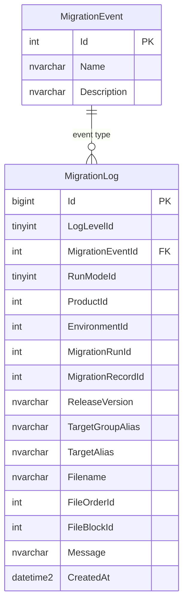

# Logging Schema

RayMigrator can optionally log migration events to a database for centralized logging and monitoring.

## Entity Relationship Diagram



## Tables

### MigrationEvent

Lookup table for migration event types.

| Column | Type | Description |
|--------|------|-------------|
| `Id` | INT | Primary key |
| `Name` | NVARCHAR(100) | Event name |
| `Description` | NVARCHAR(1000) | Event description |

### MigrationLog

Main logging table. Types shown are SQL Server canonical types. PostgreSQL stores all `NVARCHAR(n)` string columns as `TEXT` and the `CreatedAt` audit column as `TIMESTAMPTZ`. After DAL-017, PostgreSQL uses unquoted snake_case column names throughout (e.g., `log_level_id`, `migration_event_id`, `migration_run_id`, `created_at`). After DAL-018, MariaDB and MySQL use the same unquoted snake_case convention — `migration_log` and `migration_event` table names, `log_level_id`, `migration_event_id`, etc. SQL Server and SQLite retain PascalCase. The Mermaid ERD above uses PascalCase as engine-neutral canonical names; the snake_case names follow the mechanical conversion rule documented in [Naming Conventions per Engine](sql-dialects.md#naming-conventions-per-engine).

| Column | Type | Description |
|--------|------|-------------|
| `Id` | BIGINT | Primary key (auto-increment) |
| `LogLevelId` | TINYINT | Log level (Debug, Info, Warning, Error) |
| `MigrationEventId` | INT | FK to MigrationEvent |
| `RunModeId` | TINYINT | Run mode (Validate/Simulate/Migrate) |
| `ProductId` | INT | Product ID (nullable) |
| `EnvironmentId` | INT | Environment ID (nullable; no FK — logging DB may differ from repository DB) |
| `MigrationRunId` | INT | Migration run ID (nullable) |
| `MigrationRecordId` | INT | Migration record ID (nullable) |
| `ReleaseVersion` | NVARCHAR(100) | Release version |
| `TargetGroupAlias` | NVARCHAR(100) | Target group |
| `TargetAlias` | NVARCHAR(100) | Target database |
| `Filename` | NVARCHAR(300) | Migration filename |
| `FileOrderId` | INT | File execution order |
| `FileBlockId` | INT | Block index within file |
| `Message` | NVARCHAR(MAX) | Log message |
| `CreatedAt` | DATETIME2(3) | Timestamp (default: SYSUTCDATETIME()) |

### Indexes

`MigrationLog` has two indexes, for the readers of the log and for the cleanup by age: `ix_{TableBaseName}MigrationLog_MigrationRunId` (`MigrationRunId`) and `ix_{TableBaseName}MigrationLog_CreatedAt` (`CreatedAt`), `ix_{TableBaseName}migration_log_migration_run_id` and `ix_{TableBaseName}migration_log_created_at` on PostgreSQL, MySQL and MariaDB. `DatabaseLogging_CheckCreate` creates each index when it is missing, whether or not it creates the tables, so the next initialization of the database log also adds them to a log table that an older engine created and still reports that the log existed (result `0`). This holds as well for a log database of its own, with its own connection, schema and prefix: the log tables are not part of the repository schema version, whose steps would not reach such a database.

- **Rights.** The start that adds the indexes needs the right to create indexes on the log table (`ALTER` on the table on SQL Server, ownership of the table on PostgreSQL, the `INDEX` privilege on MySQL and MariaDB). A later start finds them and needs that right no more: SQL Server, PostgreSQL, MySQL and MariaDB look each index up before they create it, so a start that finds both runs no index DDL; SQLite runs its `CREATE INDEX IF NOT EXISTS` on every start, a no-op once the index is there.
- **Duration.** That first start builds the indexes on the rows already there within the command timeout of `DatabaseLogging` (`DbCommandTimeoutInSeconds`, 20 seconds by default). A timeout of `DatabaseLogging_CheckCreate` is not retried; other transient failures are, up to three times, as for every log write. The attempt was rolled back whole, and a retry would build the indexes from the start again and hold back the log writes of other hosts once more. The start then fails with a message that names the index build and `DatabaseLogging.DbCommandTimeoutInSeconds`: when updating, raise that timeout for the first start on a large log. `DalBase.IsTimeout` tells a timeout from other failures (a `TimeoutException` in the chain of inner exceptions, SqlClient error -2, the `CommandTimeoutExpired` of MySqlConnector). While the build runs, SQL Server, PostgreSQL and SQLite block the writes to the log table: the log writers of other hosts wait, and an entry whose insert fails is lost and reported on the standard error output only.
- **Parallel starts.** A parallel start of another host does not fail on the indexes. SQL Server, PostgreSQL and MySQL serialise the initialization with a lock apart from the repository schema lock (`sp_getapplock` in one transaction, an advisory lock, `GET_LOCK()`), which also serialises the creation of the tables. The wait for that lock ends with the command timeout of `DatabaseLogging` (20 seconds by default) and, like a timeout of the index build, is not retried: SQL Server and MySQL give up after 60 seconds and report `-1` only when that timeout is longer (or `0`, no timeout), and PostgreSQL waits for its advisory lock until the timeout. A start that waits while another host builds the indexes on a large log therefore needs the longer timeout as well. On MySQL a start that fails, times out or is cancelled inside the template keeps no lock: the DAL releases the locks of the session (`DO RELEASE_ALL_LOCKS()`) before the connection goes back to the pool. MariaDB and SQLite rely on `CREATE INDEX IF NOT EXISTS`, which the metadata lock of the table and the write lock of the database serialise; two first starts at once can still collide there on the event catalogue, as before.

## MigrationEvent Lookup Table

The `MigrationEvent` table is the catalogue of the `EventId`s RayMigrator logs with. It is seeded by the `DatabaseLogging_CheckCreate` template and mirrors the static class `Raycoon.RayMigrator.Core.Logging.MigrationEvent` one to one: the C# constant, the event name and the row `Name` are identical. The DatabaseLogging sink stores the `Id` of the `EventId` passed to the logger call in `MigrationLog.MigrationEventId`; a call without an EventId is stored as 0. The catalogue is written only when the log tables are created; apart from the two indexes above an existing log database is not upgraded in place, so a log database created before 0.13.0 keeps the old names `CreateAndStartRayMigratorService` (100) and `CreateCompositeLogger` (32) until it is dropped and recreated. There is no FK from `MigrationLog.MigrationEventId` to `MigrationEvent.Id`.

| Id | Name | Description |
|----|------|-------------|
| 0 | UnspecifiedEvent | Logged without an EventId |
| 10 | CommandLineParsing | CLI argument parsing |
| 20 | EnvironmentVariableReplacement | Env var resolution |
| 31 | CreateDatabaseLogger | Database logger setup |
| 40 | ValidateRayMigratorOptions | Options validation |
| 50 | CreateApplicationHost | Host creation |
| 60 | InitializeDalSpecificProperties | DAL initialization |
| 70 | ValidateConnectionStrings | Connection validation |
| 80 | RayMigratorServiceStart | Service startup |
| 100 | TemplateExecutionRepositoryCheckCreate | Repository check/create |
| 101 | TemplateExecutionRepositoryUpgrade | Repository schema step (`Repository_Upgrade_{n}`) |
| 102 | TemplateExecutionRepositoryMigratorMetaCheckInsert | Engine version registration in `MigratorMeta` |
| 110 | TemplateExecutionRepositoryMigrationRunInsert | MigrationRun insert |
| 111 | TemplateExecutionRepositoryMigrationRunUpdate | MigrationRun update |
| 112 | TemplateExecutionRepositoryMigrationRunSelectOrphaned | Select orphaned runs |
| 113 | TemplateExecutionRepositoryMigrationRunFixOrphaned | Fix orphaned migration runs |
| 114 | TemplateExecutionRepositoryMigrationFixOrphaned | Fix orphaned migration records |
| 115 | TemplateExecutionRepositoryMigrationRunHeartbeat | MigrationRun heartbeat |
| 120 | TemplateExecutionRepositoryProductCheckInsert | Product check/insert |
| 121 | TemplateExecutionRepositoryEnvironmentCheckInsert | Environment check/insert |
| 122 | TemplateExecutionRepositoryProductSelect | Product lookup (read-only commands) |
| 123 | TemplateExecutionRepositoryEnvironmentSelect | Environment lookup (read-only commands) |
| 130 | TemplateExecutionRepositoryMigrationInsert | Migration record insert |
| 131 | TemplateExecutionRepositoryMigrationUpdate | Migration record update |
| 132 | TemplateExecutionRepositoryMigrationGetInterrupted | Check for interrupted migrations |
| 133 | TemplateExecutionRepositoryMigrationUpdateRollback | Migration rollback update |
| 134 | TemplateExecutionRepositoryMigrationSelect | Query migration records |
| 135 | TemplateExecutionRepositoryMigrationUpdateHash | Update migration hashes |
| 136 | TemplateExecutionRepositoryMigrationRunSelect | Query MigrationRun records |
| 137 | TemplateExecutionRepositoryMigrationRecordHistorySelect | Query MigrationRecordHistory rows (info run history) |
| 1000 | RayMigratorServiceShutdown | Service shutdown |

## Log Levels

| Id | Name |
|----|------|
| 0 | Trace |
| 1 | Debug |
| 2 | Information |
| 3 | Warning |
| 4 | Error |
| 5 | Critical |

## Configuration

Database logging is on by default and goes into the repository: without a `DatabaseLogging` section the log tables are created in the repository schema and `MinimumLevel` is `Information`; `"DatabaseLogging": { "Enabled": false }` switches it off. A fully written section describes a separate log database:

```json
{
  "RayMigrator": {
    "DatabaseLogging": {
      "DatabaseType": "SqlServer",
      "ConnectionString": "{ENV:LOG_CONNECTION}",
      "SchemaName": "logs",
      "TableBaseName": "",
      "MinimumLevel": "Information",
      "DbCommandTimeoutInSeconds": 20
    }
  }
}
```

### Options

| Property | Type | Required | Default | Description |
|----------|------|----------|---------|-------------|
| `DatabaseType` | string | Yes | - | Database type (SqlServer, PostgreSQL, MariaDb, MySql, Sqlite) |
| `ConnectionString` | string | Yes | - | Database connection string |
| `SchemaName` | string | No | - | Schema for logging tables |
| `TableBaseName` | string | No | - | Table name prefix; at most 16 bytes in UTF-8 (16 ASCII characters) (RULE_4_4) |
| `MinimumLevel` | string | No | Information | Minimum log level |
| `DbCommandTimeoutInSeconds` | int | No | 20 | Command timeout |

## SQL Templates

Two SQL templates implement database logging, available for each supported database engine (SqlServer, PostgreSQL, MariaDb, MySql, Sqlite):

- **`DatabaseLogging_CheckCreate.sql`** -- Creates the logging schema, tables, and lookup data if they do not exist, and the two indexes when they are missing
- **`DatabaseLogging_Insert.sql`** -- Inserts a single log entry into the MigrationLog table

Two more, `DatabaseLogging_Delete.sql` and `DatabaseLogging_Count.sql`, belong to the retention of the repository: `IRepositoryMaintenanceService` runs them against the repository database with the schema and prefix of the `Repository` section, so they reach only a log that lives there, and with the command timeout of the repository but without its retries (see [Retention](repository-schema.md#retention)). With `@ExistsOnly` = 1, `DatabaseLogging_Count` reports only whether the log table is there, which the cleanup asks before it deletes, without counting a large log; the dry run counts.

### DatabaseLogging_CheckCreate.sql

The `DatabaseLogging_CheckCreate.sql` template creates the logging infrastructure. SQL Server names the keys `pk_{CFG:TableBaseName}MigrationEvent` and `pk_{CFG:TableBaseName}MigrationLog`, PostgreSQL `pk_{CFG:TableBaseName}migration_event` and `pk_{CFG:TableBaseName}migration_log`; MariaDB, MySQL and SQLite leave them unnamed. The prefix keeps the log tables of two configurations with different prefixes in one schema apart; a log database created before 0.18.0 keeps its unprefixed key names (`pk_MigrationEvent` and `pk_Log` on SQL Server).

```sql
BEGIN TRANSACTION;

-- A parallel start of another host waits here; the lock is not the repository schema lock
EXEC @LockResult = sp_getapplock @Resource = 'RayMigrator_Log_{CFG:SchemaName}_{CFG:TableBaseName}', @LockMode = 'Exclusive', @LockOwner = 'Transaction', @LockTimeout = 60000;
IF (@LockResult < 0)
BEGIN
    ROLLBACK TRANSACTION;
    SELECT '-1,Could not acquire the database logging lock';
    RETURN;
END;

DECLARE @Created BIT = 0;

-- Check if tables exist
IF (OBJECT_ID('{CFG:SchemaName}.{CFG:TableBaseName}MigrationLog', 'U') IS NULL)
BEGIN
    -- Create schema if needed
    IF SCHEMA_ID('{CFG:SchemaName}') IS NULL
        EXECUTE('CREATE SCHEMA [{CFG:SchemaName}]');

    -- Create MigrationEvent table
    CREATE TABLE [{CFG:SchemaName}].[{CFG:TableBaseName}MigrationEvent] (
        Id INT NOT NULL,
        Name NVARCHAR(100) NOT NULL,
        Description NVARCHAR(1000) NULL,
        CONSTRAINT pk_{CFG:TableBaseName}MigrationEvent PRIMARY KEY (Id)
    );

    -- Create MigrationLog table
    CREATE TABLE [{CFG:SchemaName}].[{CFG:TableBaseName}MigrationLog] (
        Id BIGINT IDENTITY(1,1) NOT NULL,
        LogLevelId TINYINT NOT NULL,
        MigrationEventId INT NULL,
        RunModeId TINYINT NULL,
        ProductId INT NULL,
        EnvironmentId INT NULL,
        MigrationRunId INT NULL,
        MigrationRecordId INT NULL,
        ReleaseVersion NVARCHAR(100) NULL,
        TargetGroupAlias NVARCHAR(100) NULL,
        TargetAlias NVARCHAR(100) NULL,
        Filename NVARCHAR(300) NULL,
        FileOrderId INT NULL,
        FileBlockId INT NULL,
        Message NVARCHAR(MAX) NULL,
        CreatedAt DATETIME2(3) DEFAULT SYSUTCDATETIME() NOT NULL,
        CONSTRAINT pk_{CFG:TableBaseName}MigrationLog PRIMARY KEY (Id)
    );

    -- Insert event master data
    INSERT INTO [{CFG:SchemaName}].[{CFG:TableBaseName}MigrationEvent]
        (Id, Name, Description)
    VALUES
        (0, 'UnspecifiedEvent', N''),
        (10, 'CommandLineParsing', N''),
        -- ... more events ...
        (1000, 'RayMigratorServiceShutdown', N'');

    SET @Created = 1;
END;

-- Outside the creation branch, so that a log table an older engine created gets the indexes at its next start
IF NOT EXISTS (SELECT 1 FROM sys.indexes WHERE name = N'ix_{CFG:TableBaseName}MigrationLog_MigrationRunId' AND object_id = OBJECT_ID(N'{CFG:SchemaName}.{CFG:TableBaseName}MigrationLog', N'U'))
    CREATE INDEX ix_{CFG:TableBaseName}MigrationLog_MigrationRunId ON [{CFG:SchemaName}].[{CFG:TableBaseName}MigrationLog] ( MigrationRunId );

IF NOT EXISTS (SELECT 1 FROM sys.indexes WHERE name = N'ix_{CFG:TableBaseName}MigrationLog_CreatedAt' AND object_id = OBJECT_ID(N'{CFG:SchemaName}.{CFG:TableBaseName}MigrationLog', N'U'))
    CREATE INDEX ix_{CFG:TableBaseName}MigrationLog_CreatedAt ON [{CFG:SchemaName}].[{CFG:TableBaseName}MigrationLog] ( CreatedAt );

COMMIT TRANSACTION;

IF (@Created = 1)
    SELECT '1,Database logging infrastructure successfully created';
ELSE
    SELECT '0,Database logging infrastructure already exists';
```

The real template wraps this in `BEGIN TRY ... END TRY BEGIN CATCH ... END CATCH` and rolls the transaction back on an error. PostgreSQL runs the same in one `DO` block under an advisory lock. MySQL and MariaDB run statement by statement (their DDL commits implicitly) and look each index up in `information_schema` before a prepared `CREATE INDEX` runs: MySQL under `GET_LOCK()`, because it has no `CREATE INDEX IF NOT EXISTS`, MariaDB with `IF NOT EXISTS` and without a lock.

### DatabaseLogging_Insert.sql

The `DatabaseLogging_Insert.sql` template inserts a single log entry. It is called by `DatabaseLogWriter` via the `DatabaseLoggerQueue` (asynchronous queue). All parameters except `LogLevelId` are nullable:

```sql
INSERT INTO [{CFG:SchemaName}].[{CFG:TableBaseName}MigrationLog]
(
    [LogLevelId],
    [MigrationEventId],
    [RunModeId],
    [ProductId],
    [EnvironmentId],
    [MigrationRunId],
    [MigrationRecordId],
    [ReleaseVersion],
    [TargetGroupAlias],
    [TargetAlias],
    [Filename],
    [FileOrderId],
    [FileBlockId],
    [Message],
    [CreatedAt]
)
VALUES
(
    @LogLevelId,
    @MigrationEventId,
    @RunModeId,
    @ProductId,
    @EnvironmentId,
    @MigrationRunId,
    @MigrationRecordId,
    @ReleaseVersion,
    @TargetGroupAlias,
    @TargetAlias,
    @Filename,
    @FileOrderId,
    @FileBlockId,
    @Message,
    SYSUTCDATETIME()
);
```

## Querying Logs

### Recent Errors

```sql
SELECT
    CreatedAt,
    EnvironmentId,
    Filename,
    Message
FROM logs.MigrationLog
WHERE LogLevelId >= 4  -- Error and above
ORDER BY CreatedAt DESC;
```

### Logs for Specific Run

```sql
SELECT
    e.Name AS Event,
    l.Message,
    l.Filename,
    l.FileBlockId,
    l.CreatedAt
FROM logs.MigrationLog l
LEFT JOIN logs.MigrationEvent e ON l.MigrationEventId = e.Id
WHERE l.MigrationRunId = @RunId
ORDER BY l.CreatedAt;
```

### Logs for Specific Migration

```sql
SELECT
    e.Name AS Event,
    l.Message,
    l.FileBlockId,
    l.CreatedAt
FROM logs.MigrationLog l
LEFT JOIN logs.MigrationEvent e ON l.MigrationEventId = e.Id
WHERE l.MigrationRecordId = @MigrationRecordId
ORDER BY l.CreatedAt;
```

### Migration Duration Analysis

```sql
SELECT
    Filename,
    MIN(CreatedAt) AS StartedAt,
    MAX(CreatedAt) AS FinishedAt,
    DATEDIFF(MILLISECOND, MIN(CreatedAt), MAX(CreatedAt)) AS DurationMs
FROM logs.MigrationLog
WHERE MigrationRunId = @RunId
    AND Filename IS NOT NULL
GROUP BY Filename
ORDER BY StartedAt;
```

## Serilog Integration

RayMigrator uses Serilog for logging. Console and file sinks are configured alongside database logging. The `Serilog` section must be placed **inside** the `RayMigrator` section:

```json
{
  "RayMigrator": {
    "Serilog": {
      "MinimumLevel": {
        "Default": "Information"
      },
      "WriteTo": [
        {
          "Name": "Console"
        },
        {
          "Name": "File",
          "Args": {
            "path": "logs/raymigrator-.txt",
            "rollingInterval": "Day"
          }
        }
      ]
    }
  }
}
```

## Best Practices

1. **Separate database** for logs only when their growth must not touch the repository (the repository is the default home, where Studio reads them): the cleanup of the engine reaches only a log in the repository database and reports any other as `LogSkipped`, so a separate log database needs a retention of its own
2. **Set a retention** - logs grow with every run; a host deletes old rows through `IRepositoryMaintenanceService` (see [Retention](repository-schema.md#retention)), the CLI has no command for it
3. **Grant the index right once** - the first start after the update to 0.20.0 creates the indexes on `MigrationRunId` and `CreatedAt` (see [Indexes](#indexes)) and needs the right to create them, and on a large log a longer `DbCommandTimeoutInSeconds` for that start, since a timeout there is not retried
4. **Monitor disk space** - NVARCHAR(MAX) columns can be large
5. **Consider log level** - Debug is verbose, Information is balanced

## Related Documentation

- [Repository Schema](repository-schema.md) - Migration tracking tables
- [Logging Options](../06-configuration-reference/logging-options.md)
- [Configuration System](../02-core-concepts/configuration-system.md)
