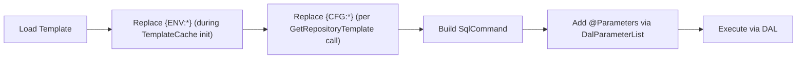

# Template System

RayMigrator uses SQL templates with placeholder substitution for database-agnostic repository operations.

## Template Types

| Template | Purpose |
|----------|---------|
| `Repository_CheckCreate` | Report the repository schema version; create the schema and the `RepositorySchemaVersion` table when missing (ADR-024) |
| `Repository_Upgrade_1` | Schema step 1: create the 11 repository tables with indexes, foreign keys and lookup master data and write version row 1 |
| `Repository_Upgrade_2` | Schema step 2: add the run details to `MigrationRun` and the `MigrationRunSource` lookup, write version row 2; later versions add `Repository_Upgrade_{n}` |
| `Repository_MigratorMeta_CheckInsert` | Register the engine version in `MigratorMeta`, return the `MigratorMetaId` |
| `Repository_Product_CheckInsert` | Ensure product exists |
| `Repository_Environment_CheckInsert` | Ensure environment exists |
| `Repository_Product_Select` | Look up product id read-only (no insert); returns `0` when not registered. Used by Simulate mode (#7) |
| `Repository_Environment_Select` | Look up environment id read-only (no insert); returns `0` when not registered. Used by Simulate mode (#7) |
| `Repository_MigrationRun_Insert` | Create new migration run |
| `Repository_MigrationRun_Update` | Update migration run status |
| `Repository_MigrationRun_SelectOrphaned` | Select open migration runs with their heartbeat age (`MinutesSinceHeartbeat`) |
| `Repository_MigrationRun_FixOrphaned` | Fix an orphaned MigrationRun entry whose heartbeat is older than `@ThresholdMinutes` |
| `Repository_MigrationRun_Heartbeat` | Refresh `LastHeartbeatAt` of a running MigrationRun (every `Repository.HeartbeatIntervalInSeconds`) |
| `Repository_MigrationRecord_FixOrphaned` | Fix orphaned Migration entries for a MigrationRun |
| `Repository_MigrationRecord_Select` | Query migration records |
| `Repository_MigrationRecord_Insert` | Create new migration record |
| `Repository_MigrationRecord_Update` | Update migration record |
| `Repository_MigrationRecord_UpdateRollback` | Update migration record with rollback (FileDown) fields |
| `Repository_MigrationRecord_UpdateHash` | Update hash fields of a migration record |
| `Repository_MigrationRecord_GetInterrupted` | Check for interrupted migrations |
| `Repository_MigrationRun_Select` | Query MigrationRun records for history |
| `Repository_MigrationRecordHistory_Select` | Select the terminal state transitions (MigrationRecordHistory rows) of a product/environment; the `info` run history is built from it (#13) |
| `Repository_Drop` | Drop repository (cleanup) |
| `DatabaseLogging_CheckCreate` | Create logging tables |
| `DatabaseLogging_Insert` | Insert log entry |

| Template | SQL Server | PostgreSQL | MariaDB | MySQL | SQLite |
|----------|:----------:|:----------:|:-------:|:-----:|:------:|
| `DatabaseLogging_CheckCreate` | Active | Active | Active | Active | Active |
| `DatabaseLogging_Insert` | Active | Active | Active | Active | Active |
| `Repository_CheckCreate` | Active | Active | Active | Active | Active |
| `Repository_Upgrade_1` | Active | Active | Active | Active | Active |
| `Repository_Upgrade_2` | Active | Active | Active | Active | Active |
| `Repository_MigratorMeta_CheckInsert` | Active | Active | Active | Active | Active |
| `Repository_Drop` | Active | Active | Active | Active | Active |
| `Repository_Product_CheckInsert` | Active | Active | Active | Active | Active |
| `Repository_Environment_CheckInsert` | Active | Active | Active | Active | Active |
| `Repository_Product_Select` | Active | Active | Active | Active | Active |
| `Repository_Environment_Select` | Active | Active | Active | Active | Active |
| `Repository_MigrationRun_Insert` | Active | Active | Active | Active | Active |
| `Repository_MigrationRun_Update` | Active | Active | Active | Active | Active |
| `Repository_MigrationRun_SelectOrphaned` | Active | Active | Active | Active | Active |
| `Repository_MigrationRun_FixOrphaned` | Active | Active | Active | Active | Active |
| `Repository_MigrationRun_Heartbeat` | Active | Active | Active | Active | Active |
| `Repository_MigrationRun_Select` | Active | Active | Active | Active | Active |
| `Repository_MigrationRecord_Select` | Active | Active | Active | Active | Active |
| `Repository_MigrationRecord_FixOrphaned` | Active | Active | Active | Active | Active |
| `Repository_MigrationRecord_Insert` | Active | Active | Active | Active | Active |
| `Repository_MigrationRecord_Update` | Active | Active | Active | Active | Active |
| `Repository_MigrationRecord_UpdateRollback` | Active | Active | Active | Active | Active |
| `Repository_MigrationRecord_UpdateHash` | Active | Active | Active | Active | Active |
| `Repository_MigrationRecord_GetInterrupted` | Active | Active | Active | Active | Active |
| `Repository_MigrationRecordHistory_Select` | Active | Active | Active | Active | Active |

> **Note:** The 25 templates listed above are shared by all DAL plugins, including the SQLite DAL.

## Template Location

Source templates are stored in each DAL project (e.g., `Database.SqlServer/Templates/`, `Database.PostgreSQL/Templates/`). They are deployed as `<Content>` items that propagate transitively through ProjectReference and as `contentFiles` in NuGet packages:

```xml
<!-- In each DAL .csproj (e.g., Database.SqlServer.csproj) -->
<PropertyGroup>
    <RayMigratorDatabaseType>SqlServer</RayMigratorDatabaseType>
</PropertyGroup>

<!-- Templates as Content (transitive propagation + NuGet contentFiles) -->
<ItemGroup>
    <Content Include="Templates\**\*.sql">
        <CopyToOutputDirectory>PreserveNewest</CopyToOutputDirectory>
        <Link>DataAccessLayers\$(RayMigratorDatabaseType)\%(RecursiveDir)%(Filename)%(Extension)</Link>
        <Pack>true</Pack>
        <PackagePath>contentFiles\any\any\DataAccessLayers\$(RayMigratorDatabaseType)\</PackagePath>
        <PackageCopyToOutput>true</PackageCopyToOutput>
    </Content>
</ItemGroup>
```

Each DAL project also copies its own DLL into the `DataAccessLayers/{Type}/` directory via a post-build target:

```xml
<Target Name="CopyDalToDataAccessLayers" AfterTargets="Build">
    <MakeDir Directories="$(OutputPath)DataAccessLayers\$(RayMigratorDatabaseType)" />
    <Copy SourceFiles="$(TargetPath)"
          DestinationFolder="$(OutputPath)DataAccessLayers\$(RayMigratorDatabaseType)\"
          SkipUnchangedFiles="true" />
</Target>
```

The Console project additionally copies all DAL DLLs into the correct subdirectories via its own post-build target (`CopyDalAssembliesToDataAccessLayers`).

The resulting output directory structure:

```
bin/{Configuration}/{TargetFramework}/
└── DataAccessLayers/
    ├── SqlServer/
    │   ├── Raycoon.RayMigrator.Database.SqlServer.dll
    │   ├── Repository_CheckCreate.sql
    │   ├── Repository_Drop.sql
    │   └── ...
    ├── PostgreSQL/
    │   ├── Raycoon.RayMigrator.Database.PostgreSQL.dll
    │   └── ...
    ├── MariaDb/
    │   └── ...
    ├── MySql/
    │   └── ...
    └── Sqlite/
        └── ...
```

**Runtime access**: `TemplateCache` scans each database type subdirectory for `.sql` files during construction:
```csharp
var dataAccessLayersPath = Path.Combine(
    AppDomain.CurrentDomain.BaseDirectory,
    "DataAccessLayers");          // ConfigurationConstants.DatabaseAccessLayersRootDirectory

// For each subDir in DataAccessLayers/ (e.g., SqlServer/, PostgreSQL/):
Directory.GetFiles(subDir, "*.sql");
```

## Placeholder Types

### Configuration Placeholders: `{CFG:PropertyName}`

Replaced with values from configuration options.

```sql
CREATE TABLE [{CFG:SchemaName}].[{CFG:TableBaseName}MigrationRecord] (
    ...
);
```

**Source**: Configuration section depends on template type:
- `Repository_*` templates → `Repository` options
- `DatabaseLogging_*` templates → `DatabaseLogging` options

**Allowed placeholders** (defined in `ConfigurationConstants.AllowedTemplateVariableNameReplacements`):
- `{CFG:SchemaName}` - Schema name (e.g., `migrations`)
- `{CFG:TableBaseName}` - Table prefix (e.g., `Ray`)

Only these two property names are permitted in `{CFG:*}` placeholders within templates. The replacement uses reflection-based property matching against the passed options object via `ReplacePlaceholdersFromPropertyClass()`.

### Environment Placeholders: `{ENV:VariableName}`

Replaced with environment variable values.

```sql
-- Example: Insert current user
INSERT INTO MigrationRecord (CreatedBy)
VALUES ('{ENV:USERNAME}');
```

### SQL Parameters: `@ParameterName`

Used for parameterized queries (safe from SQL injection).

```sql
INSERT INTO Product (Name, NameLower, CreatedAt)
VALUES (@Name, @NameLower, SYSUTCDATETIME());
```

## Placeholder Resolution Order



`{ENV:*}` placeholders are replaced eagerly when the private `Initialize()` method loads all templates from the filesystem during `TemplateCache` construction. Missing or empty environment variables cause a `ConfigurationValidationException` during initialization. `{CFG:*}` placeholders are replaced later, each time a template is retrieved via `GetRepositoryTemplate<T>()` or `GetTemplate<T>()`, using reflection-based property matching against the passed options object (limited to `AllowedTemplateVariableNameReplacements`). After replacement, any remaining `{CFG:*}` placeholders trigger a `ConfigurationValidationException`.

## Template Structure

### Header Metadata

Each template includes TOML metadata in a standardized format:

```sql
/*
================================================================================
RayMigrator SQL Template
================================================================================
[RayMigratorTemplate]
TemplateType   = "Repository_CheckCreate"
DatabaseType   = "SqlServer"
Author         = "RAYCOON.com GmbH (https://raycoon.com)"
Version        = "2026-10-14.1"

[Description]
Function = """
Reports the schema version of the repository (ADR-024). Creates the schema and the
RepositorySchemaVersion table when they do not exist; creates nothing else. The engine
applies the missing Repository_Upgrade_{n} steps afterwards.
"""

Behaviour = """
- First code: highest applied schema version, 0 when the repository has none
- Second code: 1 when the MigratorMeta table exists, 0 otherwise. With version 0 this
  means a repository of a RayMigrator before 0.17.0, which the engine refuses
- Idempotent; a parallel start on the same repository is serialised with sp_getapplock
"""

[ConfigPlaceholders]
SchemaName    = "Database schema from Repository configuration (e.g., 'ray')"
TableBaseName = "Table name prefix from Repository configuration (e.g., '' or 'rm_')"

[Parameters]
# none

[ReturnValues]
# Format: SELECT 'schemaVersion,unversionedTables,message'
Success_N        = "N (schema version),0|1,RayMigrator repository has schema version [N]"
Success_Legacy   = "0,1,RayMigrator repository tables exist without a schema version"
Success_None     = "0,0,RayMigrator repository does not exist yet"

[ModificationNotes]
Note1 = "SELECT result format: 'schemaVersion,unversionedTables,message' - DO NOT change this format"
Note2 = "No commas allowed in messages"
Note3 = "Creates only the schema and the RepositorySchemaVersion table; the repository tables come from Repository_Upgrade_1"
Note4 = "ResultCode catalog: see TemplateResultCode.cs in Shared project"
================================================================================
*/
```

### Result Convention

Templates return results via SELECT:

```sql
-- Success: ResultCode >= 0
SELECT '1,MigrationRun created successfully';

-- Error: ResultCode < 0
SELECT '-1,Error message without commas';

-- Further integer codes between the result code and the message (Repository_CheckCreate)
SELECT '1,1,RayMigrator repository has schema version [1]';
```

**Format**: `{ResultCode}[,{Code}...],{Message}`

- `ResultCode >= 0`: Success (the code can carry a value such as a new record id or the `MigratorMetaId`)
- `ResultCode < 0`: Error (triggers migration abort)
- Further integer codes before the message carry template-specific information. `Repository_CheckCreate` returns the schema version as its first code and `unversionedTables` as its second (`1` when the `MigratorMeta` table exists, which with version `0` marks a repository of a RayMigrator before 0.17.0); `RepositorySchemaExecutor` decides from them which `Repository_Upgrade_{n}` steps to run and whether to refuse the repository (ADR-024). The parser takes every leading integer token as a code and the rest as the message, so a message must not start with an integer followed by a comma.

## Template Class

**Location**: `Raycoon.RayMigrator.Core/Templates/Template.cs` (namespace: `Raycoon.RayMigrator.Core.Templates`)

Represents a loaded SQL template with its metadata and content. Created by `TemplateCache` when templates are loaded and when `{CFG:*}` placeholders are replaced.

```csharp
public class Template
{
    public TemplateType TemplateType { get; set; } = TemplateType.Undefined;
    public string DatabaseType { get; set; } = string.Empty;
    public string Filename { get; set; } = string.Empty;
    public string Content { get; set; } = string.Empty;

    public override string ToString()
        => $"TemplateType: {TemplateType}, DatabaseType: {DatabaseType}, file: {Filename}";
}
```

## TemplateExecutor

**Location**: `Raycoon.RayMigrator.Infrastructure/TemplateExecutor.cs` (namespace: `Raycoon.RayMigrator.Core`)

All methods are **synchronous** (they internally call async DAL methods with `.GetAwaiter().GetResult()`). The class uses `IMigrationContextAccessor` for per-request context isolation (supporting both CLI and API modes).

### Constructor

```csharp
public TemplateExecutor(TemplateCache templateCache, ILogger<TemplateExecutor> logger, IMigrationContextAccessor ctxAccessor)
```

The constructor stores references but does **not** resolve the repository DAL immediately. DAL resolution is deferred to first use via the lazy `_repository` and `_repositoryDal` properties, which call `InitializeFromContext()` on demand. This supports API endpoints where `MigrationContext` is set after DI resolution. When first accessed, `InitializeFromContext()` reads `Repository.DatabaseType` and `Repository.ConnectionString` from the current `MigrationContext` and calls `DalFactory.TryGetDal()` to obtain the DAL instance.

### Key Methods

```csharp
public class TemplateExecutor
{
    // Repository Setup
    public void RepositoryCheckCreate();   // schema steps through RepositorySchemaExecutor (values of the current context)
    public void RepositoryProductCheckInsert();
    public void RepositoryEnvironmentCheckInsert();
    public bool RepositoryProductSelect();       // read-only lookup (Simulate and read-only commands)
    public bool RepositoryEnvironmentSelect();

    // Migration Run Operations
    public void RepositoryMigrationRunInsert(string migrationRunSettingsJson);
    public void RepositoryMigrationRunUpdate(MigrationRunResult runResult, string? errorCode = null, string? errorMessage = null);
    public bool RepositoryMigrationRunHeartbeat();
    public List<Dictionary<string, object?>> RepositoryMigrationRunSelectOrphaned(int productId, int environmentId);
    public bool RepositoryMigrationRunFixOrphaned(int migrationRunId, int thresholdMinutes);
    public List<Dictionary<string, object?>> RepositoryMigrationRunSelect(int limit);

    // Fix Operations
    public int RepositoryMigrationRecordFixOrphaned(int migrationRunId, MigrationStatus status);

    // Migration Record Operations
    public int RepositoryMigrationInsert(
        int existingMigrationRecordId,
        string filename, string releaseVersion,
        string targetGroupAlias, string targetAlias, int fileOrderId,
        string fileUpHash, string? fileUpConfigHash, string fileUpBlocksHash,
        int fileUpBlocksTotal, string? fileUpConfigJson, bool migrateDownFileExists);

    // Standard overload: manages its own connection
    public void RepositoryMigrationUpdate(int migrationRecordId,
        MigrationStatus migrationStatus, int fileUpBlocksMigrated);
    // Shared-connection overload: caller provides connection + transaction for atomic execution
    public void RepositoryMigrationUpdate(int migrationRecordId,
        MigrationStatus migrationStatus, int fileUpBlocksMigrated,
        DbConnection connection, DbTransaction transaction, int repoCommandTimeoutInSeconds);

    // Standard overload: manages its own connection
    public void RepositoryMigrationUpdateRollback(int migrationRecordId,
        MigrationStatus migrationStatus, string fileDownHash, string? fileDownConfigHash,
        string fileDownBlocksHash, int fileDownBlocksMigrated, int fileDownBlocksTotal,
        string? fileDownConfigJson);
    // Shared-connection overload: caller provides connection + transaction for atomic execution
    public void RepositoryMigrationUpdateRollback(int migrationRecordId,
        MigrationStatus migrationStatus, string fileDownHash, string? fileDownConfigHash,
        string fileDownBlocksHash, int fileDownBlocksMigrated, int fileDownBlocksTotal,
        string? fileDownConfigJson,
        DbConnection connection, DbTransaction transaction, int repoCommandTimeoutInSeconds);

    public void RepositoryMigrationUpdateHash(int migrationRecordId, string fileUpHash,
        string? fileUpConfigHash, string fileUpBlocksHash);
    // Always queries MigrationRunModeId = Migrate: records are only written in Migrate mode,
    // so Simulate and validate-hash (Validate) read the same records as Migrate (#5)
    public List<MigrationRecord> RepositoryMigrationSelect();
    public List<MigrationRecord> RepositoryMigrationRecordHistorySelect();
    public InterruptedMigrationInfo? RepositoryMigrationGetInterrupted();

    // Core Execution — standard (DAL manages connection)
    public TemplateResponse ExecuteScalarWithNegativeResultCodeException(
        Template template, IDal dal, DalSettings dalSettings,
        DalParameterList? dalParameterList, ILogger? logger = null, EventId? eventId = null);

    // The execution and result validation behind it, without context and logging; the schema steps share it
    internal static TemplateResponse ExecuteScalar(
        Template template, IDal dal, DalSettings dalSettings, DalParameterList? dalParameterList);

    // Core Execution — shared-connection overload (caller controls connection/transaction)
    public TemplateResponse ExecuteScalarWithNegativeResultCodeException(
        Template template, IDal dal, DbConnection connection, DbTransaction transaction,
        int commandTimeoutInSeconds, DalParameterList? dalParameterList,
        ILogger? logger = null, EventId? eventId = null);
}
```

### TemplateResponse

**Location**: `Raycoon.RayMigrator.Core/Templates/TemplateResponse.cs` (namespace: `Raycoon.RayMigrator.Core.Templates`)

```csharp
public class TemplateResponse
{
    public int ResultCode { get; set; }            // first code
    public int[] ResultCodes { get; set; } = [];   // every integer code in order; [0] == ResultCode
    public string? ResultMessage { get; set; }
}
```

Templates return a comma-separated string `"ResultCode[,Code...],ResultMessage"`; `ResultCodes` holds every leading integer code and `ResultCode` equals its first entry. A negative `ResultCode` causes `ExecuteScalarWithNegativeResultCodeException` to throw a `TemplateResultException`. Known negative codes (defined in `TemplateResultCode` in `Raycoon.RayMigrator.Shared.Constants`) throw `TemplateResultException`, while unknown negative codes throw `UndefinedTemplateResultException`.

## TemplateCache

**Location**: `Raycoon.RayMigrator.Infrastructure/TemplateCache.cs` (namespace: `Raycoon.RayMigrator.Core.Templates`)

The cache is eagerly initialized at construction time (not lazy-loaded). It takes no options: a host builds one cache per process and validates every configuration it runs against it.

```csharp
public class TemplateCache
{
    private readonly bool _revealSensitiveData;
    private readonly ILogger _logger;
    private Dictionary<string, Dictionary<TemplateType, Template>> _templateDictionary;

    public TemplateCache(bool revealSensitiveData, ILogger<TemplateCache> logger)
    {
        _revealSensitiveData = revealSensitiveData;
        _logger = logger;
        Initialize();                            // Load all templates from filesystem, replace {ENV:*}
    }

    // Returns a Template with {CFG:*} placeholders replaced from the options object
    public Template GetRepositoryTemplate<T>(TemplateType templateType, T propertyClass)
        where T : RepositoryOptions;

    // Generic version for non-repository templates
    public Template GetTemplate<T>(string databaseType, TemplateType templateType, T propertyClass);

    // Returns only the content string with {CFG:*} replaced
    public string GetTemplateContent<T>(string databaseType, TemplateType templateType, T propertyClass);

    // Validates configured DatabaseTypes against loaded templates. The host calls it for every
    // configuration it runs (the CLI pipeline once, after the options are bound).
    public void ValidateConfigurationAgainstTemplateCache(RayMigratorOptions options);

    // Returns all available DatabaseType names from loaded DAL templates (e.g., "SqlServer", "PostgreSQL")
    public List<string> GetAvailableDatabaseTypes();
}
```

### Constructor Parameters

| Parameter | Purpose |
|-----------|---------|
| `revealSensitiveData` | Whether to include sensitive data (paths, env values) in log output. |
| `logger` | Logger instance for template loading diagnostics. |

### Validation

`ValidateConfigurationAgainstTemplateCache(RayMigratorOptions)` is a **public** method that can be called at any time after construction. It validates:

1. The Repository's `DatabaseType` has a matching DAL with templates
2. Every TargetGroup's `DatabaseType` across all Products has a matching DAL with templates

If validation fails, a `ConfigurationValidationException` is thrown with a list of available DatabaseTypes.

`GetAvailableDatabaseTypes()` is a **public** method that returns the list of DatabaseType names for which templates were successfully loaded (e.g., `["SqlServer", "PostgreSQL", "MariaDb", "MySql", "Sqlite"]`).

### Template Loading

Templates are loaded from the filesystem: `DataAccessLayers/{DatabaseType}/*.sql` under the application base directory. SQL template files are delivered as `<Content>` items that propagate transitively through ProjectReference and as `contentFiles` in NuGet packages.

Each template file maps to a `TemplateType` enum value (unrecognized filenames are skipped with a debug log). The cache validates that all `TemplateType` enum values (except `Undefined`) have a corresponding file for each DAL.

## Example: Repository_CheckCreate and the schema steps

The `Version` header of a template is the revision of that file and is maintained per file and per engine; it is not written to the database. The schema version of a repository lives in its `RepositorySchemaVersion` table (ADR-024): `Repository_CheckCreate` creates that table when it is missing and reports the highest applied version, the steps `Repository_Upgrade_{n}` create the schema on top of each other (step 1 the 11 repository tables with their master data) and write their version row, and `Repository_MigratorMeta_CheckInsert` registers the RayMigrator version in `MigratorMeta` (`@RayMigratorVersion`, bound by `RepositorySchemaExecutor`). A schema change ships as a new step template in every DAL and a bump of `RepositorySchema.CurrentVersion`; the next command of the newer RayMigrator (or a host through `IRepositorySchemaService.Ensure`) applies the missing steps and the data stays. Only a repository without a schema version (created before 0.17.0) must be recreated once.

### SQL Server Version

```sql
/*
[RayMigratorTemplate]
TemplateType = "Repository_CheckCreate"
DatabaseType = "SqlServer"
Version = "2026-10-14.1"
*/

SET NOCOUNT ON;
SET XACT_ABORT ON;

BEGIN TRY
	BEGIN TRANSACTION;

	-- Serialise a parallel start on the same repository
	DECLARE @LockResult INT;
	EXEC @LockResult = sp_getapplock @Resource = 'RayMigrator_{CFG:SchemaName}_{CFG:TableBaseName}', @LockMode = 'Exclusive', @LockOwner = 'Transaction', @LockTimeout = 60000;
	IF (@LockResult < 0) BEGIN ROLLBACK TRANSACTION; SELECT '-1,Could not acquire the repository schema lock'; RETURN; END;

	IF SCHEMA_ID('{CFG:SchemaName}') IS NULL EXECUTE('CREATE SCHEMA [{CFG:SchemaName}];');

	IF OBJECT_ID('{CFG:SchemaName}.{CFG:TableBaseName}RepositorySchemaVersion', 'U') IS NULL
		CREATE TABLE [{CFG:SchemaName}].[{CFG:TableBaseName}RepositorySchemaVersion] (
			Version int NOT NULL, AppliedAt datetime2(3) NOT NULL, RayMigratorVersion nvarchar(100) NOT NULL,
			CONSTRAINT pk_{CFG:TableBaseName}RepositorySchemaVersion PRIMARY KEY ( Version ));

	DECLARE @SchemaVersion INT = (SELECT COALESCE(MAX([Version]), 0) FROM [{CFG:SchemaName}].[{CFG:TableBaseName}RepositorySchemaVersion]);
	DECLARE @UnversionedTables INT = CASE WHEN OBJECT_ID('{CFG:SchemaName}.{CFG:TableBaseName}MigratorMeta', 'U') IS NULL THEN 0 ELSE 1 END;

	COMMIT TRANSACTION;

	-- 'schemaVersion,unversionedTables,message'
	SELECT CAST(@SchemaVersion AS VARCHAR(10)) + ',' + CAST(@UnversionedTables AS VARCHAR(1)) + ',RayMigrator repository has schema version [' + CAST(@SchemaVersion AS VARCHAR(10)) + ']';
END TRY
BEGIN CATCH
    IF (@@TRANCOUNT > 0) ROLLBACK TRANSACTION;
    ;THROW;
END CATCH;
```

`Repository_Upgrade_1.sql` runs under the same lock, creates the 11 tables only when `MigratorMeta` does not exist (every key, foreign key and index name starts with `pk_{CFG:TableBaseName}`, `fk_{CFG:TableBaseName}`, `ix_{CFG:TableBaseName}` or `uix_{CFG:TableBaseName}`), inserts the lookup master data, writes `(1, SYSUTCDATETIME(), @RayMigratorVersion)` into `RepositorySchemaVersion` unless row 1 exists, and returns `'1,RayMigrator repository schema version [1] applied: 11 tables with master data'`.

### PostgreSQL Version

```sql
/*
[RayMigratorTemplate]
TemplateType = "Repository_CheckCreate"
DatabaseType = "PostgreSQL"
Version = "2026-10-14.1"
*/

DO $$
DECLARE
    v_schema_version INT;
    v_unversioned_tables INT;
BEGIN
    PERFORM pg_advisory_xact_lock(hashtext('RayMigrator_{CFG:SchemaName}_{CFG:TableBaseName}'));

    CREATE SCHEMA IF NOT EXISTS {CFG:SchemaName};

    CREATE TABLE IF NOT EXISTS {CFG:SchemaName}.{CFG:TableBaseName}repository_schema_version (
        version INT NOT NULL, applied_at TIMESTAMPTZ NOT NULL, raymigrator_version TEXT NOT NULL,
        CONSTRAINT pk_{CFG:TableBaseName}repository_schema_version PRIMARY KEY (version));

    SELECT COALESCE(MAX(version), 0) INTO v_schema_version FROM {CFG:SchemaName}.{CFG:TableBaseName}repository_schema_version;
    SELECT CASE WHEN EXISTS (SELECT 1 FROM information_schema.tables WHERE table_schema = '{CFG:SchemaName}' AND table_name = '{CFG:TableBaseName}migrator_meta') THEN 1 ELSE 0 END INTO v_unversioned_tables;

    RAISE NOTICE '%,%,RayMigrator repository has schema version [%]', v_schema_version, v_unversioned_tables, v_schema_version;
END $$;
```

The DO block is delimited with `$$` and nothing else: the DAL replaces `$$` with a tag unique to the call before it substitutes parameter values (see [Parameter Substitution](sql-dialects.md#parameter-substitution)).

## Best Practices

1. **Always use parameterized queries** for user-provided values
2. **Return standardized result format** for consistent parsing
3. **Include version metadata** in template headers
4. **Document placeholder usage** in template comments
5. **Handle errors with CATCH blocks** and return negative codes

## Related Documentation

- [DAL Architecture](dal-architecture.md) - Database layer overview
- [Repository Schema](repository-schema.md) - Table structures
- [SQL Dialects](sql-dialects.md) - Database-specific syntax
- [Template Customization](../09-extending/template-customization.md) - TemplateResultCode catalog, full template list with descriptions
