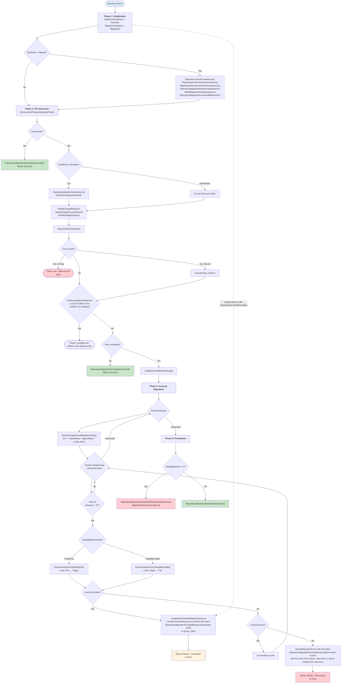
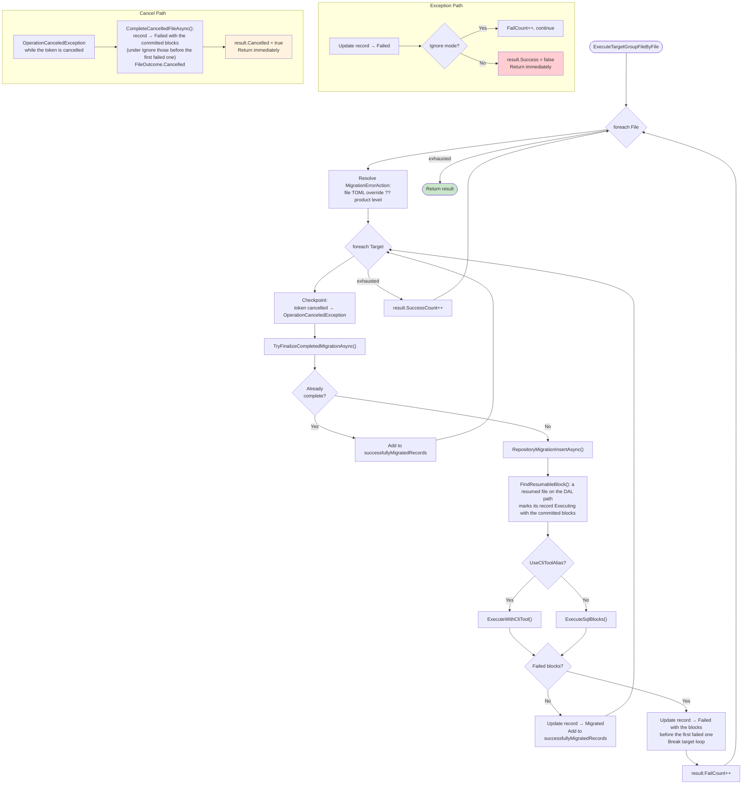
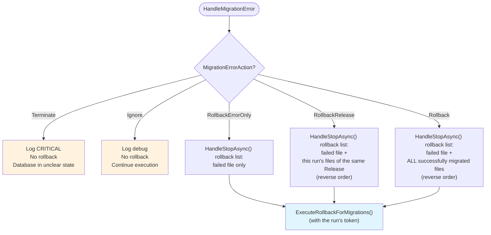
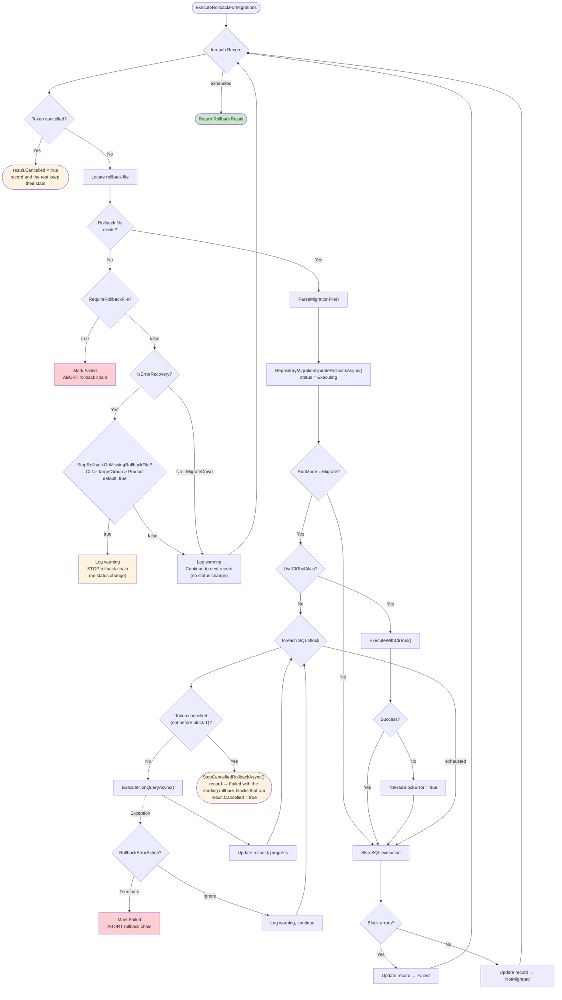
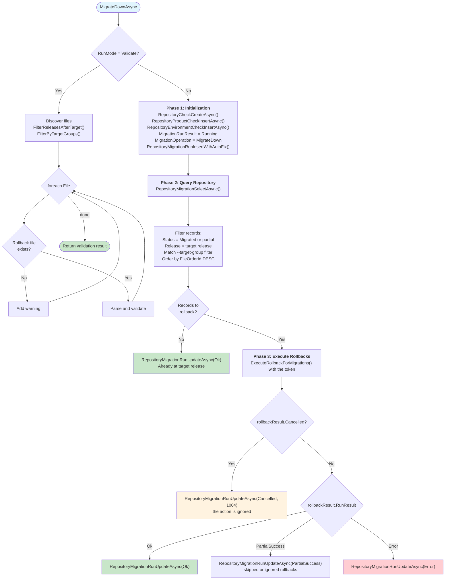
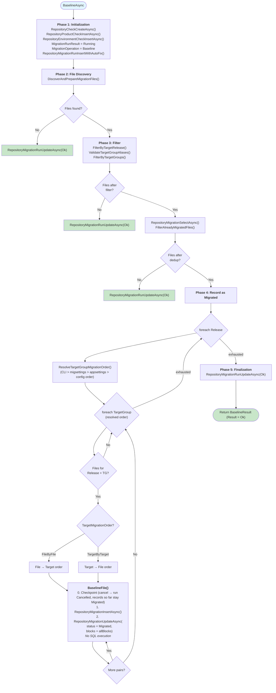

# Command Activity Diagrams

Activity diagrams for the main migration commands. All flows are implemented in `MigrationService.cs` within the Services project. Every flow checks the token of the run at its checkpoints (before every file, target and block); the cancel paths are drawn in the diagrams, the semantics are described in [Error Handling: Cancellation](../02-core-concepts/error-handling.md#cancellation).

## migrate-up

### Main Flow

### TargetGroup Execution (FileByFile Mode)

In FileByFile mode, the outer loop is files, the inner loop is targets. Each file is applied to all targets before moving to the next file.

### Error Handling (HandleMigrationError)

When a TargetGroup execution fails (non-Ignore), this method determines the rollback scope based on the resolved `MigrationErrorAction`. The rollback actions go through `HandleStopAsync`, which also runs the rollback of a cancel action (`HandleCancelActionAsync` maps `RollbackRun`, `RollbackFile` and `RollbackRelease` to `Rollback`, `RollbackErrorOnly` and `RollbackRelease` and passes `CancellationToken.None`).

### Rollback Execution (ExecuteRollbackForMigrations)

Shared by both migrate-up (error recovery and the rollback of a cancel action) and migrate-down (explicit rollback). Processes records in the provided order and is fail-fast by default.

The atomic rollback and a rollback through a CLI tool run without the token and always complete; the cancel takes effect before the next record.

---

## migrate-down

migrate-down rolls back all migrations after the target release. It reuses `ExecuteRollbackForMigrations` (see [above](#rollback-execution-executerollbackformigrations)).

**Key difference from migrate-up**: migrate-down operates on a flat list of repository records (ordered by FileOrderId descending), not the nested Release → TargetGroup → Target loop structure.

---

## Baseline

Baseline marks migration files as applied in the repository **without executing any SQL**. Uses the same Release → TargetGroup loop as migrate-up but skips all SQL execution.

**Note**: Baseline stamps `MigrationOperation = Baseline` (110) on the run and on every record it writes, so the run history and the `MigrationRecord` rows distinguish baselined files from executed ones (`MigrateUp`). The records still reach `MigrationStatus = Migrated`, so `FilterAlreadyMigratedFiles()` skips them on the next migrate-up.

---

## Related Documentation

- [migration-service.md](migration-service.md) — Method signatures and phase descriptions
- [block-execution.md](block-execution.md) — SQL block parsing and execution details
- [file-discovery.md](file-discovery.md) — Migration file scanning and filtering
- [../02-core-concepts/error-handling.md](../02-core-concepts/error-handling.md) — MigrationErrorAction and RollbackErrorAction enums
- [../02-core-concepts/execution-modes.md](../02-core-concepts/execution-modes.md) — TargetMigrationOrder and RunMode details
