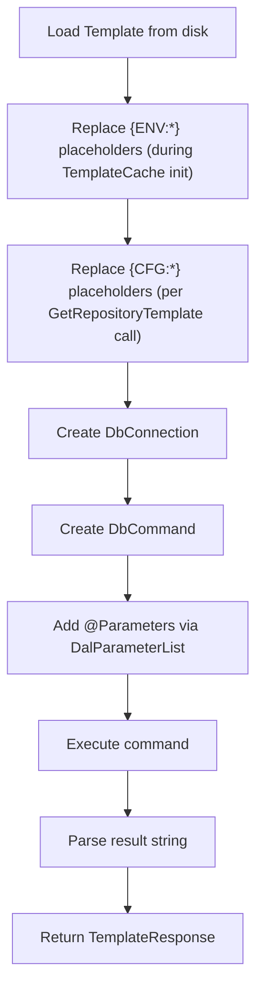

# Template Executor

The `TemplateExecutor` loads and executes SQL templates with placeholder substitution.

## Overview

**Location**: `Raycoon.RayMigrator.Infrastructure/TemplateExecutor.cs`

> **Note**: The file lives in the Infrastructure project but uses the `Raycoon.RayMigrator.Core` namespace.

The TemplateExecutor handles:
- Loading SQL templates from disk
- Replacing `{CFG:*}` and `{ENV:*}` placeholders
- Building parameterized SQL commands
- Executing and parsing results

## Dependencies

```csharp
public class TemplateExecutor
{
    private readonly TemplateCache _templateCache;
    private readonly ILogger<TemplateExecutor> _logger;
    private readonly IMigrationContextAccessor _ctxAccessor;
    private RepositoryOptions? _repositoryBacking;
    private IDal? _repositoryDalBacking;

    /// Lazily-initialized repository options. Defers context access to support API endpoints
    /// where MigrationContext is set after DI resolution.
    private RepositoryOptions _repository
    {
        get
        {
            if (_repositoryBacking == null) InitializeFromContext();
            return _repositoryBacking!;
        }
    }

    private IDal _repositoryDal
    {
        get
        {
            if (_repositoryBacking == null) InitializeFromContext();
            return _repositoryDalBacking!;
        }
    }

    public TemplateExecutor(
        TemplateCache templateCache,
        ILogger<TemplateExecutor> logger,
        IMigrationContextAccessor ctxAccessor)
    {
        _templateCache = templateCache;
        _logger = logger;
        _ctxAccessor = ctxAccessor;
        // Context access is deferred to first use (not constructor time)
        // to support API endpoints where MigrationContext is set after DI resolution.
    }

    private void InitializeFromContext()
    {
        _repositoryBacking = _ctxAccessor.Current.RayMigratorOptions.Repository!;
        if (DalFactory.TryGetDal(_repositoryBacking.DatabaseType!, _repositoryBacking.ConnectionString!, out var dal))
            _repositoryDalBacking = dal!;
    }
}
```

## Key Methods

Every public method is **asynchronous**: it returns a `Task`, takes `CancellationToken cancellationToken = default` as its last parameter and awaits the DAL with it; no method blocks on the DAL. A call that fails after the token was cancelled ends with the DAL's `OperationCanceledException` instead of a `TemplateExecutionException`. `MigrationService` hands the token of a run to the repository reads (except the two around the insert of the run row) and never to the repository writes on their own connection, so a cancel never stops a write that has started; on the atomic path the record updates run inside the file's transaction and take the token with it (see [Error Handling: Cancellation](../02-core-concepts/error-handling.md#cancellation)).

### Repository Setup

```csharp
public Task RepositoryCheckCreateAsync(CancellationToken cancellationToken = default);
public Task RepositoryProductCheckInsertAsync(CancellationToken cancellationToken = default);
public Task RepositoryEnvironmentCheckInsertAsync(CancellationToken cancellationToken = default);
public Task<bool> RepositoryProductSelectAsync(CancellationToken cancellationToken = default);
public Task<bool> RepositoryEnvironmentSelectAsync(CancellationToken cancellationToken = default);
```

- `RepositoryCheckCreateAsync` brings the repository to the schema version of the run and registers the engine version (ADR-024). It delegates to `RepositorySchemaExecutor` (see below) with the repository, `MigrationContext.RepositorySchemaTargetVersion` and the engine version of the current context, and stores the `MigratorMetaId` of the outcome in `MigrationState.MigratorMetaId`. The executor runs `Repository_CheckCreate` (no parameters, EventId `100`), which reports the schema version found and whether unversioned tables exist; refuses a repository without a version or newer than the target with `RepositorySchemaException`; runs every missing `Repository_Upgrade_{n}` in order (`@RayMigratorVersion`, EventId `101`, the step must return its own number); logs a created or upgraded repository at Information level; and executes `Repository_MigratorMeta_CheckInsert` (`@RayMigratorVersion`, `@RepositoryDatabaseType`, EventId `102`), whose `ResultCode` is the `MigratorMetaId`.
- `RepositoryProductCheckInsertAsync` passes `@Name` (the product alias from `RayMigratorConsoleOptions.Product`) and `@NameLower` (the lowercase invariant of that name), stores the returned `ResultCode` as `MigrationState.ProductId` (EventId `120`).
- `RepositoryEnvironmentCheckInsertAsync` passes `@Name` (the environment name from `RayMigratorConsoleOptions.Environment`) and `@NameLower` (the lowercase invariant of that name), stores the returned `ResultCode` as `MigrationState.EnvironmentId` (EventId `121`).
- `RepositoryProductSelectAsync` and `RepositoryEnvironmentSelectAsync` look the ids up without inserting (EventIds `122`, `123`) for the commands that must not write the repository; the id is `0` when the row does not exist, and the return value says whether it does.

### Schema Steps (`RepositorySchemaExecutor`)

The schema steps live in `RepositorySchemaExecutor` (`Raycoon.RayMigrator.Infrastructure/RepositorySchemaExecutor.cs`, namespace `Raycoon.RayMigrator.Core`), which needs no migration context:

```csharp
public RepositorySchemaExecutor(TemplateCache templateCache, ILogger logger, RepositoryOptions repository,
    IDal repositoryDal, string rayMigratorVersion, int targetVersion, Func<object>? logContext = null);

public Task<RepositorySchemaOutcome> EnsureAsync(CancellationToken cancellationToken = default);   // RepositorySchemaOutcome(VersionBefore, VersionAfter, MigratorMetaId)
public Task<int> CheckVersionAsync(CancellationToken cancellationToken = default);                // the schema version, no step applied
```

`RepositoryCheckCreateAsync` creates it with the values of the current context, so its log lines carry the context of the run. `RepositorySchemaService` (`IRepositorySchemaService.EnsureAsync(RepositoryOptions, CancellationToken)`) creates it from the repository options alone, with `RepositorySchema.CurrentVersion` as target, for a host that creates or upgrades a repository without a run. A step that fails because a parallel start applied it meanwhile (SQLite cannot make `ADD COLUMN` idempotent) is skipped when a re-read of the version shows it applied.

`CheckVersionAsync` reads the schema version through `Repository_CheckCreate` and applies no step; `EnsureAsync` starts with it. Like every command, the check creates the empty schema version table (on SQL Server and PostgreSQL also the schema) when it is missing; it refuses a repository with tables but no schema version and one newer than the target with `RepositorySchemaException`. `RepositoryMaintenanceService` uses it to check a repository before a cleanup.

### Retention Templates (`RepositoryMaintenanceExecutor`)

`RepositoryMaintenanceExecutor` (`Raycoon.RayMigrator.Infrastructure/RepositoryMaintenanceExecutor.cs`, namespace `Raycoon.RayMigrator.Core`) runs the four retention templates of one repository without a migration context (ADR-027):

```csharp
public RepositoryMaintenanceExecutor(TemplateCache templateCache, RepositoryOptions repository, IDal repositoryDal);

public Task<long> CountHistoryAsync(DateTime cutoffUtc, CancellationToken cancellationToken = default);           // Repository_MigrationRecordHistory_Count
public Task<int> DeleteHistoryAsync(DateTime cutoffUtc, int batchSize, CancellationToken cancellationToken = default); // Repository_MigrationRecordHistory_Delete
public Task<long?> CountLogAsync(DateTime cutoffUtc, CancellationToken cancellationToken = default);             // DatabaseLogging_Count with @ExistsOnly = 0; null without a log table
public Task<bool> LogTableExistsAsync(CancellationToken cancellationToken = default);                              // DatabaseLogging_Count with @ExistsOnly = 1, no count
public Task<int> DeleteLogAsync(DateTime cutoffUtc, int batchSize, CancellationToken cancellationToken = default);     // DatabaseLogging_Delete
```

Every template spares the rows of a run that is still open; the log templates run under the schema and prefix of the repository and join its `MigrationRun`. The cutoff goes to `@CutoffUtc` as UTC text with whole seconds (`CutoffFormat`, `yyyy-MM-dd HH:mm:ss`). Each delete batch is one statement in autocommit. Every template runs with the command timeout of the repository but without its retries (`MaxRetries` = 0): a statement that timed out, and on SQLite one that reports BUSY after its busy timeout, would wait the whole command timeout again on every retry; the next batch or the next call takes a failed batch up. `LogTableExistsAsync` asks for the log table without a count, so a cleanup does not read a large log whole before its first batch; `CountLogAsync` counts, for the dry run. Both refuse a result without the second code with a `TemplateResultException`. `RepositoryMaintenanceService` runs the batches; see [Repository Schema: Retention](../03-database-layer/repository-schema.md#retention).

### Migration Run Operations

```csharp
public Task RepositoryMigrationRunInsertAsync(string migrationRunSettingsJson, CancellationToken cancellationToken = default);
public Task RepositoryMigrationRunUpdateAsync(MigrationRunResult runResult, string? errorCode = null, string? errorMessage = null,
    CancellationToken cancellationToken = default);
public Task<bool> RepositoryMigrationRunHeartbeatAsync(CancellationToken cancellationToken = default);
public Task<List<Dictionary<string, object?>>> RepositoryMigrationRunSelectOrphanedAsync(int productId, int environmentId,
    CancellationToken cancellationToken = default);
public Task<bool> RepositoryMigrationRunFixOrphanedAsync(int migrationRunId, int thresholdMinutes, CancellationToken cancellationToken = default);
public Task<List<Dictionary<string, object?>>> RepositoryMigrationRunSelectAsync(int limit, CancellationToken cancellationToken = default);
```

### Fix Operations

```csharp
public Task<int> RepositoryMigrationRecordFixOrphanedAsync(int migrationRunId, MigrationStatus status, CancellationToken cancellationToken = default);
```

### Migration Record Operations

```csharp
public Task<int> RepositoryMigrationInsertAsync(int existingMigrationRecordId, string filename,
    string releaseVersion, string targetGroupAlias, string targetAlias,
    int fileOrderId, string fileUpHash, string? fileUpConfigHash,
    string fileUpBlocksHash, int fileUpBlocksTotal, string? fileUpConfigJson,
    bool migrateDownFileExists, CancellationToken cancellationToken = default);

// Standard overload (uses the internally-managed repository connection)
public Task RepositoryMigrationUpdateAsync(int migrationRecordId,
    MigrationStatus migrationStatus, int fileUpBlocksMigrated, CancellationToken cancellationToken = default);

// Atomic overload (uses caller-provided shared connection+transaction)
public Task RepositoryMigrationUpdateAsync(int migrationRecordId,
    MigrationStatus migrationStatus, int fileUpBlocksMigrated,
    DbConnection connection, DbTransaction transaction,
    int repoCommandTimeoutInSeconds, CancellationToken cancellationToken = default);

// Standard overload (uses the internally-managed repository connection)
public Task RepositoryMigrationUpdateRollbackAsync(int migrationRecordId,
    MigrationStatus migrationStatus, string fileDownHash, string? fileDownConfigHash,
    string fileDownBlocksHash, int fileDownBlocksMigrated, int fileDownBlocksTotal, string? fileDownConfigJson,
    CancellationToken cancellationToken = default);

// Atomic overload (uses caller-provided shared connection+transaction)
public Task RepositoryMigrationUpdateRollbackAsync(int migrationRecordId,
    MigrationStatus migrationStatus, string fileDownHash, string? fileDownConfigHash,
    string fileDownBlocksHash, int fileDownBlocksMigrated, int fileDownBlocksTotal, string? fileDownConfigJson,
    DbConnection connection, DbTransaction transaction,
    int repoCommandTimeoutInSeconds, CancellationToken cancellationToken = default);

public Task RepositoryMigrationUpdateHashAsync(int migrationRecordId, string fileUpHash,
    string? fileUpConfigHash, string fileUpBlocksHash, CancellationToken cancellationToken = default);
public Task<List<MigrationRecord>> RepositoryMigrationSelectAsync(CancellationToken cancellationToken = default);
public Task<List<MigrationRecord>> RepositoryMigrationRecordHistorySelectAsync(CancellationToken cancellationToken = default);
public Task<InterruptedMigrationInfo?> RepositoryMigrationGetInterruptedAsync(CancellationToken cancellationToken = default);
```

The atomic overloads of `RepositoryMigrationUpdateAsync` and `RepositoryMigrationUpdateRollbackAsync` accept a `DbConnection`, `DbTransaction`, and `repoCommandTimeoutInSeconds`. They execute the repository update on the caller-supplied connection within the caller's active transaction. This is used exclusively by `ExecuteSqlBlocksAtomic` and `ExecuteRollbackBlocksAtomic` in `MigrationService` to guarantee that SQL blocks and repository status writes either all commit or all roll back together. See [Atomic Shared Connection](migration-service.md#atomic-shared-connection-execution) for the full pattern.

`RepositoryMigrationSelectAsync` and `RepositoryMigrationRecordHistorySelectAsync` map their rows with `MapMigrationRecord`, since both selects share one column contract. The rows carry `StartedAt` and `FinishedAt` (as `DateTimeKind.Utc` on every engine, by the rules of `RepositoryRowMapper` of the read model: a value without a kind is UTC, a local one is converted, SQLite text is parsed as UTC), which `TargetGroupStatus.LastMigrationDate` reads; a row without the columns, from the selects of an external DAL written for an engine before 0.20.0, maps with null dates. Apart from the counts of the retention, `RepositoryMigrationRecordHistorySelectAsync` is the only reader of `MigrationRecordHistory` in the engine (the run history of `info`), and no engine code reads `MigrationLog` ([ADR-027](../arc42/09-Architecture-Decisions.md#adr-027-the-engine-deletes-log-and-history-rows-on-a-hosts-request-and-never-reads-them-for-a-decision)).

`RepositoryMigrationSelectAsync` always binds `MigrationRunModeId = Migrate`, independently of the run mode of the current `MigrationContext`: `MigrationRecord` rows are only ever written by runs in Migrate mode, so this is the only filter value that can match. Deriving the filter from the context run mode made `validate-hash` (which ran in Validate mode at the time; since #6 every non-migrate command runs in Migrate mode) query an empty record set (#5); the former `overrideRunMode` parameter that `migrate-up`/`migrate-down` used to pass for Simulate mode is therefore gone.

### Core Execution

```csharp
// Standard overload — creates its own connection using DalSettings
public Task<TemplateResponse> ExecuteScalarWithNegativeResultCodeExceptionAsync(
    Template template, IDal dal, DalSettings dalSettings,
    DalParameterList? dalParameterList, ILogger? logger = null, EventId? eventId = null,
    CancellationToken cancellationToken = default);

// Atomic overload — executes on caller-provided connection+transaction
public Task<TemplateResponse> ExecuteScalarWithNegativeResultCodeExceptionAsync(
    Template template, IDal dal, DbConnection connection, DbTransaction transaction,
    int commandTimeoutInSeconds, DalParameterList? dalParameterList,
    ILogger? logger = null, EventId? eventId = null, CancellationToken cancellationToken = default);

// Shared execution of the standard overload — no context, no logging
internal static Task<TemplateResponse> ExecuteScalarAsync(
    Template template, IDal dal, DalSettings dalSettings, DalParameterList? dalParameterList,
    CancellationToken cancellationToken = default);

// The scalar as the DAL read it, for a caller that validates the result itself (the retention counts)
internal static Task<object?> ExecuteScalarValueAsync(
    Template template, IDal dal, DalSettings dalSettings, DalParameterList? dalParameterList,
    CancellationToken cancellationToken = default);
```

The atomic overload is used internally by the shared-connection atomic methods (`RepositoryMigrationUpdateAsync` and `RepositoryMigrationUpdateRollbackAsync` with connection/transaction parameters) to execute the repository update within the caller's active transaction.

The standard overload runs the template through the static `ExecuteScalarAsync`, which executes it on the DAL and validates the result contract, and then writes the Debug line with the current migration context. `RepositorySchemaExecutor` calls `ExecuteScalarAsync` directly, because its steps also run without a context, and writes that line itself. `RepositoryMaintenanceExecutor` reads the counts through `ExecuteScalarValueAsync`, because a count may exceed the `int` range of `ResultCode` and is read as a `long`.

## TemplateResponse

```csharp
public class TemplateResponse
{
    public int ResultCode { get; set; }            // first code
    public int[] ResultCodes { get; set; } = [];   // every integer code in order; [0] == ResultCode
    public string? ResultMessage { get; set; }

    public override string ToString()
    {
        string additionalCodes = ResultCodes.Length > 1 ? $" (codes: {string.Join(", ", ResultCodes)})" : string.Empty;
        return $"ResultCode: {ResultCode}{additionalCodes}, ResultMessage: {(string.IsNullOrWhiteSpace(ResultMessage) ? "{NullOrEmpty}" : ResultMessage)}";
    }
}
```

## Execution Flow



## Placeholder Resolution

Placeholder resolution happens in two stages: during `TemplateCache` initialization and during method execution.

### Configuration Placeholders (`{CFG:*}`)

Resolved by `TemplateCache.GetRepositoryTemplate()` using reflection-based property matching:

```csharp
// TemplateCache returns a Template with {CFG:*} already replaced
var template = _templateCache.GetRepositoryTemplate(templateType, _repository);
// e.g., {CFG:SchemaName} → "migrations", {CFG:TableBaseName} → "rm_"
```

The `GetRepositoryTemplate<T>()` method calls `ReplacePlaceholdersFromPropertyClass()` which uses regex to find `{CFG:PropertyName}` patterns and replaces them with matching property values from the passed options object (e.g., `RepositoryOptions`). After replacement, `GetRepositoryTemplate<T>()` and `GetTemplate<T>()` validate that no `{CFG:*}` placeholders remain — if any are found, a `ConfigurationValidationException` is thrown.

### Environment Placeholders (`{ENV:*}`)

Resolved during `TemplateCache` initialization via `EnvironmentVariableReplacer`:

```csharp
// During TemplateCache.Initialize():
EnvironmentVariableReplacer.TryReplaceStringContainingEnvironmentVariableReferences(
    content, out var replacedContent, out var variableReplacements);
```

All `{ENV:*}` placeholders in templates are replaced when the cache loads — before any template is used by `TemplateExecutor`.

### SQL Parameters (`@ParameterName`)

Passed via `DalParameterList` objects to the DAL:

```csharp
DalParameterList dalParameterList = new DalParameterList();
dalParameterList.AddParameter(new DalParameter("ProductId", _ctxAccessor.Current.MigrationState.ProductId, typeof(int)));
dalParameterList.AddParameter(new DalParameter("EnvironmentId", _ctxAccessor.Current.MigrationState.EnvironmentId, typeof(int)));

// DAL handles parameter binding internally
var response = await ExecuteScalarWithNegativeResultCodeExceptionAsync(template, _repositoryDal, dalSettings, dalParameterList, _logger, eventId, cancellationToken);
```

## Usage Example

### Executing a Template

```csharp
public async Task RepositoryProductCheckInsertAsync(CancellationToken cancellationToken = default)
{
    var templateType = TemplateType.Repository_Product_CheckInsert;
    var eventId = MigrationEvent.TemplateExecutionRepositoryProductCheckInsert;
    string productName = _ctxAccessor.Current.RayMigratorConsoleOptions.Product;

    // Build parameter list
    DalParameterList dalParameterList = new DalParameterList();
    dalParameterList.AddParameter(new DalParameter("Name", productName, typeof(string)));
    dalParameterList.AddParameter(new DalParameter("NameLower", productName.ToLowerInvariant(), typeof(string)));

    // Get the template from the cache ({CFG:*} placeholders replaced here)
    var template = _templateCache.GetRepositoryTemplate(templateType, _repository);

    // Execute via DAL, awaited with the token
    var templateResponse = await ExecuteScalarWithNegativeResultCodeExceptionAsync(
        template, _repositoryDal, _repository.GetDalSettings(),
        dalParameterList, _logger, eventId, cancellationToken);

    // ResultCode is used as the output value (here the ProductId)
    _ctxAccessor.Current.MigrationState.ProductId = templateResponse.ResultCode;
}
```

The schema steps follow the same pattern inside `RepositorySchemaExecutor`; `Repository_MigratorMeta_CheckInsert` binds `@RayMigratorVersion` and `@RepositoryDatabaseType`, and its `ResultCode` is the `MigratorMetaId` (ADR-024).

### Parsing Results

Templates return a comma-separated string: `"ResultCode[,Code...],ResultMessage"`. The `GetValidatedTemplateResponseFromExecuteScalar()` method (internal static, called by `ExecuteScalarAsync` and the atomic overload) parses this into a `TemplateResponse`: every leading integer token becomes a code (`ResultCodes`, the first one is `ResultCode`) and the rest is `ResultMessage`, so a message that contains commas stays intact. If the result is null or empty, or its first token is not an integer, a `TemplateResultException` is thrown. A negative `ResultCode` throws either a `TemplateResultException` (if the code is registered in `TemplateResultCode.IsKnown()`) or an `UndefinedTemplateResultException` (for unrecognized negative codes from custom templates). A non-negative `ResultCode` indicates success and is often used as an output ID value.

Additionally, `RepositoryMigrationRunInsertAsync` catches `TemplateResultException` with `ResultCode == -2` specifically and wraps it in a `MigrationAlreadyRunningException` to signal parallel run prevention.

## Template Cache

**Location**: `Raycoon.RayMigrator.Infrastructure/TemplateCache.cs`

> **Note**: The file lives in the Infrastructure project but uses the `Raycoon.RayMigrator.Core.Templates` namespace.

The `TemplateCache` is eagerly initialized at construction time (not lazy-loaded). It loads all SQL templates from the `DataAccessLayers/{Type}/` filesystem directories, replaces `{ENV:*}` placeholders, and checks that every template type exists for each loaded database type. It does not depend on a configuration: a host builds one cache per process and calls `ValidateConfigurationAgainstTemplateCache(options)` for each configuration it runs, which checks that the repository and every target group name a database type with templates. The CLI pipeline does that right after building the cache.

**Constructor**:

```csharp
public TemplateCache(bool revealSensitiveData, ILogger<TemplateCache> logger)
```

- The constructor loads the templates of every DAL folder; it knows no configuration.
- The host calls `ValidateConfigurationAgainstTemplateCache(options)` for each configuration it runs (the CLI pipeline once, after the options are bound) to ensure all configured `DatabaseType` values have matching DAL templates.

**Key public methods**:

- `ValidateConfigurationAgainstTemplateCache(RayMigratorOptions options)` -- Validates that the Repository and all TargetGroup `DatabaseType` values have matching templates in the cache. The CLI pipeline calls it once after the options are bound; a host calls it for every configuration it runs.
- `GetAvailableDatabaseTypes()` -- Returns the list of all discovered DAL database type names (loaded from `DataAccessLayers/` subdirectories).
- `GetRepositoryTemplate<T>(TemplateType, T) where T : RepositoryOptions` -- Returns a template with `{CFG:*}` placeholders replaced using the passed `RepositoryOptions` property class. The database type is inferred from `T.DatabaseType`. Throws `ConfigurationValidationException` if unreplaced `{CFG:*}` placeholders remain.
- `GetTemplate<T>(string databaseType, TemplateType, T)` -- Same as above but for non-repository templates, requiring an explicit `databaseType` parameter.
- `GetTemplateContent<T>(string databaseType, TemplateType, T)` -- Returns only the replaced content string (not a `Template` object). Unlike `GetTemplate` and `GetRepositoryTemplate`, this method does not validate that all `{CFG:*}` placeholders were replaced.

For details on template file format, directory layout, and the full list of template types, see [Template System](../03-database-layer/template-system.md).

## Error Handling

All template methods are asynchronous and propagate exceptions to the caller. There are four exception categories:

1. **`TemplateExecutionException`** -- Wraps any exception thrown by the DAL during `ExecuteScalarAsync` or `ExecuteReaderAsync` calls while the token is not cancelled. Indicates a connection, timeout, or SQL syntax error at the database level.

2. **`TemplateResultException`** -- Thrown when the template returns a negative `ResultCode` that is registered in `TemplateResultCode.IsKnown()`. Includes the `ResultCode` property for programmatic handling. Also thrown when the template returns null or an empty result.

3. **`UndefinedTemplateResultException`** (subclass of `TemplateResultException`) -- Thrown when the template returns a negative `ResultCode` that is not in the known catalog (e.g., from user-customized templates).

4. **`OperationCanceledException`** -- A DAL call that fails after the token was cancelled ends with the DAL's `OperationCanceledException`, which carries the token, whatever the provider reported; it is not wrapped. Its message names a database error that met the cancel, which stays its inner exception.

```csharp
public async Task<TemplateResponse> ExecuteScalarWithNegativeResultCodeExceptionAsync(
    Template template, IDal dal, DalSettings dalSettings,
    DalParameterList? dalParameterList, ILogger? logger = null, EventId? eventId = null,
    CancellationToken cancellationToken = default)
{
    // 1. Executes template via DAL (ExecuteScalarAsync, in the static ExecuteScalarAsync)
    //    -> throws OperationCanceledException when the token was cancelled
    //    -> throws TemplateExecutionException on DAL failure
    // 2. Parses result via GetValidatedTemplateResponseFromExecuteScalar
    //    -> throws TemplateResultException on null/empty result
    //    -> throws TemplateResultException on known negative ResultCode
    //    -> throws UndefinedTemplateResultException on unknown negative ResultCode
    // 3. Returns TemplateResponse with ResultCode and ResultMessage
}
```

Some methods use `ExecuteReaderAsync` directly (e.g., `RepositoryMigrationSelectAsync`, `RepositoryMigrationRunSelectOrphanedAsync`, `RepositoryMigrationRunSelectAsync`) and wrap DAL exceptions in `TemplateExecutionException` themselves, except a failure after the cancellation.

## Related Documentation

- [Template System](../03-database-layer/template-system.md) - Template format
- [DAL Architecture](../03-database-layer/dal-architecture.md) - Connection creators
- [Migration Service](migration-service.md) - Service usage
- [Template Customization](../09-extending/template-customization.md) - TemplateResultCode catalog, template list
