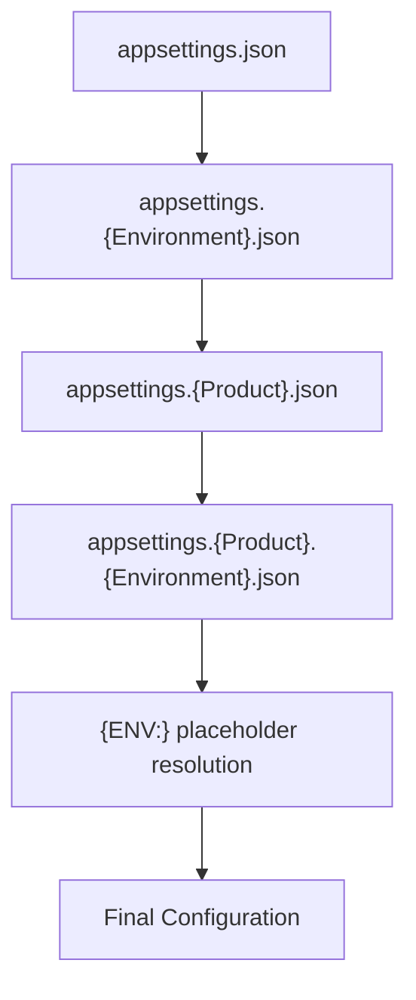

# Global Options

Options available across all RayMigrator commands.

## Syntax

```bash
raymigrator <command> [command-options] [global-options]
```

## Global Options

### --startup-info (-si)

Controls display of application information at startup.

| Value | Description |
|-------|-------------|
| `true` | Show version, copyright, system info (default) |
| `false` | Suppress startup information |

**Example:**
```bash
# Quiet mode for scripts
raymigrator migrate-up -p MyProduct -env Prod -rm migrate --startup-info false
```

**Startup Info Includes:**
- ASCII logo with embedded version number
- Website URL
- Product tagline
- Copyright

### --reveal-sensitive-data (-rsd)

Controls logging of sensitive information.

| Value | Description |
|-------|-------------|
| `true` | Log connection strings, passwords in output |
| `false` | Mask sensitive data (default) |

**Example:**
```bash
# Debug connection issues
raymigrator migrate-up -p MyProduct -env Dev -rm simulate --reveal-sensitive-data true
```

**Logged When Enabled:**
- Full connection strings
- Repository schema names and table base names
- Migration file root directories
- Environment variable values

### --config-dir (-cd)

Overrides the directory where RayMigrator searches for `appsettings.json` configuration files.

| Value | Description |
|-------|-------------|
| `<path>` | Absolute or relative path to the configuration directory |
| (omitted) | Use the current working directory (default) |

When a relative path is provided, it is resolved to an absolute path via `Path.GetFullPath` at parse time. The `{ENV:VAR_NAME}` placeholder syntax is supported.

If the specified directory does not exist, RayMigrator exits with a `ConfigurationValidationException` before any migration is attempted.

**Examples:**
```bash
# Use configuration files from a specific directory
raymigrator migrate-up -p MyProduct -env Prod -rm migrate --config-dir /etc/raymigrator

# Use a relative path (resolved against the current working directory)
raymigrator migrate-up -p MyProduct -env Prod -rm migrate -cd ../config

# Use an environment variable for the path
raymigrator migrate-up -p MyProduct -env Prod -rm migrate -cd {ENV:CONFIG_DIR}
```

## Common Command Options

The following options are shared across most migration commands. They are **not** global options (not on the root command), but are defined identically on each command that uses them.

### --product (-p)

Product alias from configuration. Required for: migrate-up, migrate-down, validate-hash, update-hash, info, baseline, fix.

The value is matched case-sensitively against product aliases in the configuration. If the provided alias does not match but a case-insensitive match exists, RayMigrator will suggest the correct casing before exiting.

### --environment (-env)

Target environment. Required for: migrate-up, migrate-down, validate-hash, update-hash, info, baseline, fix.

The value is matched case-sensitively. It is used to load `appsettings.{Environment}.json` and `appsettings.{Product}.{Environment}.json` configuration files, and must therefore match the file-system casing of those files exactly.

### --run-mode (-rm)

Execution mode. Available on migrate-up and migrate-down. Default: `migrate`.

| Value | Description |
|-------|-------------|
| `migrate` | Execute migrations against target databases (default) |
| `simulate` | Validate, check DB connectivity, read repository records. Does NOT write repository records or execute SQL against target databases |
| `validate` | Validate configuration and migration files. Does NOT connect to any databases |

**Example:**
```bash
raymigrator migrate-up -p MyProduct -env Dev -rm simulate
```

### --to-release (-tr)

Target release version. Required for migrate-down. Optional for migrate-up and baseline (omit to process all releases).

**Example:**
```bash
raymigrator migrate-down -p MyProduct -env Prod -rm migrate --to-release "Release 1.0"
raymigrator baseline -p MyProduct -env Prod --to-release "Release 2.0"
```

### --target-group (-tg)

Filter execution to specific target groups. Can be specified multiple times. Available on: migrate-up, migrate-down, validate-hash, update-hash, baseline.

**Example:**
```bash
raymigrator migrate-up -p MyProduct -env Prod -rm migrate --target-group Backend --target-group Frontend
```

### --allow-out-of-order (-ooo)

Allow out-of-order migration execution. Available on migrate-up only. Default: `false`.

**Example:**
```bash
raymigrator migrate-up -p MyProduct -env Dev -rm migrate --allow-out-of-order
```

### --cancelled-action (-ca)

What a run does when Ctrl+C or SIGTERM cancels it. Available on migrate-up, migrate-down and baseline. Default: `terminate`. Values are matched case-insensitively; any other value is a parse error.

| Value | Description |
|-------|-------------|
| `terminate` | Stop at the next block boundary and do nothing else (default) |
| `rollback-file` | Stop, then roll back the interrupted file |
| `rollback-run` | Stop, then roll back the interrupted file and every file the run migrated before it |
| `rollback-release` | Stop, then roll back the interrupted file and the files of its release that the run migrated |

Migrate-down and baseline accept the option so that a script can pass the same options to every run command, and ignore it. See [Cancelling a Run](#cancelling-a-run).

**Example:**
```bash
raymigrator migrate-up -p MyProduct -env Prod -rm migrate --cancelled-action rollback-file
```

### --scope (-s)

Context-dependent scope option, used by two commands:

**validate-hash:** Hash validation scope override. If omitted, uses the per-TargetGroup `HashValidationScope` configuration.

| Value | Description |
|-------|-------------|
| `file` | Validate hash of the entire migration file |
| `sqlblocks` | Validate hash of SQL content only (ignoring TOML metadata changes). The value is the lower-cased enum name `SqlBlocks`; the former second spelling `sqlblock` is rejected (#21). |
| `disabled` | Skip hash validation entirely (all files counted as valid) |

**Fix:** Fix scope. Default: `orphanedruns`.

| Value | Description |
|-------|-------------|
| `orphanedruns` | Fix only orphaned migration runs (default) |
| `all` | Fix all known issue types |

## Environment Variable Support

String-valued command parameters support environment variable resolution using the `{ENV:VariableName}` placeholder syntax. This applies to options such as `--product`, `--environment`, `--run-mode`, `--to-release`, `--target-group` (per individual alias value), `--scope`, `--last-migration-status`, `--cancelled-action`, and `--config-dir`. Options that do NOT support this syntax: non-string options (`--older-than`, `--allow-out-of-order`, `--startup-info`, `--reveal-sensitive-data`, `--stop-rollback-on-missing-rollback-file`) are parsed directly by System.CommandLine, and `--target-group-migration-order` is not resolved (use literal alias names).

If the referenced environment variable is not set or is empty, RayMigrator reports the option as invalid and exits with a non-zero code: the parser's own code for an ordinary validation error, `5` only when `System.CommandLine` itself throws.

```bash
raymigrator migrate-up --product {ENV:PRODUCT_NAME} --environment {ENV:TARGET_ENV}
```

### Syntax

```
{ENV:VariableName}
```

### Examples

```bash
# Using environment variables
export PRODUCT_NAME="MyProduct"
export TARGET_ENV="Production"

raymigrator migrate-up -p {ENV:PRODUCT_NAME} -env {ENV:TARGET_ENV} -rm migrate
```

### Mixed Usage

```bash
# Combine literal and environment values
raymigrator migrate-up -p MyProduct -env {ENV:DEPLOY_ENV} -rm migrate
```

## Help

### Command Help

```bash
# General help
raymigrator --help
RayMigrator -h

# Command-specific help
raymigrator migrate-up --help
raymigrator migrate-down -h
```

### Version

```bash
raymigrator --version
```

## Exit Codes

Standard exit codes across all commands:

| Code | Meaning |
|------|---------|
| 0 | Success |
| 1 | Execution error (migration failed, validation found issues, service exception) |
| 2 | Environment conflict: `--environment` and `DOTNET_ENVIRONMENT` are both set and differ |
| 3 | `--environment` is given but empty (or whitespace), whether or not `DOTNET_ENVIRONMENT` is set; the variable is only cross-checked and never replaces the option. Omitting `--environment` altogether is a parse error, because the option is required, and returns the parser's code `1` |
| 4 | No `Serilog` section inside the `RayMigrator` section of the loaded configuration, or no `RayMigrator` section in any loaded file. The message names the missing section and lists the files that were loaded; the files of the hierarchy that were not found are listed only when no loaded file carries a `RayMigrator` section (#31). A directory without any `appsettings*.json` file does not reach this check: it throws `ConfigurationValidationException` and exits with `100` |
| 5 | `System.CommandLine` threw while parsing or invoking the command; ordinary parse errors (invalid arguments, missing required options such as `--environment`) return the parser's own code, `1` |
| 100 | Unhandled exception before or while the command runs, including `ConfigurationValidationException` from option validation, `TemplateCache` and `DalFactory` (see TD-C-01 in [Risks and Technical Debt](../arc42/11-Risks-and-Technical-Debt.md)) |
| 130 | Ctrl+C or SIGTERM cancelled the command and it stopped cleanly (see [Cancelling a Run](#cancelling-a-run)): migrate-up, migrate-down or baseline ended with the run result `Cancelled`, update-hash or fix with the engine code `1004` (`Cancelled`) while the process was cancelled, validate-hash or info was interrupted. A cancelled migrate-up whose rollback did not complete cleanly is an `Error` (engine code `1005`) and exits with `1`, and so do a migrate-up that failed at a file before the signal stopped its error recovery (`Error` with the code of the failure) and a `1004` or an interrupted read without the signal. On Linux and macOS a shell reports `130` as well for a process that a second Ctrl+C ended at once (`143` for a second SIGTERM); only the run row tells the two apart |

### Using Exit Codes

```bash
# Shell script
raymigrator migrate-up -p MyProduct -env Prod -rm migrate
status=$?
if [ $status -eq 130 ]; then
    echo "Migration cancelled"
    exit 130
elif [ $status -ne 0 ]; then
    echo "Migration failed!"
    exit 1
fi

# PowerShell
raymigrator migrate-up -p MyProduct -env Prod -rm migrate
if ($LASTEXITCODE -ne 0) {
    Write-Error "Migration failed!"
    exit 1
}
```

## Cancelling a Run

While a command runs, the first Ctrl+C or SIGTERM cancels it instead of ending the process. RayMigrator logs a warning, on the console and in the database log of the run, the command stops at its next checkpoint and records why, and the process exits with `130`:

| Command | Stops | Records |
|---------|-------|---------|
| migrate-up | at the next block boundary; SQL Server, PostgreSQL and MariaDB abort the block in progress (on MariaDB except a `SLEEP()`, which ends early without an error), on MySQL and SQLite it may run to its end | run `Cancelled` (engine code `1004`); the interrupted file `Failed` with the blocks that committed; then the `--cancelled-action`. A run that had failed at a file and was in its error recovery stays `Error` and exits with `1` (see below) |
| migrate-down | at the next rollback block; the first block of a rollback file, an atomic rollback and a rollback through a CLI tool always complete | run `Cancelled`; the record in progress `Failed` with its rollback blocks, which the next migrate-down continues (not after a first rollback block that failed under `RollbackErrorAction=Ignore`); migrate-up refuses to run that file until then |
| baseline | before the next file | run `Cancelled`; the records written so far stay `Migrated` |
| update-hash, fix | before the next record or run | what they did so far stays |
| validate-hash, info | at once | nothing |

`--cancelled-action` decides what a cancelled migrate-up does after it stopped. `terminate` (the default) does nothing else: the next migrate-up resumes the interrupted file with the first block that did not commit. `rollback-file`, `rollback-run` and `rollback-release` run the rollback chain of the `MigrationErrorAction` with the same number (`RollbackErrorOnly`, `Rollback`, `RollbackRelease`), with the same rules for missing rollback files and `RollbackErrorAction`; this rollback cannot be cancelled again. When it does not complete cleanly, the run is `Error` (engine code `1005`) and the exit code is `1`. Migrate-down is a rollback already and a baseline executes no SQL, so both ignore the action (the log says so); they accept the option so that a script can pass the same options to every run command. A migrate-up that has already failed at a file and runs the error recovery of its `MigrationErrorAction` stops that recovery at the next rollback block and ignores the action as well, but stays a failed run: the run is `Error` with the code of the failed file, its message names the failure first and then how many rollbacks the recovery completed, and the exit code is `1`; migrate-down completes the rollback. Simulate and validate runs persist nothing and roll nothing back. What the engine does on a cancel, for the CLI and for a host alike, is described in [Cancellation](../02-core-concepts/error-handling.md#cancellation).

A second Ctrl+C or SIGTERM ends the process at once. That abandons the run like a crash: its run row stays `Running` and the record of the file in progress `Executing` (or `Pending`) until a later start for the same product and environment closes the run as orphaned, once its heartbeat is older than `Repository.OrphanedRunThresholdInMinutes`, or `raymigrator fix --scope orphanedruns` does. The repair keeps the progress of the file: the record becomes `Failed` with its committed blocks, and the next migrate-up resumes after them, so normally only the block that was running runs again (under `MigrationErrorAction=Ignore` the blocks from the first failed one). `fix --last-migration-status` sets one status on every open record instead, so check how far the file got before you choose it.

Before the command starts (loading the configuration, connecting) and after it ended (flushing the log), Ctrl+C and SIGTERM end the process at once, as they always did.

**Platforms.** On Windows only Ctrl+C cancels a run: SIGTERM does not exist there, and closing the console window, logging off or shutting down end the process at once. Ctrl+Break and Ctrl+\ (SIGQUIT) always end the process at once. In a terminal on Linux and macOS, Ctrl+C reaches every process in the foreground, so a CLI tool (`UseCliToolAlias`) that runs at that moment receives it as well and may stop its statement or end before RayMigrator ends it. A tool that fails, or that did not get the whole file in `Stdin` mode, after the cancel took effect counts as the cancel, not as a tool error under `MigrationErrorAction`, and a tool that exited with success after it got the whole file keeps its result. To cancel a run that uses CLI tools without that race, send the signal to the RayMigrator process alone (`kill -INT <pid>` or `kill -TERM <pid>`).

## Configuration File Loading

RayMigrator loads configuration in this order:



All files are optional — a file is only loaded if it exists on disk. After loading, `{ENV:VARIABLE_NAME}` placeholders in configuration values are resolved from OS environment variables. CLI arguments are **not** part of the configuration file hierarchy — they are parsed separately by System.CommandLine.

## Logging Configuration

RayMigrator supports console/file logging via Serilog and optional structured logging to a database. See [Logging Options](../06-configuration-reference/logging-options.md) for full configuration details including Serilog JSON configuration, database logging setup, and per-sink log level control.

## Best Practices

### CI/CD Pipelines

```bash
# Suppress startup info, use environment variables
raymigrator migrate-up \
  -p {ENV:PRODUCT} \
  -env {ENV:ENVIRONMENT} \
  -rm migrate \
  --startup-info false

# Configuration files stored outside the working directory
raymigrator migrate-up \
  -p {ENV:PRODUCT} \
  -env {ENV:ENVIRONMENT} \
  -rm migrate \
  --startup-info false \
  --config-dir {ENV:CONFIG_DIR}
```

### Debugging

```bash
# Enable sensitive data for troubleshooting
raymigrator migrate-up -p MyProduct -env Dev -rm simulate --reveal-sensitive-data true

# Clean up logs after debugging!
```

### Scripts

```bash
#!/bin/bash
set -e  # Exit on error

# Validate before migrate
raymigrator validate-hash -p "$PRODUCT" -env "$ENV" --startup-info false

# Execute migration
raymigrator migrate-up -p "$PRODUCT" -env "$ENV" -rm migrate --startup-info false

echo "Migration completed successfully"
```

## Command Reference

| Command | Description | Status |
|---------|-------------|--------|
| [migrate-up](migrate-up.md) | Execute forward migrations | Implemented |
| [migrate-down](migrate-down.md) | Rollback migrations | Implemented |
| [validate-hash](validate-hash.md) | Check file integrity | Implemented |
| [update-hash](update-hash.md) | Update stored hashes | Implemented |
| [Info](command-reference.md#info) | Display migration status information | Implemented |
| [Baseline](command-reference.md#baseline) | Mark existing database as migrated | Implemented |
| [Fix](command-reference.md#fix) | Fix repository inconsistencies | Implemented |
| [Command Reference](command-reference.md) | Complete command and option matrix | Reference |

## Related Documentation

- [Configuration System](../02-core-concepts/configuration-system.md)
- [Logging Options](../06-configuration-reference/logging-options.md)
- [Environment Variables](../06-configuration-reference/environment-variables.md)
