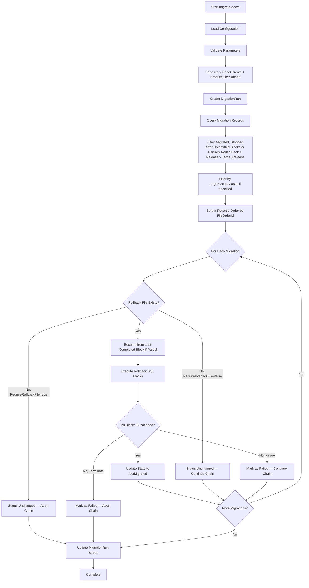

# migrate-down Command

Executes database migrations in reverse (down) direction using rollback files.

## Synopsis

```bash
raymigrator migrate-down --product <ProductAlias> --environment <Environment> --to-release <ReleaseVersion> [options]
```

## Description

The `migrate-down` command reverses previously applied migrations by executing their corresponding rollback files. Migrations are rolled back in reverse order from the current state to the specified target release version. Besides the migrated files it rolls back a file that a failed, cancelled or abruptly ended migrate-up left with committed blocks, and it continues a rollback that stopped in the middle (see [Rollback Order](#rollback-order)).

## Required Parameters

| Parameter | Short | Description |
|-----------|-------|-------------|
| `--product` | `-p` | Product alias as defined in configuration |
| `--environment` | `-env` | Target environment (e.g., Development, Production) |
| `--to-release` | `-tr` | Target release version to rollback to |

## Optional Parameters

| Parameter | Short | Default | Description |
|-----------|-------|---------|-------------|
| `--run-mode` | `-rm` | `Migrate` | Execution mode: `Migrate`, `Simulate`, or `Validate` |
| `--target-group` | `-tg` | (all) | Filter rollback to specific target groups (can be specified multiple times) |
| `--cancelled-action` | `-ca` | `terminate` | Accepted like on migrate-up so that scripts can pass the same options to every run command; migrate-down ignores it |
| `--startup-info` | `-si` | `true` | Show application info at startup |
| `--reveal-sensitive-data` | `-rsd` | `false` | Log sensitive data (passwords) |
| `--config-dir` | `-cd` | (current directory) | Override directory where RayMigrator searches for configuration files |

### Run Modes

| Mode | Description |
|------|-------------|
| `validate` | Validates rollback file existence and parseability without connecting to the targets or reading the repository; with database logging on (the default) the start initializes the log database, which once after the update to 0.20.0 creates the two indexes of `MigrationLog` |
| `simulate` | Validates and processes everything, reads repository records, but does not write repository records or execute rollback SQL on targets |
| `migrate` | Validates, then performs actual rollback against target databases |

See [Execution Modes — Run Mode](../02-core-concepts/execution-modes.md#run-mode) for detailed behavior.

### Cancelling

The first Ctrl+C or SIGTERM stops a migrate-down at the next rollback block (the first block of a rollback file, an atomic rollback and a rollback through a CLI tool always complete), leaves the record in progress `Failed` with its leading rollback blocks (with `RollbackErrorAction=Ignore` those before the first failed one), records the run as `Cancelled` and ends the process with exit code `130`; the next migrate-down continues the record, a failed rollback block included, unless its first rollback block failed under `RollbackErrorAction=Ignore`, and until then migrate-up refuses to run that file. `--cancelled-action` has no effect here, because migrate-down is a rollback already. A second Ctrl+C or SIGTERM ends the process at once and leaves the run open for the orphan repair of a later start or `fix`, which keeps the rollback blocks that ran, so that the next migrate-down continues the rollback. See [Global Options — Cancelling a Run](global-options.md#cancelling-a-run).

## Examples

### Rollback to Specific Release

```bash
# Rollback to Release 1.0
raymigrator migrate-down --product MyProduct --environment Production --to-release "Release 1.0"
```

### Simulate Rollback

```bash
# Test what would be rolled back
raymigrator migrate-down -p MyProduct -env Staging -rm simulate -tr "Release 1.0"
```

### Development Rollback

```bash
# Rollback in development environment
raymigrator migrate-down -p MyProduct -env Development -rm migrate -tr "Release 2.0"
```

### Rollback Specific Target Groups

```bash
# Rollback only Backend target group
raymigrator migrate-down -p MyProduct -env Production -tr "Release 1.0" -tg Backend

# Rollback Backend and Frontend, leave Analytics untouched
raymigrator migrate-down -p MyProduct -env Production -tr "Release 1.0" -tg Backend -tg Frontend
```

## Execution Flow



## Rollback Order

The query filters for migration records in three states:

- `Migrated`.
- A file that stopped after committed blocks without a rollback: `Failed`, or `Executing` in a run that has ended, with `FileUpBlocksMigrated > 0` and no `FileDownHash`. A failure, a cancel with `Terminate`, a file that ran to its end with failed blocks under `MigrationErrorAction=Ignore` and the orphan repair of a run that ended abruptly leave it, and the next migrate-up would resume it after its committed blocks. migrate-down rolls it back like a migrated file: its rollback file runs from its first rollback block, at the place of the file in the reverse order, and the record ends `NotMigrated`, so that the next migrate-up runs the file from its first block instead of resuming it after blocks whose effect the rollback of the release took away. The rollback file must therefore tolerate a partially applied file ([Rollback Files](../07-migration-files/rollback-files.md#rollback-of-a-partially-applied-file)). `--run-mode simulate` lists it.
- `Failed` (or `Executing` in a run that has ended) with partial rollback progress, i.e. a previous rollback was interrupted partway through. This enables **rollback resumption** -- if a rollback was partially completed and then aborted, a subsequent migrate-down will resume from where it left off rather than re-executing already-completed rollback blocks. The record keeps those rollback blocks from the start of the resumed rollback, so a migrate-down that ends before its next rollback block leaves the rollback for the next migrate-down as well. The continued rollback does not compare the rollback file with the one the earlier attempt ran (`FileDownBlocksHash`): change a rollback file only after its rollback has completed.

A record that stopped without a committed block (`Failed`, or `Executing` in a run that has ended, with `FileUpBlocksMigrated = 0` and no `FileDownHash`), as the atomic path, a CLI tool and a failed first block leave it, is not rolled back: its record counts nothing that committed. migrate-down logs a warning for each such record in the releases it rolls back (`File not rolled back`, with release, target group, target, file and record id), because with `MigrationErrorAction=Ignore` or a CLI tool blocks of the file may have run; the warning does not change the result of the run. migrate-down picks neither a record whose first rollback block failed nor one whose rollback ran to its end with ignored rollback errors.

Migrations are rolled back in **reverse** order of their original execution:

**Original Migration Order:**
```
1. Release 1.0/Backend/001_CreateTable.sql
2. Release 1.0/Backend/002_InsertData.sql
3. Release 2.0/Backend/001_AddColumn.sql
```

**Rollback Order (to Release 1.0):**
```
1. Release 2.0/Backend/001_AddColumn.rollback.sql
```

**Rollback Order (to start):**
```
1. Release 2.0/Backend/001_AddColumn.rollback.sql
2. Release 1.0/Backend/002_InsertData.rollback.sql
3. Release 1.0/Backend/001_CreateTable.rollback.sql
```

## Rollback File Discovery

RayMigrator looks for rollback files using the configured naming convention:

```
{MigrationFilename}.{RollbackExtension}.{Extension}
```

Default: `Migration.rollback.sql`

### Custom Rollback Extension

Configure via product settings:
```json
{
  "Products": [{
    "MigrationRollbackFilesPreExtension": "down"
  }]
}
```

Result: `Migration.down.sql`

## Missing Rollback Files

Behavior depends on the `RequireRollbackFile` product setting:

### RequireRollbackFile = true (default)

| Behavior | Description |
|----------|-------------|
| Error Logged | The missing file is treated as a structural error |
| State Unchanged | Migration status is not updated (`Migrated` stays `Migrated`, a file that stopped after committed blocks keeps them), because nothing of the rollback ran; once the rollback file is there, the next migrate-down rolls the file back |
| Chain Aborted | The entire rollback chain is aborted immediately; the run ends as `Error`, and the error message names the missing rollback file |

### RequireRollbackFile = false

| Behavior | Description |
|----------|-------------|
| Info Logged | The missing file is logged at Information level; for a file that stopped after committed blocks a warning names them |
| State Unchanged | Migration status is not updated (retains its current status, e.g., `Migrated`); a file that stopped after committed blocks keeps them and stays pending for the next migrate-up, which resumes it after them unless it runs the file in full (a RunAlways file, changed SQL blocks, a CLI tool), while the chain rolls back the files before it |
| Continue | Next rollback proceeds; the run ends `PartialSuccess` |

## Non-Reversible Operations

Some operations cannot be rolled back:

| Operation | Reversible | Notes |
|-----------|------------|-------|
| CREATE TABLE | Yes | DROP TABLE |
| DROP TABLE | No | Data lost |
| ADD COLUMN | Yes | DROP COLUMN |
| DROP COLUMN | No | Data lost |
| INSERT DATA | Yes | DELETE |
| DELETE DATA | Conditional | Need backup |
| TRUNCATE | No | Data lost |

### Handling Non-Reversible Operations

Create a rollback file that documents the limitation:

```sql
/*
[RayMigrator]
Description = "WARNING: Data deleted, cannot restore automatically"
*/

-- Manual restoration required
-- See backup: backup_20250129.bak
SELECT 1;  -- No-op placeholder
```

## RollbackErrorAction

Controls behavior when a rollback SQL block fails during execution. Configured at product level or overridden per rollback file via TOML metadata.

| Value | Numeric | Description |
|-------|---------|-------------|
| Undefined | 0 | Invalid value (resolves to Terminate at runtime) |
| Terminate | 10 | Abort the entire rollback chain immediately (default) |
| Ignore | 30 | Skip the failed block, continue with remaining blocks in the same file, mark the file as Failed, then continue with the next file |

See [Error Handling](../02-core-concepts/error-handling.md) for details.

## State Changes

After successful rollback (all SQL blocks pass), migration states change:

| Before | After |
|--------|-------|
| Migrated | NotMigrated |
| Failed (or Executing in a run that has ended) with committed blocks, no rollback | NotMigrated |
| Failed with partial rollback progress | NotMigrated |

If rollback SQL fails with `RollbackErrorAction=Terminate`:

| Before | After | Chain |
|--------|-------|-------|
| Migrated | Failed | Aborted |
| Failed with committed blocks, no rollback | Failed | Aborted |

A record whose rollback SQL failed keeps the rollback blocks that ran before the failed block; an atomic rollback and a rollback through a CLI tool keep those of the attempt they continued (0 without one). A record with some but not all of its rollback blocks is a rollback that stopped in the middle: the next migrate-down continues it at the failed block, and migrate-up refuses to run its file until then.

If the rollback file is missing with `RequireRollbackFile=true`:

| Before | After | Chain |
|--------|-------|-------|
| Migrated | Unchanged (Migrated) | Aborted |
| Failed with committed blocks, no rollback | Unchanged (Failed with its committed blocks) | Aborted |

If rollback SQL fails with `RollbackErrorAction=Ignore`:

| Before | After | Chain |
|--------|-------|-------|
| Migrated | Failed | Continues |

The rollback that ran to its end accepts its failed blocks: the record is `Failed` with every rollback block, migrate-down does not pick it again, and migrate-up runs the file again from its first block. A cancel or a run that ends abruptly before that end accepts nothing: the record keeps the rollback blocks before the first failed one, and the next migrate-down runs the failed block again, unless it was the first rollback block, which leaves no rollback block to continue after.

If rollback file is missing with `RequireRollbackFile=false`:

| Before | After | Chain |
|--------|-------|-------|
| Migrated | Unchanged (Migrated) | Continues |
| Failed with committed blocks, no rollback | Unchanged (Failed with its committed blocks); the warning names them | Continues |

## Exit Codes

→ See [Global Options — Exit Codes](global-options.md#exit-codes) for the complete exit code table.

## Best Practices

1. **Always test in non-production first**
   ```bash
   raymigrator migrate-down -p MyProduct -env Development -rm simulate -tr "Release 1.0"
   ```

2. **Backup before rollback in production**

3. **Create rollback files for all production migrations**

4. **Test rollback files before deployment**

5. **Document non-reversible operations clearly**

## Related Commands

- [migrate-up](migrate-up.md) - Forward migrations
- [Global Options](global-options.md) - Common options

## Related Documentation

- [Rollback Files](../07-migration-files/rollback-files.md)
- [Migration State Machine](../02-core-concepts/migration-state-machine.md)
- [Error Handling](../02-core-concepts/error-handling.md)
