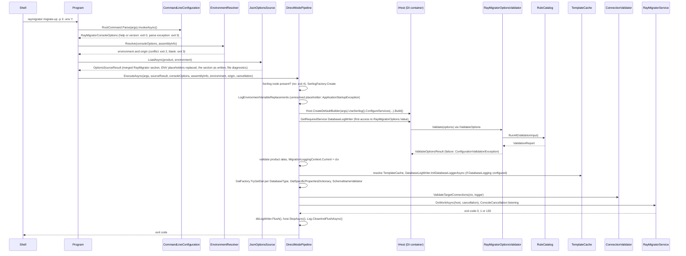
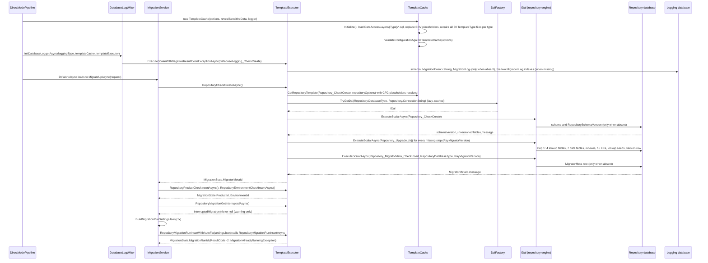
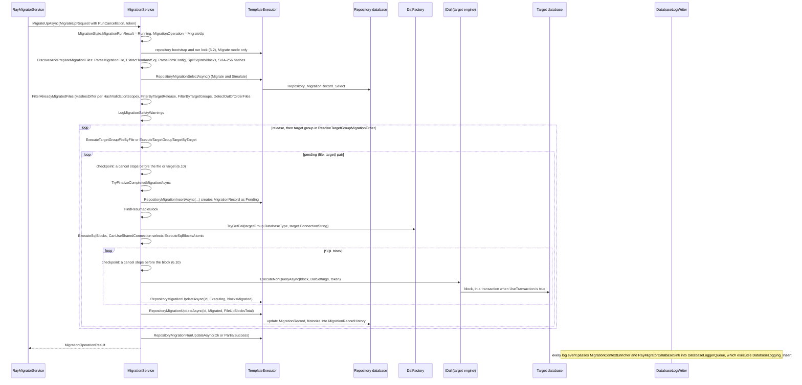
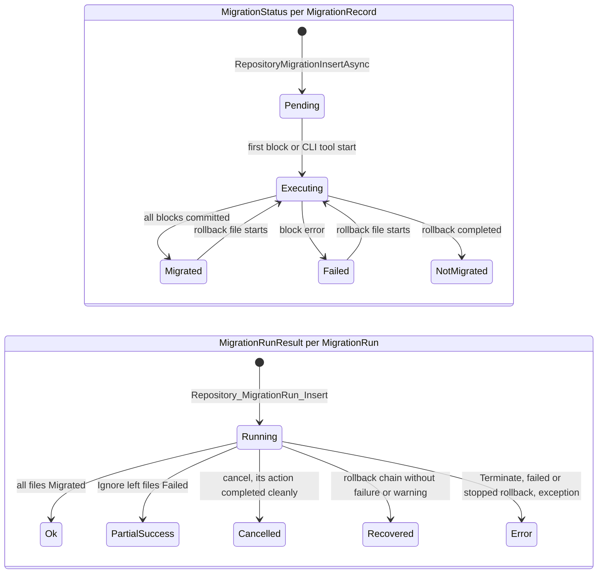
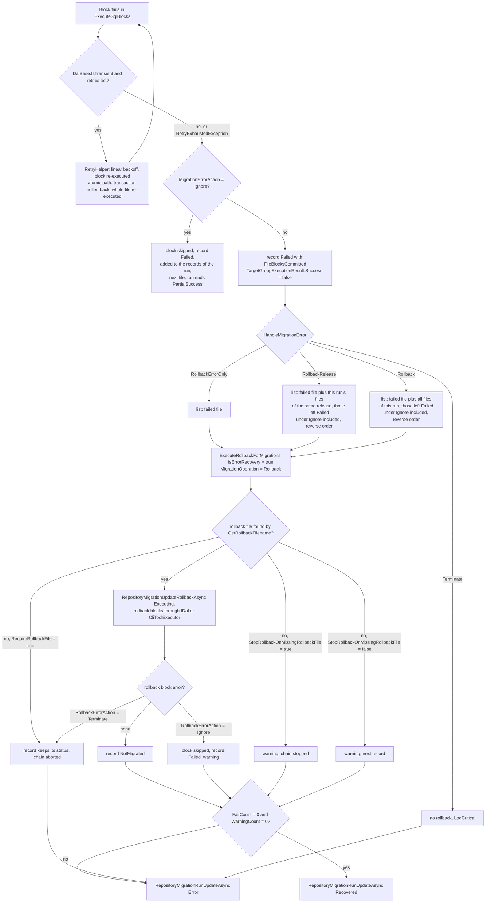
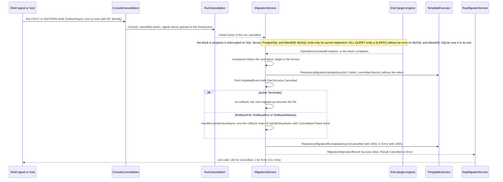

# 6. Runtime View

This chapter answers how the building blocks of the
[Building Block View](05-Building-Block-View.md) cooperate at run time: which
classes are involved in a scenario, in which order they call each other, and
what a scenario leaves behind in the migration repository (the RayMigrator
bookkeeping database), in the log sinks and in the process exit code. The
scenarios are chosen by three criteria: the most important ones (startup,
repository bootstrap and `migrate-up`, which every installation runs), the
most risky ones (error handling with rollback, the exclusive run lock,
external CLI tools, the cancellation of a run) and the most instructive ones (`migrate-down`, hash
validation, the Config Wizard), because they show mechanisms that recur in
the [Crosscutting Concepts](08-Crosscutting-Concepts.md).

| Scenario | Trigger | Why it is documented |
|----------|---------|----------------------|
| 6.1 Startup and Configuration Resolution | any `raymigrator` invocation | every run passes through it; produces exit codes `2` to `5` |
| 6.2 Repository Bootstrap | first state changing command against a repository database | creates the schema that every later run depends on |
| 6.3 `migrate-up` | `raymigrator migrate-up -p X -env Y` | the primary use case |
| 6.4 Error Handling and Rollback | a failing SQL block during 6.3 | highest risk for the target databases |
| 6.5 `migrate-down` | `raymigrator migrate-down --to-release R` | explicit use of the rollback engine |
| 6.6 Hash Validation | `validate-hash`, `update-hash` | integrity mechanism of the audit trail |
| 6.7 Exclusive Run Lock and `fix` | two concurrent runs, a crashed run | integrity of the repository under concurrency |
| 6.8 External CLI Tool Execution | `UseCliToolAlias` on a file, target, target group or product | leaves the ADO.NET path |
| 6.9 Config Wizard Session | a developer opens the wizard in the browser | the only runtime outside the engine process |
| 6.10 Cancellation of a run | a host's `RunCancellation.Cancel`, or Ctrl+C or SIGTERM in the CLI | stops a run midway without leaving it open |

## 6.1 Startup and Configuration Resolution

Trigger: the shell starts `raymigrator` with a subcommand. Participants:
`Program` (Console), `CommandLineConfiguration` and `EnvironmentResolver`
(Core), `JsonOptionsSource`, `DirectModePipeline`, `SerilogFactory` and
`RayMigratorService` (Pipeline), `RayMigratorOptionsValidator` (Core) over
`RuleCatalog` (Validation), `TemplateCache` and `ConnectionValidator`
(Infrastructure), `DalFactory` (Database).

1. `Program.Main` registers code page encodings, builds `CommandLineConfiguration` with the banner from `AssemblyInfoHelper` and parses `args` with System.CommandLine. A parse exception returns `5`; a help or version request leaves `ParsedOptions` empty and returns `0`. `SensitiveDataMasker.Initialize` receives `--reveal-sensitive-data`. `Program` creates the one `RunCancellation` of the process, which travels through the pipeline to the command (6.10).
2. `EnvironmentResolver.Resolve` checks `--environment` against `DOTNET_ENVIRONMENT`: a blank option value returns `3` (the variable never replaces it), both set and different returns `2`; otherwise the option value and its origin are passed on.
3. `Program.RunDirectMode` calls `JsonOptionsSource.LoadAsync(product, environment)`, which layers `appsettings.json`, `appsettings.{Environment}.json`, `appsettings.{Product}.json` and `appsettings.{Product}.{Environment}.json` from the working directory or `--config-dir`, merges them by alias, keeps the shared sections and the product of the run (`ConfigurationProductScope`, ADR-026; an alias written as a placeholder is resolved for the comparison), extracts the `RayMigrator` section and replaces `{ENV:NAME}` placeholders through `EnvironmentVariableReplacer`. Missing files are reported as diagnostics; a `ConfigurationValidationException` is thrown when `--config-dir` does not exist, the product is empty, the files name products but none carries the `--product` alias (the message lists the aliases they do name, printed by `Program.Main` on stdout, exit code `100`), no file carries a `RayMigrator` node at all, or loading fails.
4. `DirectModePipeline.ExecuteAsync` first checks for a `Serilog` node. If it is missing, it prints the files that were not found and returns `4`. Then `SerilogFactory.Create` builds the logger (with `RayMigratorDatabaseSink` when `DatabaseLogging` exists), and every environment variable replacement is logged; an unresolved placeholder throws `ApplicationStartupException`.
5. The host is built: `RayMigratorOptions` bound from the section with `RayMigratorDataAnnotationValidateOptions` (the data annotations, naming a failed element by alias) and `ValidateOnStart`, `ProductDefaultsPostConfigureOptions`, `RayMigratorOptionsValidator`, `DatabaseLogWriter`, `AddRayMigratorServices(RayMigratorHostMode.Cli)`, `TemplateCache`, `TemplateExecutor`, `RayMigratorService` and the singleton `MigrationContext`. A failure inside `Build()` becomes `ApplicationStartupException`.
6. Resolving `DatabaseLogWriter` touches `IOptions<RayMigratorOptions>.Value` for the first time, which runs the data annotations and `RayMigratorOptionsValidator.Validate`; the latter flattens the options through `OptionsValidationInputAdapter` and calls `RuleCatalog.RunAll`. Any issue of severity error is wrapped into `ConfigurationValidationException`.
7. The product alias is validated case sensitively, `MigrationLoggingContext.Current` is set so that `MigrationContextEnricher` can tag all events, and, unless `DatabaseLogging` is disabled, `TemplateCache` is resolved and `DatabaseLogWriter.InitDatabaseLoggerAsync` runs `DatabaseLogging_CheckCreate` (see 6.2).
8. `DalFactory.TryGetDal` is called for the repository, every target and the logging database; the returned `DalSpecificProperties` fill `MigrationContext.DalSpecificPropertiesDictionary`, and `SchemaNameValidator` rejects a `SchemaName` on an engine without schema support.
9. `ConnectionValidator.ValidateTargetConnections` opens a connection to every target only when `CommandProfile.ConnectsToTargets` is true for the command and run mode (`migrate-up` and `migrate-down` in `Migrate` or `Simulate` mode); otherwise it only validates the connection string.
10. `RayMigratorService.DoWorkAsync` dispatches on `MigrationCommand` (6.3 to 6.7). Only while it runs, `ConsoleCancellation` turns the first Ctrl+C or SIGTERM into a cancel of the command (6.10); before and after it both signals keep their default and end the process. Afterwards the pipeline flushes `DatabaseLoggerQueue`, stops the host and returns the exit code.

Exit codes produced on failure: `5` (parse exception), System.CommandLine's own code for parse errors, `0` (help), `2`, `3` from steps 1 and 2; `4` from step 4; `1` for every `ApplicationStartupException` (steps 4, 5, 7, 8, 9); `100` for any other exception in the pipeline, which includes `ConfigurationValidationException` from steps 3, 6, 7 and 8 because that type does not derive from `ApplicationStartupException`; `130` from step 10 for a command that the cancel ended. Detailed page:
[Configuration hierarchy](https://github.com/RAYCOON/RayMigrator/blob/main/Docs/06-configuration-reference/appsettings-hierarchy.md),
[Global options](https://github.com/RAYCOON/RayMigrator/blob/main/Docs/08-cli-reference/global-options.md#exit-codes).

## 6.2 Repository Bootstrap (first contact with a database)

Trigger: the first state changing command (`migrate-up`, `migrate-down`,
`baseline`, `update-hash`, `fix` in `Migrate` mode) against a repository
database without RayMigrator tables. Participants: `DirectModePipeline`,
`DatabaseLogWriter`, `MigrationService`, `TemplateExecutor` (with
`RepositorySchemaExecutor` for the schema steps), `TemplateCache`,
`DalFactory`, the repository `IDal` (`DalSqlServer`, `DalPostgreSql`,
`DalMariaDb`, `DalMySql` or `DalSqlite`).

1. `TemplateCache` is a DI singleton; its constructor scans `DataAccessLayers/{Type}/` next to the binary, maps file names to `TemplateType`, resolves `{ENV:*}` once and throws `ConfigurationValidationException` when a type lacks one of the 30 templates or when a configured `DatabaseType` has no template folder. No SQL runs in this phase.
2. Unless `DatabaseLogging` is disabled (`Enabled: false`), `DatabaseLogWriter.InitDatabaseLoggerAsync` executes `DatabaseLogging_CheckCreate` on the logging database, the repository by default, during startup, regardless of run mode, and keeps `DatabaseLogging_Insert` in memory for the asynchronous queue. The template creates the log tables when they are missing and adds each of the two `MigrationLog` indexes (`MigrationRunId`, `CreatedAt`) that is missing, also to a log table an older engine created, and still reports `0` for a log that existed; SQL Server, PostgreSQL and MySQL serialize this with a lock of their own apart from the repository schema lock (the templates of SQL Server and MySQL end with `-1` when they do not get it within 60 seconds; with the default command timeout of `DatabaseLogging`, 20 seconds, the call times out first), MariaDB and SQLite rely on `CREATE INDEX IF NOT EXISTS`. The log tables are not part of the repository schema version. Log rows are written only when `CommandProfile.WritesDatabaseLog` is true.
3. `TemplateExecutor.RepositoryCheckCreateAsync` runs the schema steps through `RepositorySchemaExecutor` with the repository, the target version and the engine version of the context. `Repository_CheckCreate` creates the schema (SQL Server, PostgreSQL) and the `RepositorySchemaVersion` table when they are missing and reports the schema version found. Every missing `Repository_Upgrade_{n}` step up to `RepositorySchema.CurrentVersion` (3) then runs in order; step 1 creates the lookup tables `MigrationOperation`, `MigrationRunResult`, `MigrationRunMode`, `MigrationStatus`, the data tables `MigratorMeta`, `Product`, `Environment`, `MigrationRun`, `MigrationRunMeta`, `MigrationRecord`, `MigrationRecordHistory`, the indexes and foreign keys, seeds the lookup tables and writes version row 1; step 2 adds the run details of `MigrationRun` and the lookup table `MigrationRunSource`, step 3 the lookup row `Cancelled` (70) of `MigrationRunResult` and four indexes for the readers of runs, records and history. `Repository_MigratorMeta_CheckInsert` registers the engine version; its result code is the `MigratorMetaId`. A repository without a schema version (created before 0.17.0) or newer than the engine ends the run with `RepositorySchemaException` before a schema step runs or a row is written (ADR-024). A host that manages repositories runs the same steps without a run through `IRepositorySchemaService.EnsureAsync(RepositoryOptions)`, which validates the repository options first.
4. `RepositoryProductCheckInsertAsync` and `RepositoryEnvironmentCheckInsertAsync` register the product and environment by lowercase name. Commands whose profile does not write the repository (`info`, `validate-hash`, `fix` and `migrate-up`/`migrate-down` in `Simulate` mode) call `RepositoryProductSelectAsync` and `RepositoryEnvironmentSelectAsync` instead and treat an unknown product as an empty repository (`MigrationService.InitializeRepositoryAsync`, `ResolveRepositoryIdsReadOnlyAsync`).
5. `RepositoryMigrationGetInterruptedAsync` reports a record left in `Executing` by a crashed run as a warning; `RepositoryMigrationRunInsertAsync` then creates the `MigrationRun` row with `MigrationRunResult.Running` and a JSON snapshot of the effective settings in `MigrationRunMeta` (6.7 for the lock).

On later runs the same calls execute, but `Repository_CheckCreate` finds the version table at the current version, no step runs and `Repository_MigratorMeta_CheckInsert` only returns the existing `MigratorMetaId`; after an engine update the missing steps run once and the data stays. `DatabaseLogging_CheckCreate` behaves the same way for the log tables, except that it adds the indexes a log table lacks. `Validate` run mode skips the repository part of the phase because it never connects to the repository; only step 2 still runs, so a `Validate` run can create the log tables or their indexes once. The repository writes of this phase take no cancellation token; the run checks the token between them (6.10). Detailed page:
[Template execution order](https://github.com/RAYCOON/RayMigrator/blob/main/Docs/03-database-layer/template-execution-order.md),
[Template executor](https://github.com/RAYCOON/RayMigrator/blob/main/Docs/04-service-layer/template-executor.md).

## 6.3 `migrate-up` (the primary scenario)

Trigger: `raymigrator migrate-up -p X -env Y [--run-mode migrate|simulate|validate] [--to-release R] [--target-group A] [--allow-out-of-order]`. Participants: `RayMigratorService`, `MigrationService`, `TemplateExecutor`, `DalFactory`, the target `IDal`, `DatabaseLogWriter`; optionally `CliToolExecutor` (6.8).

1. `RayMigratorService.ExecuteMigrateUpAsync` maps `RayMigratorConsoleOptions` to `MigrateUpRequest`, puts the `RunCancellation` of the process into it and calls `IMigrationService.MigrateUpAsync` with its token.
2. `MigrationService` checks that product and run mode match the `MigrationContext`, sets `MigrationRunResult.Running` and `MigrationOperation.MigrateUp`, and, when `MigrationRunMode.ShouldWriteRepository()` is true (`Migrate` only), performs the bootstrap and takes the run lock (6.2, 6.7).
3. `DiscoverAndPrepareMigrationFiles` scans `MigrationFilesRootDirectory` recursively, sorted by relative path with `StringComparer.OrdinalIgnoreCase`, skips rollback files, `migsettings` files and files that are not for this environment, and calls `ParseMigrationFile` per file: `ExtractTomlAndSql`, `ParseTomlConfig`, `ResolveMigSettingsForFile` for directory defaults, `SplitSqlIntoBlocks` with the engine's `SqlBlockDelimiter`, and the three SHA-256 hashes `FileUpHash`, `FileUpConfigHash`, `FileUpBlocksHash`. `RequireRollbackFile` and flat layout ambiguity are validated here, before any SQL runs.
4. In `Migrate` and `Simulate` mode the existing `MigrationRecord` rows are read and `FilterAlreadyMigratedFiles` keeps a `(file, target)` pair only when there is no `Migrated` record with a matching hash under the target group's `HashValidationScope`; `Failed` and `NotMigrated` records are always pending. `FilterByTargetRelease` (`--to-release`), `FilterByTargetGroups` (`--target-group`) and `DetectOutOfOrderFiles` follow; out of order files abort the run unless `--allow-out-of-order` is given. `FindIncompleteRollbacks` then refuses the run in the same way when a pair it would run has a record whose rollback stopped in the middle (`Failed`, or `Executing` in a run that has ended, with `0 < FileDownBlocksMigrated < FileDownBlocksTotal`): the record insert would reset the rollback columns and run the file from block 1 on a target that kept part of it. No file runs, the run is `Error`, and the message names release, file, target and `k of n rollback blocks`; `migrate-down` continues such a record at block k+1 (6.5). `Validate` mode processes every file without repository access.
5. The outer loop is release, then target group in the order from `ResolveTargetGroupMigrationOrder` (CLI, release `migsettings`, product `TargetGroupMigrationOrder`, configuration order). Per target group `TargetMigrationOrder` selects `ExecuteTargetGroupFileByFile` (file, then target) or `ExecuteTargetGroupTargetByTarget` (target, then file); `Undefined` behaves as `TargetByTarget`.
6. For each pending pair, `TryFinalizeCompletedMigrationAsync` closes a record whose blocks were all committed by an interrupted run, `FindResumableBlock` returns the number of blocks already committed for a `Failed` record with unchanged `FileUpBlocksHash` (neither applies to a `RunAlways` file, which runs in full from block 1), and `RepositoryMigrationInsertAsync` creates (or reuses) the `MigrationRecord` with status `Pending`. `MigrationState` receives record id, file, block and target so that log events are enriched.
7. `ExecuteSqlBlocks` obtains the target `IDal` from `DalFactory`, builds `DalSettings` from `UseTransaction`, `DbCommandTimeoutInSeconds`, `DbCommandMaxRetries` and `DbCommandWaitTimeInMsBeforeRetry`, and executes block by block through `ExecuteNonQueryAsync` with the token of the run; after each block `RepositoryMigrationUpdateAsync` persists `Executing` with the committed block count. When `CanUseSharedConnection` holds (`UseTransaction`, error action not `Ignore`, repository and target with identical `DatabaseType` and connection string), `ExecuteSqlBlocksAtomic` runs all blocks and the repository updates on one connection and transaction. In `Simulate` mode the blocks are logged instead of executed.
8. A file that succeeds on a target is recorded as `Migrated` with `FileUpBlocksTotal` and added to the records of the run (`RunRecord`), as is a file that `MigrationErrorAction.Ignore` leaves `Failed`, with its committed blocks; the record update templates historize the previous row into `MigrationRecordHistory`. A failing block leads to 6.4.
9. After the last release, `RepositoryMigrationRunUpdateAsync` closes the `MigrationRun` with `Ok`, or `PartialSuccess` when `MigrationErrorAction.Ignore` left files `Failed`. `RayMigratorService` returns `0` for `Success`, `130` for a run the cancel ended as `Cancelled` (6.10), otherwise `1`.

Result: one `MigrationRun` row with `MigrationRunMeta`, one `MigrationRecord` per `(file, target)` with history rows, `MigrationLog` rows in the repository (or the configured log database) unless `DatabaseLogging` is disabled, console and file log output, exit code `0` or `1` (`130` after a cancel). The state machine that these writes follow:

`MigrationStatus` values: `Undefined` 0, `Pending` 10, `Executing` 20, `Failed` 30, `NotMigrated` 50, `Migrated` 100. `MigrationRunResult` values: `Undefined` 0, `Running` 10, `PartialSuccess` 50, `Cancelled` 70, `Recovered` 80, `Error` 90, `Ok` 100. A cancel leaves the interrupted record `Failed` with its committed blocks (6.10). Detailed pages:
[Activity diagrams](https://github.com/RAYCOON/RayMigrator/blob/main/Docs/04-service-layer/activity-diagrams.md),
[Migration service](https://github.com/RAYCOON/RayMigrator/blob/main/Docs/04-service-layer/migration-service.md),
[File discovery](https://github.com/RAYCOON/RayMigrator/blob/main/Docs/04-service-layer/file-discovery.md),
[Block execution](https://github.com/RAYCOON/RayMigrator/blob/main/Docs/04-service-layer/block-execution.md),
[Execution modes](https://github.com/RAYCOON/RayMigrator/blob/main/Docs/02-core-concepts/execution-modes.md),
[Migration state machine](https://github.com/RAYCOON/RayMigrator/blob/main/Docs/02-core-concepts/migration-state-machine.md).

## 6.4 Error Handling and Rollback during `migrate-up`

Trigger: `IDal.ExecuteNonQueryAsync` throws for a block, or `CliToolExecutor` reports an exit code outside `SuccessExitCodes`. Participants: the target `IDal` with `DalBase.IsTransient` and `RetryHelper` (Database.Common), `MigrationService` (`ExecuteSqlBlocks`, `ExecuteSqlBlocksAtomic`, `HandleMigrationError`, `HandleStopAsync`, `ExecuteRollbackForMigrations`, `ExecuteRollbackBlocksAtomic`), `TemplateExecutor`.

1. Retry path. The block by block path relies on the DAL: `ExecuteNonQueryAsync` wraps the provider call in `DalBase.ExecuteWithRetryAsync`, and `RetryHelper` repeats it with linear backoff while `IsTransient` recognizes the provider error code and `DbCommandMaxRetries` is not exhausted; then it throws `RetryExhaustedException`. The atomic path retries at file level: `ExecuteSqlBlocksAtomic` rolls the shared transaction back, waits `RetryDelayMs` and re-executes every block.
2. A non transient error inside `ExecuteTargetGroupFileByFile` or `ExecuteTargetGroupTargetByTarget` is caught per file. The record is updated to `Failed` with `MigrationState.FileBlocksCommitted` so that the next run can resume (`FindResumableBlock`). With `MigrationErrorAction.Ignore` a failed block is skipped inside the file, whose record ends `Failed` with the blocks before the first failed one, so that the next run resumes at that block; the file counts as failed, its record joins the records of the run, which a later rollback of the run rolls back, the loop continues and the run ends as `PartialSuccess`; with any other action the target group returns `Success = false` and `MigrateUpAsync` calls `HandleMigrationError`.
3. `HandleMigrationError` resolves the effective action (`MigrationFileInfo.MigrationErrorActionOverride` from TOML or `migsettings`, else `ProductOptions.MigrationErrorActionEnum`; enum values `Undefined` 0, `Terminate` 10, `Rollback` 20, `RollbackErrorOnly` 21, `RollbackRelease` 22, `Ignore` 30), and `HandleStopAsync`, which the rollback actions of a cancel use as well (6.10), builds the list of `MigrationRecord` entries to roll back with `BuildStopChain`, each with the `TargetAlias` it was executed on: the failed file first when it has a record (a file that failed before its record was written ran nothing and is left out), then the records the run wrote in the scope of the action, newest first, the files the run migrated (`Migrated` with every block) and those it left `Failed` under `Ignore` (with their committed blocks, also none); records of earlier runs never.
4. `ExecuteRollbackForMigrations` sets `MigrationOperation.Rollback`, locates `{name}.{MigrationRollbackFilesPreExtension}.{ext}` next to the migration file (or in the flat release directory for single target group products), parses it with `ParseMigrationFile`, writes `Executing` through `RepositoryMigrationUpdateRollbackAsync` with the rollback blocks the record already counts (those of an earlier attempt when it continues a rollback that stopped in the middle) and executes the rollback blocks; the atomic path (`ExecuteRollbackBlocksAtomic`) applies when `CanUseSharedConnection` accepts the rollback file itself (its `UseTransaction`, shared repository and target connection, `RollbackErrorAction` not `Ignore`). `RollbackErrorAction` (`Undefined` 0, `Terminate` 10, `Ignore` 30) decides whether a failing rollback block aborts the chain or is skipped; a missing rollback file is governed by `RequireRollbackFile` and `StopRollbackOnMissingRollbackFile` (CLI `--stop-rollback-on-missing-rollback-file`, target group, product).
5. `MigrateUpAsync` persists the run as `Recovered` only when the `RollbackResult` has neither failures nor warnings, otherwise as `Error`; `Terminate` always yields `Error`. The run row and the `MigrationOperationResult` carry the engine error code of the failure (`MigrationRun.ErrorCode`, `ExtractErrorCode`). `RayMigratorService` returns `1` in every case, so a scheduler notices the failure and reads `MigrationRunResult` to tell a clean recovery from an inconsistent state. A cancel while the recovery runs stops it at the next record or rollback block and ignores the action of the cancel; the run stays `Error` with the code of the failure, its message names the failure first and then where the cancel stopped the recovery and what that leaves, and the CLI exits with `1` (6.10).

Detailed pages:
[Error handling](https://github.com/RAYCOON/RayMigrator/blob/main/Docs/02-core-concepts/error-handling.md),
[Error scenarios and recovery](https://github.com/RAYCOON/RayMigrator/blob/main/Docs/02-core-concepts/error-scenarios-and-recovery.md),
[Resilience](https://github.com/RAYCOON/RayMigrator/blob/main/Docs/02-core-concepts/resilience.md).

## 6.5 `migrate-down`

Trigger: `raymigrator migrate-down -p X -env Y --to-release R [--run-mode migrate|simulate|validate] [--target-group A]`. Participants: `RayMigratorService.ExecuteMigrateDownAsync`, `MigrationService.MigrateDownAsync`, `ExecuteRollbackForMigrations`, `TemplateExecutor`, target `IDal`.

1. `Validate` mode never touches a database: the migration files are discovered, `FilterReleasesAfterTarget` keeps releases greater than `--to-release` (ordinal, case insensitive string comparison), and for each file the rollback file must exist and parse; a missing file is a warning and makes the result `Error` (exit code `1`).
2. In `Migrate` mode `Repository_CheckCreate`, `Repository_Product_CheckInsert`, `Repository_Environment_CheckInsert` and the run lock (`RepositoryMigrationRunInsertWithAutoFix`) of 6.2 are taken with `MigrationOperation.MigrateDown`, without the interrupted-run query; `Simulate` resolves product and environment read only.
3. `RepositoryMigrationSelectAsync` returns the current records. Candidates (`IsRolledBackByMigrateDown`) are records with status `Migrated`, records of a file that stopped after committed blocks without a rollback (`Failed`, or `Executing` in a run that has ended, with `FileUpBlocksMigrated > 0` and no `FileDownHash`), whose rollback file runs from its first rollback block, and `Failed` or `Executing` records whose rollback was interrupted (`FileDownBlocksMigrated` between 0 and `FileDownBlocksTotal`), whose `ReleaseVersion` is greater than the target release and whose `TargetGroupAlias` matches `--target-group`, ordered by `FileOrderId` descending. A record of that range that stopped without a committed block is no candidate, and a warning names it. Unlike `migrate-up`, the loop order comes from the repository, not from the release and target group nesting.
4. `ExecuteRollbackForMigrations` runs with `isErrorRecovery = false`: a missing rollback file with `RequireRollbackFile = false` is logged and skipped, `StopRollbackOnMissingRollbackFile` is not consulted, `RollbackErrorAction` applies to block errors as in 6.4. Each record passes `Executing` and ends as `NotMigrated` or `Failed`, with `FileDownHash`, `FileDownBlocksHash` and `FileDownBlocksMigrated` written by `RepositoryMigrationUpdateRollbackAsync`.
5. The run is closed with `RollbackResult.RunResult`: `Ok`, `PartialSuccess` (warnings only) or `Error` (at least one failure); `Recovered` is not used here. Exit code `0` only when every rollback succeeded.
6. A cancel stops the chain before the next record or rollback block and ignores `--cancelled-action`: the record in progress ends `Failed` with the leading rollback blocks that ran, the run `Cancelled`, and the next `migrate-down` continues it (6.10), unless its first rollback block failed under `RollbackErrorAction=Ignore`; until then `migrate-up` refuses to run the file (6.3, step 4).

Detailed pages:
[migrate-down](https://github.com/RAYCOON/RayMigrator/blob/main/Docs/08-cli-reference/migrate-down.md),
[Rollback files](https://github.com/RAYCOON/RayMigrator/blob/main/Docs/07-migration-files/rollback-files.md).

## 6.6 Hash Validation (`validate-hash`, `update-hash`) and `HashValidationScope`

Trigger: `raymigrator validate-hash -p X -env Y [--scope file|sqlblocks|disabled] [--target-group A]` or `raymigrator update-hash -p X -env Y [--target-group A]`. Participants: `RayMigratorService`, `MigrationService.ValidateHashAsync` and `UpdateHashAsync`, `ResolveHashValidationScope`, `HashesDiffer`, `TemplateExecutor.RepositoryMigrationSelectAsync` and `RepositoryMigrationUpdateHashAsync`.

1. Both commands call `InitializeRepositoryAsync`: `RepositoryCheckCreateAsync` always, then `RepositoryProductCheckInsertAsync` and `RepositoryEnvironmentCheckInsertAsync` for `update-hash` (profile writes the repository) or the read only `RepositoryProductSelectAsync` and `RepositoryEnvironmentSelectAsync` for `validate-hash`. Neither command connects to a target.
2. `DiscoverAndPrepareMigrationFiles` computes the current hashes, `FilterByTargetGroups` applies `--target-group`, and `RepositoryMigrationSelectAsync` loads the records with status `Migrated`.
3. `validate-hash` resolves the scope per file: `--scope` overrides everything, otherwise `ResolveHashValidationScope` takes the target group's `HashValidationScope` (`Undefined` 0, `File` 1, `SqlBlocks` 2, `Disabled` 3). `File` compares `FileUpHash`, `SqlBlocks` compares `FileUpBlocksHash`, `Disabled` counts the file as valid. Files without a `Migrated` record are reported as `New`; `Migrated` records without a file on disk as `Missing`; mismatches as `Modified`. `RayMigratorService.ExecuteValidateHashAsync` returns `1` when `InvalidFiles` or `MissingFiles` is greater than zero, otherwise `0`.
4. `update-hash` ignores the scope: for every `Migrated` record where `HashesDiffer` (any of `FileUpHash`, `FileUpConfigHash`, `FileUpBlocksHash`) it calls `RepositoryMigrationUpdateHashAsync` with the three current hashes and reports updated files and records, new files and files missing from disk. Exit code `0` unless the service throws. A cancel stops `update-hash` before the next record with `ErrorCode` `1004` and what it updated so far, and `validate-hash` with an `OperationCanceledException`; both exit with `130` (6.10).
5. During `migrate-up` the same comparison decides whether a `Migrated` file is pending again (6.3, step 4); a mismatch re-executes the file, it does not abort. Block level resume and interrupted run recovery always require an unchanged `FileUpBlocksHash`, even with `Disabled`.

Detailed page:
[Hash validation](https://github.com/RAYCOON/RayMigrator/blob/main/Docs/02-core-concepts/hash-validation.md),
[validate-hash](https://github.com/RAYCOON/RayMigrator/blob/main/Docs/08-cli-reference/validate-hash.md),
[update-hash](https://github.com/RAYCOON/RayMigrator/blob/main/Docs/08-cli-reference/update-hash.md).

## 6.7 Concurrency: exclusive run lock and orphaned run recovery (`fix`)

Trigger: a second `migrate-up`, `migrate-down` or `baseline` for the same product and environment while a `MigrationRun` row is still open, or `raymigrator fix -p X -env Y [--scope orphanedruns|all] [--older-than 2] [--run-mode migrate|simulate] [--last-migration-status not-migrated|migrated]`. Participants: `MigrationService.RepositoryMigrationRunInsertWithAutoFix` and `FixIssuesAsync`, `TemplateExecutor.RepositoryMigrationRunInsertAsync`, `RepositoryMigrationRunSelectOrphanedAsync`, `RepositoryMigrationRunFixOrphanedAsync`, `RepositoryMigrationRecordFixOrphanedAsync`, the repository `IDal`.

1. Refusal of a second run. `Repository_MigrationRun_Insert` checks inside the database for a `MigrationRun` with the same `ProductId` and `EnvironmentId` and `FinishedAt IS NULL` before inserting; the check is serialized per engine (`UPDLOCK, HOLDLOCK` on SQL Server, `pg_advisory_xact_lock` on PostgreSQL, `GET_LOCK` on MariaDB and MySQL, a `BEGIN IMMEDIATE` transaction around the check, the insert and the `MigrationRunMeta` row on SQLite), so two starts at the same moment cannot both pass it. An open run makes the template return `-2` (`TemplateResultCode.MigrationAlreadyRunning`); `ExecuteScalarWithNegativeResultCodeExceptionAsync` raises `TemplateResultException`, which `RepositoryMigrationRunInsertAsync` converts into `MigrationAlreadyRunningException`. Different products or environments do not block each other.
2. Auto-fix. `RepositoryMigrationRunInsertWithAutoFix` catches that exception, calls `RepositoryMigrationRunSelectOrphanedAsync` and looks for runs with `MinutesSinceHeartbeat` (minutes since `LastHeartbeatAt`, or since `StartedAt` for a run without heartbeat) of at least `Repository.OrphanedRunThresholdInMinutes` (2); a run that refreshes its heartbeat every `Repository.HeartbeatIntervalInSeconds` (30) is never taken for orphaned, however long it runs. For each such run it first closes the run as `Error` with `FinishedAt` (`RepositoryMigrationRunFixOrphanedAsync`); the template refuses a run that wrote a heartbeat since the select (`-31`, `MigrationRunNotInRunningState`), which is alive and keeps its records as they are. Only for a run it closed does it then settle the `Pending` and `Executing` records of the run by the progress of their files (`RepositoryMigrationRecordFixOrphanedAsync` without a status): `Failed` with the committed blocks, which the new run resumes after, `Migrated` when every block committed, `NotMigrated` without progress, and a rollback that was running `Failed` with its rollback blocks or `NotMigrated` when every rollback block ran; the records get `FinishedAt` where they have none and keep `DurationInMs` as it is. When it closed at least one run, it reads the records again for the release the new run starts from and retries the insert once; when every candidate wrote a heartbeat meanwhile, it rethrows. Such orphans come from a killed process, a lost connection or a CLI run that a second Ctrl+C or SIGTERM ended at once (6.10). Without an old enough orphan it logs the hint to use `fix` and rethrows; `MigrateUpAsync` catches the exception, returns a failed `MigrationOperationResult` with `ErrorCode` `-2`, and `RayMigratorService` returns `1`.
3. Orphan detection by `fix`. `FixIssuesAsync` resolves the repairs for the scope (`FixScope` `All` 1 and `OrphanedRuns` 2 both run the orphaned run repair), resolves product and environment (read only in `Simulate`), selects all runs with `MigrationRunResult.Running` and `FinishedAt IS NULL` and filters by `--older-than` (default 2 minutes, compared with the heartbeat age). `Simulate` lists them and writes nothing.
4. Repair. In `Migrate` mode `RepositoryMigrationRunFixOrphanedAsync` closes the run as `Error` with the engine code `1006` (`OrphanedRunClosed`) and a message that names its last heartbeat, provided its heartbeat is still older than the threshold (`-31` otherwise: the run is alive and stays untouched), and only then `RepositoryMigrationRecordFixOrphanedAsync` settles the run's open records: by their progress as the auto-fix does, or with the status of `--last-migration-status` (`NotMigrated`, or `Migrated` when the operator has verified the target) on every one of them. The lock is released because `FinishedAt` is set. Exit code `0`; `1` only when the service throws; a cancel stops `fix` before the next run with `ErrorCode` `1004` and the runs fixed so far, exit code `130`.
5. A normally finished run stops its heartbeat and releases the lock through `RepositoryMigrationRunUpdateAsync`, which sets `MigrationRunResultId`, `FinishedAt` and `DurationInMs`; a `Validate` or `Simulate` run never inserts a row and therefore never holds the lock.

Detailed pages:
[Concurrency control](https://github.com/RAYCOON/RayMigrator/blob/main/Docs/02-core-concepts/concurrency-control.md),
[Command reference, Fix](https://github.com/RAYCOON/RayMigrator/blob/main/Docs/08-cli-reference/command-reference.md#fix).

## 6.8 External CLI Tool Execution

Trigger: `ResolveUseCliToolAlias(file, targetOptions)` returns an alias, taken from the file's TOML header or `migsettings` (`UseCliToolAlias`), else from the target, the target group or the product. Participants: `MigrationService.ExecuteWithCliTool`, `GetCliToolByAlias`, `ResolveCliToolArguments`, `CliToolExecutor` (`ICliToolExecutor`), `ExitCodeMatcher` (Core), `TemplateExecutor`.

1. A file that names a CLI tool, or whose target group runs every target through one, is not split into blocks (`ShouldSkipBlockSplitting`): the whole file is one unit and one block for the record; a file split into blocks for the targets on the DAL counts these blocks on a target with a tool as well, and the tool runs the whole file either way. Repository bookkeeping is unchanged: the `MigrationRecord` is created as in 6.3 and set to `Executing` with 0 committed blocks before the process starts, because the tool commits nothing the engine can count; a run that ends while the tool runs leaves nothing to resume or to finalize.
2. `GetCliToolByAlias` looks the alias up in `RayMigratorOptions.CliTools` (`CliToolOptions`), and `ResolveCliToolArguments` renders `ArgumentTemplate` with the placeholders from the target's `CliToolParameters` and the file path. In `Simulate` and `Validate` mode the call is only logged (`ShouldExecuteSql` false); the record is advanced to `Executing` only in `Migrate` mode.
3. `MigrationService` builds a `CliToolExecutionRequest` with `ExecutablePath`, the rendered arguments, `CliToolInputMode` (`File` passes the path in the arguments, `Stdin` passes the file content read with `MigrationFilesEncoding`), `CliToolTimeoutInSeconds` (default 120) and the `ExitCodeMatcher` parsed from `SuccessExitCodes`.
4. `CliToolExecutor.ExecuteAsync` creates a `ProcessStartInfo` with `UseShellExecute = false`, `CreateNoWindow = true`, redirected stdout and stderr and, for `Stdin`, redirected stdin with UTF-8 without BOM. `Process.Start` failures become `CliToolExecutionException`. Stdout and stderr are read asynchronously from the start of the tool, before the input is written, so that a tool that writes output while it reads its input never blocks the write; the timeout counts from the start and covers the write of the input as well as the wait for the exit, and when it elapses the process tree is killed and `CliToolTimeoutException` is thrown. A cancel of the run kills the process tree the same way and throws `OperationCanceledException`; a tool is not started when the token is already cancelled, and its output is read without the token, so a cancel that arrives after the tool got the whole file and exited keeps its result. Arguments are never logged because they may carry passwords; stdout is logged at debug level, stderr as a warning.
5. Only the exit code is evaluated: `ExitCodeMatcher.IsMatch(exitCode)` decides `Success`. A mismatch makes `ExecuteWithCliTool` throw `MigrationExecutionException` with the exit code and the first 500 characters of stderr, which enters the error handling of 6.4 exactly like a failing SQL block; success marks the record `Migrated`. The same path executes rollback files during 6.4 and 6.5, without the `Executing` mark of the up counter, which the rollback columns replace; a rollback through a CLI tool takes no token and always runs to its end (6.10).

Repository and log writes still require a DAL, so a plugin for the repository engine is mandatory even when every target is migrated by a vendor client. Detailed page:
[CLI tools options](https://github.com/RAYCOON/RayMigrator/blob/main/Docs/06-configuration-reference/cli-tools-options.md),
[External CLI Tool Execution](https://github.com/RAYCOON/RayMigrator/blob/main/Docs/01-architecture/design-decisions.md#external-cli-tool-execution).

## 6.9 Config Wizard session (short)

Trigger: a developer opens `Raycoon.RayMigrator.ConfigWizard.Web` in the browser. Participants: `WizardStateService`, `FileInteropService`, `ZipExportService`, `LocalizationService` (Web), `ConfigurationFileParser`, `ConfigFileMerger`, `ConfigurationScaffolder`, `DefaultsPromoter`, `ConfigurationValidator`, `ConfigurationSerializer` (Core), `RuleCatalog` (Validation).

1. The static files are served by Azure Static Web Apps; from then on everything runs in WebAssembly. `WizardStateService` is scoped per browser tab and holds one `WizardState`; the language lives in `localStorage`, terms acceptance in memory only.
2. Phase `Start`: the user either scaffolds a minimal `WizardState` (`ConfigurationScaffolder`) or uploads existing `appsettings*.json` files, which `ConfigurationFileParser` and `ConfigFileMerger` turn into `ConfigurationModel` instances with unknown keys preserved for the round trip.
3. Phase `Hub` and `GuidedConfig`: the product and environment matrix and the six stepper steps (`WizardStepId`) edit the model; `ConfigurationValidator.ValidateAll(model)` runs after each change with `ValidationCapability.Structural`, that is `RuleCatalog.RunAll` plus wizard only checks; `Filesystem` and `AdoNetParsing` checks are unavailable in the browser.
4. Phase `Overview`: `DefaultsPromoter` lifts repeated values into `ProductDefaults`, `ZipExportService.ComputeExportJsons` merges the layers per combination with the shared `ConfigurationJsonMerger` and lets `HierarchyFactoring` place every value in the highest file it holds for (ADR-021), and `ZipExportService` packs `appsettings.json`, `appsettings.{Environment}.json`, `appsettings.{Product}.json`, `appsettings.{Product}.{Environment}.json`, `example.env` and `TERMS-ACCEPTANCE.txt` into `raymigrator-config.zip`, handed to the browser by `FileInteropService` through `downloadFileFromBytes`.

No database connection is opened at any point and no request reaches a RayMigrator server; the output is used only when the files are placed next to `raymigrator` or in `--config-dir` (6.1). Detailed page:
[Config Wizard overview](https://github.com/RAYCOON/RayMigrator/blob/main/Docs/12-config-wizard/overview.md).

## 6.10 Cancellation of a run

Trigger: a host calls `RunCancellation.Cancel(action, reason)` on the handle it put into the request of a `migrate-up`, `migrate-down` or `baseline`, or cancels the token of the call; in the CLI the first Ctrl+C or SIGTERM (SIGTERM on Linux and macOS only) while the command runs. Participants: `Program` and `ConsoleCancellation` (CLI), `RunCancellation` (Services.Abstractions), `MigrationService` (`LinkRunCancellation`, the checkpoints, `CompleteCancelledFileAsync`, `CompleteCancelledMigrateUpAsync`, `HandleCancelActionAsync`, `HandleStopAsync`), the target `IDal`, `CliToolExecutor`, `TemplateExecutor`, `RayMigratorService`. The decision is [ADR-028](09-Architecture-Decisions.md#adr-028-a-run-cancels-at-the-next-block-boundary-with-a-migrationcancelledaction-and-records-cancelled).

1. The handle. `Program` creates one `RunCancellation` for the process and passes it through `DirectModePipeline.ExecuteAsync` to `RayMigratorService.DoWorkAsync`, which puts it into the requests of `migrate-up`, `migrate-down` and `baseline` and hands its token to every `IMigrationService` call. A host creates one handle per run. `MigrationService` links the token of the call with the handle (`LinkRunCancellation`); the first `Cancel` decides the `MigrationCancelledAction` (`Terminate` 10, the default, `RollbackRun` 20, `RollbackFile` 21, `RollbackRelease` 22), later calls return false, and a cancel through the token of the call alone means `Terminate`.
2. The CLI signals. `ConsoleCancellation` listens only while `DoWorkAsync` runs. It suppresses the first Ctrl+C or SIGTERM, counts it and queues the cancel to the thread pool in the execution context of the command, so that its warning reaches the database log of the run: the cancel callbacks of the providers run on the calling thread (MySQL opens a connection for `KILL QUERY`), and Windows runs console control handlers under a lock. A second signal keeps the default and ends the process at once; the run row then stays `Running` and the record `Executing` until the orphan repair of a later start or `fix` closes them, which keeps the committed blocks of the record (6.7). On Windows only Ctrl+C cancels, because Windows ends the process after the handler of `CTRL_SHUTDOWN_EVENT`, to which .NET maps SIGTERM.
3. Where the run stops. There are checkpoints before every file, target and block, in the rollback chain, in the baseline loop and in the setup phases, and the token reaches the target DAL, the atomic transaction of a file and `CliToolExecutor`, which kills the tool with its child processes (6.8). SQL Server, PostgreSQL and MariaDB abort the statement in progress; MySQL ends only the statement in progress and runs the further statements of the block, so the next block boundary stops it; on MySQL and MariaDB `KILL QUERY` ends a `SLEEP()` early without an error, and the block runs on to that boundary; SQLite cannot interrupt a statement and checks before a block. A CLI tool that exited before the cancel took effect counts by its exit code if it got the whole file, and one that fails, or that did not get the whole file in `Stdin` mode, after the cancel counts as the cancel, not as a failure for `MigrationErrorAction`. Repository writes on a connection of their own never take the token, so a cancel never separates a record from its history row; on the atomic path the record updates are part of the file's transaction, which the token may interrupt and which then rolls back as a whole.
4. The interrupted file. `CompleteCancelledFileAsync` reports `FileOutcome.Cancelled` (100) and writes the record `Failed` with the blocks that committed (on the atomic path, whose transaction rolled back, only those of an earlier attempt, normally none), through the repository connection and without the token, so the next `migrate-up` resumes it like a failed file. With `MigrationErrorAction.Ignore` these are the blocks before the first failed one, as at the end of such a file, and the next `migrate-up` resumes at that block. A run cancelled between two files, or in `FileByFile` order between two targets of a file, has no interrupted file; such a file counts as finished in the result and in `RunCompletedEvent`, since it migrated on the targets it ran on.
5. The action. `CompleteCancelledMigrateUpAsync` runs the action with `CancellationToken.None`, so a second cancel cannot leave it halfway: `Terminate` does nothing else; `RollbackFile`, `RollbackRun` and `RollbackRelease` go through `HandleCancelActionAsync` into the rollback chain of `HandleStopAsync` that `RollbackErrorOnly`, `Rollback` and `RollbackRelease` use after a failure (6.4), with the same rules for missing rollback files and `RollbackErrorAction`, and with the same files: the interrupted one and those the run migrated or left `Failed` under `Ignore`; without an interrupted file `RollbackFile` rolls nothing back and `RollbackRelease` takes the release of the file the run ran last. `migrate-down`, `baseline` and an error recovery that is already running stop at the next block or file and ignore the action (logged when it is not `Terminate`); the record in progress of a `migrate-down` or a recovery keeps its leading rollback blocks, which the next `migrate-down` continues, unless its first rollback block failed under `RollbackErrorAction=Ignore`, while `migrate-up` refuses to run the file (6.3, step 4), and the records a baseline wrote stay. A `migrate-up` whose recovery the cancel stopped had failed at a file before, so it stays `Error` with the code of that failure (6.4, step 5). In a `migrate-down` or a recovery that a cancel stops, the first block of a rollback file, an atomic rollback and a rollback through a CLI tool still run to their end, so a cancel leaves a record `Failed` without rollback progress only where `RollbackErrorAction=Ignore` went on after a failed first rollback block.
6. The result. `RepositoryMigrationRunUpdateAsync` records `MigrationRunResult.Cancelled` (70) with the engine code `1004` (`TemplateResultCode.Cancelled`) and the message `Cancelled on request (<action>): <outcome>` plus the reason; when the rollback reported a failure or a warning, the run is `Error` with `1005` (`CancelledRollbackIncomplete`), the rule that decides `Recovered` against `Error` after a failure. The service returns `Success = false` with that result instead of throwing, and `RunCompletedEvent` carries it, for `baseline` as well (`BaselineResult.Result`). `update-hash` and `fix` stop before the next record or run and return `ErrorCode` `1004` with what they did so far; `validate-hash`, the status and the history throw `OperationCanceledException`. `Simulate` and `Validate` persist nothing, and neither does a run cancelled before its run row (`MigrationRunId` 0), for which a rollback action reports that there is nothing to roll back. The engine logs a cancel as a warning without the exception and the exception with its stack trace at `Debug`.
7. The exit code. `RayMigratorService` logs the cancel as a warning and returns `130` for a run result `Cancelled` and, while the token of the process is cancelled, for `1004` from `update-hash` and `fix` and for an `OperationCanceledException`; without the signal both are errors and return `1`, as do a cancelled `migrate-up` whose rollback did not complete (`Error`, `1005`) and a `migrate-up` that failed at a file before the cancel stopped its error recovery (`Error` with the code of the failure).

Known gaps: a failed first block of a rollback file leaves the record `Failed` with no rollback block, which `migrate-down` does not continue and `migrate-up` runs again from its first block (as after a failure); on MySQL a block with several statements runs on after `KILL QUERY` until the next block boundary, and on MySQL and MariaDB a block in `SLEEP()` as well. Detailed pages:
[Error handling: Cancellation](https://github.com/RAYCOON/RayMigrator/blob/main/Docs/02-core-concepts/error-handling.md#cancellation),
[Cancelling a run](https://github.com/RAYCOON/RayMigrator/blob/main/Docs/08-cli-reference/global-options.md#cancelling-a-run),
[Global options and exit codes](https://github.com/RAYCOON/RayMigrator/blob/main/Docs/08-cli-reference/global-options.md#exit-codes),
[Migration service](https://github.com/RAYCOON/RayMigrator/blob/main/Docs/04-service-layer/migration-service.md).

## Related documentation

- [Data flow](https://github.com/RAYCOON/RayMigrator/blob/main/Docs/01-architecture/data-flow.md), [Activity diagrams](https://github.com/RAYCOON/RayMigrator/blob/main/Docs/04-service-layer/activity-diagrams.md), [Migration service](https://github.com/RAYCOON/RayMigrator/blob/main/Docs/04-service-layer/migration-service.md)
- [Migration state machine](https://github.com/RAYCOON/RayMigrator/blob/main/Docs/02-core-concepts/migration-state-machine.md), [MigrationContext](https://github.com/RAYCOON/RayMigrator/blob/main/Docs/02-core-concepts/migration-context.md), [Execution modes](https://github.com/RAYCOON/RayMigrator/blob/main/Docs/02-core-concepts/execution-modes.md)
- [Error handling](https://github.com/RAYCOON/RayMigrator/blob/main/Docs/02-core-concepts/error-handling.md), [Resilience](https://github.com/RAYCOON/RayMigrator/blob/main/Docs/02-core-concepts/resilience.md), [Concurrency control](https://github.com/RAYCOON/RayMigrator/blob/main/Docs/02-core-concepts/concurrency-control.md), [Hash validation](https://github.com/RAYCOON/RayMigrator/blob/main/Docs/02-core-concepts/hash-validation.md)
- [Template execution order](https://github.com/RAYCOON/RayMigrator/blob/main/Docs/03-database-layer/template-execution-order.md), [Command reference](https://github.com/RAYCOON/RayMigrator/blob/main/Docs/08-cli-reference/command-reference.md), [Config Wizard overview](https://github.com/RAYCOON/RayMigrator/blob/main/Docs/12-config-wizard/overview.md)
- [Context and Scope](03-Context-and-Scope.md), [Building Block View](05-Building-Block-View.md), [Crosscutting Concepts](08-Crosscutting-Concepts.md)
